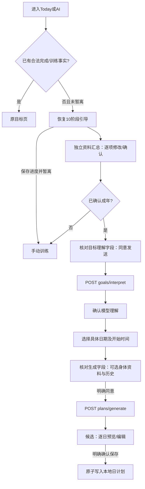

# Fitness UI/UX 设计规范 · UIUX20261008

**这是 Fitness 唯一的 UI/UX 设计规范入口。** 视觉、交互、文案、动效、主题、组件与训练闭环的设计规则都在本文件中维护（维护规则见第 4 部分）。

当前版本：**V9.1.2**（2026-10-22）　状态：V9 定版设计系统（五套主题、芽芽形象与悬浮助手、共享组件）；页面改版随后进行，不修改生产

## V9 定版视觉与设计系统（2026-10-19，V9.0.0）

**来源：** `docs/design/v9/`（Bo 已定版的设计画布快照，`README.md` 为索引）。本节取代第 1 部分第 2 节（四套主题）、第 3 节取值、第 4–7 节中的 V8 视觉取值、第 11 节芽芽形象；第 2 部分交互、第 3 部分继承约束、全部数据与安全规则继续有效。冲突时以本节为准；设计稿与本节冲突时先按本节实现并记录差异。

### V9.1 五套主题（同时上线，“我的 › 外观”里切换）

| ID | 名称 | 方案 | 视觉要点（对应设计稿） |
|---|---|---|---|
| `pop`（默认） | 柔光拟物 | 浅色 | 同色浮雕/内凹（双向阴影）、暖黄渐变刻度环、Jost 细数字（`Pop.dc.html`） |
| `vivid` | 山野暖阳 | 浅色 | 拱窗山野插画 Scene、宋体标题、斜体衬线数字、鼠尾草绿黏土按钮（`Vivid.dc.html`、`Scene.dc.html`）；V9.0.9 起为“暖阳柔木”取值（V9.12） |
| `gentle` | 温和陪伴 | 浅色 | 嫩芽绿、白色大圆角卡、深绿描边的柠檬绿大按钮、“本周的小芽”（`Gentle.dc.html`） |
| `data` | 专业数据 | 深色 | 深色玻璃面板、青蓝果冻按钮、发光同心环（`Data.dc.html`） |
| `fire` | 燃动挑战 | 深色 | 黑底红光、窄体粗数字、一天一关、玻璃行（`Fire.dc.html`） |

- V8 的青瓷/留白/静奢/撞色退出选择器。已存偏好幂等迁移：`qingci→pop`、`liubai→gentle`、`jingshe→data`、`zhuangse→fire`，未知值→`pop`；写入失败保留原值，读取时仍按映射显示（`src/themes/preference.ts`，测试 `tests/unit/v8-theme-preference.test.ts`）。V3.1 旧键迁移规则不变，目标改为 `pop`。
- 后台 `/admin` 不随用户主题变化，沿用 `02-design-tokens.json` 的 `admin` 固定配色，待后台改版另定。

### V9.2 设计变量

- 取值唯一来源仍是 `docs/handoff-v8/02-design-tokens.json`（`version 9.0.0`，`$schema fitness-design-tokens-v9`）；`src/themes/token-css.ts` 生成 `src/themes/base/tokens.css` 与 `src/themes/<id>/tokens.css`，`tests/unit/v8-theme-tokens.test.ts` 校验逐字一致，`src/themes/contract.ts` 列出全部语义名。
- 主题块选择器为 `:root[data-theme="<id>"], [data-theme="<id>"]`，任意元素加 `data-theme` 即按该主题渲染（用于外观页实时预览）。
- 沿用 V8 名称：`--c-*`、`--f-*`、`--w-*`、`--r-control/panel/chip`、`--bw`、`--tr-*`、`--mat-*`、`--el-1..3`、`--press-*`、`--ring*`、`--glow*`、间距 `--s1..8`、字号 `--t1..8`、触控与布局。
- V9 新增：`--c-faint`（装饰性弱文字）、`--c-accent-text`（强调文字，≥4.5:1）、`--c-warn`/`--c-warn-soft`（安全提示）、`--c-inset`（内凹底）、`--c-invert-bg/ink`（反色屏，如 vivid 休息、fire 训练纸面）；`--f-num-style`/`--f-num-stretch`；`--r-hero`；`--tr-button`；`--el-inset`、`--el-primary`；`--glow-ambient`；`--grad-accent`、`--grad-hero`；`--glass-bg/border/blur/shadow`（悬浮层）；`--card-bg/shadow/border/blur`（卡片，深色主题为玻璃）；`--meter-from/to/glow`（进度环渐变）；`--chart-1..4`、`--chart-track`；`--yaya-accent`、`--yaya-disc`、`--yaya-shadow`；`--orb-*`；共享 `--float-cycle`、`--snap-ease`、`--pop-ease`、`--orb-size`、`--orb-safe`、`--tabbar-h`；山野插画 `--scene-*`（仅在 `.v9-scene[data-scene]` 上）。
- 正文 `--c-ink`、`--c-ink-muted`、`--c-accent-text` 在 `--c-bg` 与 `--c-surface` 上均 ≥4.5:1（单元测试校验）。设计稿中低于 4.5:1 的灰字与琥珀字已按此加深；更浅的 `--c-faint` 只用于大号或装饰文字。
- 字体：不新增运行时 CDN，复用 `src/themes/fonts` 已打包的 OFL 字体。pop 数字 Jost；vivid 标题 Noto Serif SC、数字 Cormorant Garamond 斜体（替代设计稿 Fraunces）；gentle 数字 Jost（替代 Nunito）；data 数字 Jost（替代 Sora）；fire 数字 Archivo 62% 窄体粗体（替代 Anton）。V9 字重超出紧凑无衬线子集（200–400），`fontSubset` 开关下仍用完整字体。

### V9.3 共享组件（`src/ui/components`，只用变量）

页面从 `src/ui/components/kit` 统一导入：
- `PrimaryButton`（`tone: primary | quiet | text | warn`，`size: lg | md | sm`）、`Card`（`variant: raised | inset | hero | flat`）、`ChoiceChip`、`BigChoice`（一题一屏大选项，radio/check）、`SegmentedTabs`、`ProgressRing`（`tone: meter | 1–4`）、`CountdownRing`、`StatTile`、`WeekStrip`（`dots | bars`，状态 done/partial/planned/rest/missed、today）。
- `Yaya`：`pose`（front/head/wave/cheer/think/thanks/care/celebrate/side/back）、`size`、`mode`（auto：≥110px 全身，否则头像圆盘；wave/cheer/think/thanks/care/celebrate 在小尺寸裁出动作）、`theme`（默认当前主题；图片 `public/yaya/<pose>-<theme>.webp`）、`float`（全身轻浮动；减少动效与训练中关闭）。动作用途按 `YayaPoses.dc.html`：front 首页通用、head 悬浮助手/聊天、wave 欢迎、cheer 训练开练、think 计划生成/回顾、thanks 反馈/设置、care 安全与休息、celebrate 练完、side 转场空状态、back 离开/加载。
- `Orb`：芽芽悬浮助手（`Orb.dc.html`）。可上下拖动、松手按横向位置贴左/右；可“靠边”收起（露出约三分之一）；未展开时显示提示气泡（可关闭）；点开为快捷面板：提示语、2–3 个快捷动作、“打开对话”“靠边”。快捷动作打开现有芽芽对话并把该句放入输入框，用户确认后才发送（不自动外发）。键盘：方向键上下移动、左右贴边，Esc 关闭面板。默认提示与动作按页面（home/plan/review/settings/finish）取自设计稿，不陈述未知的用户事实（`src/i18n/features/coach/orb.ts`）。
  - 不遮挡主要操作：持续检测与 `[data-orb-avoid]`、主按钮（`.v9-btn[data-tone=primary]`、`.v9-btn[data-size=lg]`、`.v8-button-primary`）及底部导航重叠，重叠即自动靠边，靠边仍重叠则上移/下移让开；拖动范围上下各留 `--orb-safe`。展开状态时根元素 `data-orb="shown"`，`--orb-reserve` 为页面可预留的空间。
  - 初见引导与计划草案页默认靠边、不显示提示；训练页（`/workout/:id`，结束页除外）不显示悬浮助手，沿用训练页自身的芽芽入口，遵守“训练中不弹窗打断”。
- `Scene`：山野插画，`variant: dawn | lake | dusk | mist | peak`，装饰性（`aria-hidden`）。
- `ThemePicker` / `ThemePreview`：外观页“界面风格”单选组，每个选项是该主题的实时缩略预览（`data-theme` 作用域），点选即时生效；方向键可在选项间切换。
- 类型角色工具类（`src/themes/base/common.css`）：`.v9-num`（数字字体、斜体/窄体、等宽数字）、`.v9-display`、`.v9-body`。页面与通用组件不写 `font-family`，用这些类或变量。
- 9 个签名组件仍在 `src/themes/<id>/slots/`（BrandMark、WeekProgress、StartHero、Suggestions、AiLine、SetValue、RestClock、FeatureCard、NavIcon），五套各自按设计稿重做；`NavIcon.kind` 增加 `me`（我的）。流光描边仅 data 主卡使用，每屏最多一张，训练中与减少动效时停止。

### V9.5 训练流程：播放器、休息、练完、回顾（2026-10-19 同日补充）

**计时（Bo 决定，取代第 2 部分 3.4 的“不倒计时、不自动开始”与 AGENTS §3.1 旧条）**
- 计时动作（`duration*`）：第一屏显示 `CountdownRing`（目标秒数），用户点“开始计时”才开始；可“暂停 / 继续计时 / 再来一次”。到 0 时提醒一次（设备设置“计时或休息结束时轻震一下”开启时轻震；提示音偏好 `fitness.timer-sound` 默认关闭），并在页面显示“时间到，点‘完成这一组’记下来。”；不自动保存，不自动进入下一组。中途点“完成这一组”时记录实际保持的秒数（至少 1 秒）；未开始计时直接完成则记录目标秒数（与旧行为一致）。
- 组间休息：保存一组后自动显示休息页，从这组的保存时间倒计时到建议休息（处方 `restSeconds`，没有时 60 秒，限制在 15 秒–5 分钟）。可“+15 秒”（已结束时从当下再加 15 秒）或“跳过休息”。到 0 时提醒一次并显示“休息好了，准备好就开始。”与“开始下一组 / 开始下一个动作”按钮；**下一组不自动开始**。超过建议时长 10 分钟后再打开训练页直接回到播放器。计时按时钟时间计算，刷新或切后台不漂移。
- 不弹窗打断：提醒只有页面文字与设备偏好允许的轻震/提示音，没有弹窗。
- 去掉“每次用时 3.5 秒”等不能据此行动的显示。

**播放器第一屏**：顶部“暂停或结束”（×）、本次动作进度条、“身体不适？”、和芽芽聊聊；动作库同源示范图（RepDB，与动作库相同）；第几组、动作名；计时动作为倒计时环，次数动作为签名组件 `SetValue`（负重 × 次数，点击修改）；主按钮“完成这一组”；下一项预告“接下来：…”。动作要点、热身组、处方细节、换动作、本组反馈、动作胶囊放在第一屏之后。原创补充动作（自建动作）使用 Fitness 原创示意图（V9.0.11 起与“自阻力划船”配图同一人物、同一画风：成年女性、鼠尾草绿短袖 T 恤、炭灰紧身裤、灰色跑鞋，写实手绘插画，暖白底与淡地面投影；需要时画出浅木椅、白墙、灰色垫子、浅蓝弹力带、木台阶等；不加箭头与文字），播放器显示“动作姿势”一张，动作怎么做并排显示“起始姿势 / 动作姿势”（静态保持只有一张）；署名“Fitness 原创示意图”，不标 RepDB。仍无示意图的动作不显示菱形“动作模式图标”，改为提示照着要点做。

**身体不适？**：停止信号与红旗按钮收进这一个入口，打开底部面板：关节或肌肉疼（换个动作，原因记为“哪里不舒服”）、跟不上（这组少做一点 → 修改数值）、全部原有安全面板（心脏停止信号、老年摔倒、产后、孕期及引擎停止说明，逻辑与文案不变）、结束今天的训练、没事，继续。需要用户处理的安全状态（心脏暂停、未确认的摔倒、孕期就医暂停、产后紧急/退步、每周产后自查）仍直接显示在训练页上，不收进面板。

**练完**：芽芽 celebrate（一次性轻微弹出，减少动效时关闭；0 组时用 care）、用时、完成组数（环）、总重量（有负重时）或动作数、本周进度（本周练了几次 / 目标、还可以再练几次、周历、连续 ≥2 周时显示连续周数）；保留原感受、少练原因、哪些动作、备注与“记下来”。“如实记下来，之后才知道怎么调”只在回顾出现一次。

**回顾**：本周 / 本月切换；“看哪一项”：次数、总重量、分钟（`--chart-1..3`），本周按天、本月按周；本周进度把“练了一部分”也算作已练（目标 3、部分完成 1 → 还可以再练 2 次），`missingCount` 仍只作为芽芽回顾事实，不显示为“还差”；训练规律只在本期保存的训练 ≥4 次且同一时段 ≥2 次时显示，否则说明记满 4 次后再看。

### V9.4 与设计稿的已知差异

- ~~设计稿休息页为倒计时并自动开始下一组；`RestClock` 显示已歇时间。~~ 2026-10-19 Bo 已决定：休息改为倒计时，但不自动开始下一组，见 V9.5。设计稿“休息结束自动进入下一组”的行为不实现。
- 设计稿的 fonts.googleapis.com 字体按 V9.2 用本地字体替代。
- 芽芽默认提示中设计稿“上周少练了一次”等含具体事实的句子改为不含事实的说法，页面有真实数据时再传入；“练得不错！”去掉感叹号以符合话术规则。新增的英文对应句待确认。


### V9.6 入口流程（欢迎、初见、计划、今天、导航、芽芽对话、我的）

- **欢迎**：首次进入（无计划、无记录）先显示一屏：芽芽挥手（`wave`）、“动起来，刚刚好”、一句价值说明、三条要点、“开始”与“我有备份，去恢复”。不再出现“这一次”。
- **初见**：目标、场地为大选项单选（`BigChoice`），时间为“每周 N 次 / 每次 M 分钟”两组点选（`ChoiceChip`），拼成原有原话格式写入原字段；“自己写一句”保留自由文本，已选项显示为选中状态，不用占位符回显。
- **健康自查**：一题一屏。PAR-Q+、症状、已知疾病/急性不适分三组，每组可“以上都没有”（等同逐题选“否”）或“有其中一项，逐个确认”（大“是/否”按钮）；孕产随访、跌倒、部位红旗题同样处理。字段、完成条件、写入时机与设置页编辑器一致（共用 `useEngineProfileDraft`）。性别为男性时不问孕产（记为“都不是”）。
- **计划（草案与计划页）**：一周日历（`WeekStrip` bars）+ 每节训练一行：周几、名称（由动作内容推导：全身 A/B、下肢、上肢、核心、有氧、拉伸与灵活、平衡与稳定；已存的真实名称原样保留）、分钟数、主要部位；未指定训练日时注明“日子是芽芽建议的”。“为什么这样排”不为空。停止级提示在顶部；其余提示只在底部显示一条“小建议”，其余折叠。草案不显示“基础计划”与 AI 提示。
- **今天**：先显示今天的训练与“开始训练”，再显示运动前状态自查；应用计划后提示一次“计划已经用上了”；“再下一次”显示周几、名称、分钟、部位。安全阻断面板位置与阻断逻辑不变。
- **导航**：底部悬浮胶囊 4 个标签（今天 / 计划 / 回顾 / 我的，`NavIcon` kind `me`）；不设设计稿中间的开始圆钮。
- **我的**：芽芽 `thanks` 计划卡（含“生成新计划”）、内嵌界面风格、分组：训练 / 芽芽 / 数据与隐私 / 通用，每个入口只出现一次。
- **芽芽对话**：头部芽芽头像 +“只调整训练，不做诊断”，3 个常用语只填入输入框，需用户发送；确认后才应用的卡片不变。
- 界面不出现 RIR、“基础计划”等术语；强度用“还能再做 2–3 次”等白话。


2026-10-18 同日 PR #62 复测：登山跑按快速交替原型补跑步类标记，冲击等级1不虚改，复用孕期既有跑跳排除。孕13–27周balance_demand动作必须有来源可核实的支撑变式和用户真实可用支撑物；树式可扶墙/椅，处方显示实际物品，并逐字使用本次要求的“扶墙或扶椅”及等义英文。孕28周排除不变，不把其他不能扶持的负重动作假称为有支撑版本。旧人群限制不扩大。
本次时长验收已由用户接受96.83%／单列97.19%，不下降改为后续目标；力量天数与活跃用户训练天数是否一致、有氧缩短时的有意义单组下限（例30秒）加入遗留，未在本轮擅自新增剂量阈值。

2026-10-18 同日训练体验补充：下犬式系列按实际倒置体位、鸽子式按前腿深屈膝标注，通过原有孕期及膝注意规则筛除，不更改安全阈值。阻断结果只显示对应关卡原因，答案变化清理旧提示。补时使用规则数据规定的顺序：力量组数→缺失模式→低强度有氧→平衡/呼吸→拉伸→允许范围内的热身/冷身；拉伸和灵活性合计不超过10分钟与实际课时25%中的较大值。后续阶段打开新容量时仅在时长确实改善时重新按同一顺序填充。只练上肢不以非上肢动作补时；同模式候选中，增肌/力量目标优先用户真实拥有的负重器械，目标质量权重不变。

同日资料更新接线：孕产状态改变或分娩后的必需自查完成后，保存通过原有版本机制生成新版本，历史原样保留；未完成关卡不生成。分娩事件仍必须走原有分娩方式及产后关卡，不能直接通过下拉框绕过。现有 `untargeted` 训练单按真实用时校验，不强行显示10分钟；普通有目标时长的训练单保留原最低时长约束。字段和备份结构不新增、不改写历史记录。

2026-10-18 同日规范补充（engine-followup）：聊天发送前在本机保守识别本人怀孕、分娩和健康变化。关键词和排除词保存在规则数据中；指代他人、否定、假设及与当前资料一致时不显示卡片。用户聊天原文照常发送，识别结果和命中词不进入请求或提示词，自查表单的既有外发边界不变。卡片不阻止聊天、不自动修改资料；使用本次用户批准的中英文案，“去更新”进入 `/settings/engine`，“不是我”在本次对话内关闭同类提示。完成并保存对应自查后复用既有版本机制重新生成；关卡不通过不生成。孕产下拉框不包含年龄选项，老年身份按出生年月判断。孕13/28周复查与分娩转换沿用原安全规则，只补验证。

同日力量配额裁定：保留新手第1周最多2次力量、第2周第三次力量路径延期；每课力量仅在该周配额允许时安排。第3周起尽量均分力量。无力量配额日安排低强度有氧、平衡、灵活性、受上限约束的拉伸和呼吸；不能靠拉伸填满时长，不增加新用户文案。

2026-10-17 收尾补充（同日版本合并）：M4 提分试验结束，保留现有结构修复。当前版本验收质量门槛为中位数 ≥0.75、P10 ≥0.55；0.85 为后续版本目标，须写入草稿 PR。性能不再作为阻断门槛：冷启动固定80画像各跑3次，取三次P95的中位数，≤400毫秒作为报告目标；250毫秒只作参考遗留目标。2000+200全量总耗时≤120秒作为单独报告指标；当前219–305毫秒、约79秒按用户裁定视为通过，不再调优。性能仅由 `npm run engine:perf` 报告，npm test与CI不作计时判定。安全硬规则、时长覆盖与其他未变门槛保持原要求；完成全量验收后才提交草稿 PR、部署预览，禁止修改生产。本次不再重跑全量，沿用d539bab完整正确性证据；M3拆分完成后再跑一次全量。M3前后golden20、80画像及问题画像集必须逐字节一致。仅需改硬规则、新用户文案或安全规格问题时停下确认；同一问题调查20分钟无进展须三行报告，不能继续盲试，性能和行数不再是停工条件。

同日 `dose.power` v2 澄清：依次区分自重、负重且1RM已知、负重且1RM未知。自重不套百分比；已知1RM的实际负荷为30%–70%；未知时仅用轻／中档位、RIR≥3，不推算公斤数、不要求测最大重量，其余硬条件照常。难度5或skill动作仍排除。批准新增中英提示：“发力时速度明显变慢就停下这一组，宁可轻一点、快一点。” / “Stop the set when your speed clearly slows down. Lighter and faster beats heavier and slower.” 规则参数统一在YAML，第三分支实现与测试单列。

同日孕期HIIT裁定：`hiit.gate.unlock` 对孕期始终硬锁定；旧 `pregnancy.hiit` 为 deferred mechanic，不参与生成/校验，覆盖清单保留延期说明。采用手册第11章用户批准双语澄清；没有既有孕前规律高强度勾选入口时不新增入口、不显示该提示。有既有明确勾选时至多一次，计入最多3条提示。后续特殊人群与通用规则冲突取更严格方；需自我声明才放行的更宽松分支v1延期，记录PR“规格冲突与裁定”。仅严格方导致某类用户完全无计划或严重偏离批准指标才暂停询问。

同日安全收尾：用户批准新增“扶稳固支撑物宽站距静态站立”，仅实现手册已有阶段1（宽站距、静态、持续手扶），剂量复用平衡规则；阶段事实按原始步骤核验，未知不算满足。修复柔韧日平衡槽角色，避免错误回退为拉伸。产后七项转诊条件按来源逐项呈现，周回访、每次阶段提升和跑步准入分别核对；生育报告原子结束未结束训练并切至产后0周，保留所有独立暂停。新增问答阴性证明撤回同意即清除；不为防绕过保留已撤回的孕期身份。同意仍有效时，孕期不能用普通资料编辑替代生育事件。

疼痛复查增加来源规定的次晨持续、较上周加重两问；未知不自动设否，阳性由用户关联真实完成动作，不编造评分。原回答沿用10天临时存储、不入备份；已应用的本次和下次模式排除独立保留并随真实完成/部分完成记录计算剩余次数。身体/历史外发勾选不包含本机安全证明。全部界面复用既定控件、令牌与中英标签，不新增健康建议。

同日幅度／箱高裁定：自动恢复路径 `deferred: true`，原因“v1 不实现：缺少测量基准与真实记录”；原caution.progression分级mechanic，非恢复部分独立为caution.progression_gate硬门禁，禁止因此放松每组痛分、连续两次训练负荷／阶梯门禁。取消注意只允许用户在设置主动发起，并重新通过本次完整红旗问题。设置说明与手册逐字使用：“本版本不会自动恢复动作幅度或箱高；身体感觉好转后，可以在设置里取消该部位的注意标记。” / “This version doesn’t automatically restore range of motion or box height. When you feel better, you can turn off the caution for that area in Settings.” 不出现在计划提示中。以后缺数据、须猜测的放宽路径v1直接延期并记录PR“规格冲突与裁定”，不重复询问。
同日新手第2周证据澄清：第三次力量训练的放行支路暂缓（source three_sessions_path.deferred=true），父级硬规则不降级；完整首周完成和DOMS证据未具备时统一保留两次，不凭自我声明增加第三次。生成和公开校验一致，原参数和历史保留可读。
同日邻日范围最终裁定：课内去重对所有动作保持hard；邻日去重按variety.no_repeat.adjacent_day_scope，仅约束力量/爆发/负重等长，真实低强度有氧、灵活拉伸等豁免，不设单独产后例外。可选模板weekday保留来源真实星期，旧资料未知不猜；剖宫产后阶段1轻步行按既有light_max明确计划强度，不放宽其他孕产门禁。

### V9.7 主流程入口（Bo 2026-10-19 线上反馈，V9.0.2；取代 V9.6 中“今天”“芽芽对话”与 V9.1“我的 › 外观里切换”的对应描述）

- **原则**：用户不会一进来就去“我的”。早期需要的东西（界面风格、用不用 AI、计划从哪天开始）都放在主流程里能看到的位置；“我的”里保留同样的入口。
- **计划开始日期**：草案页“从哪天开始”一行日期选项（今天起 15 天：今天、明天、之后 13 天），默认今天；所选日期随“就用这份计划”保存为计划版本的可选字段 `startDate`（本地日期）。旧版本没有该字段时按创建当天算。开始前，周历显示“第一周 · X 起”的 7 天真实日期（周几 + 几号），训练行显示“周四 · 10月22日”；开始后回到原来的周一到周日视图（列出全部训练）；今天页的本周条上，选过开始日的计划在开始日之前的日子显示为休息（旧计划不变）。计划页“开始日期 · …”旁“改开始日期”弹出同一选择，保存为**新版本**（动作不变，历史版本保留）；训练进行中不可改并说明原因。芽芽对话重新生成草案时保留已选日期。今天页在未开始时把“下一次”写成“X 开始”，并说明“想提前练也可以”。
- **今天**：AI 入口只有悬浮芽芽（`Orb`）。去掉页内“跟芽芽说说今天的情况”输入卡与“和芽芽聊聊”按钮；运动前状态自查与安全阻断面板不变。悬浮芽芽在今天页打开的是“调整今天这一节”（与首页显示的训练单相同），快捷动作为“只有 20 分钟 / 今天有点累 / 换个地方练”，只填入输入框，用户点发送。
- **换风格**：今天页标题右侧常驻“换风格”小按钮（调色板线性图标 + 文字），点开为带实时预览的 `ThemePicker` 底部面板，点选即生效；欢迎页提供一次“先挑个喜欢的样子（可跳过）”。“我的 › 界面风格”保留。
- **动作工具**：今天和计划的每个动作旁有“动作怎么做”“换动作”，各自弹出独立面板。动作怎么做 = 动作指导（示范图（RepDB 或 Fitness 原创示意图）、动作要点、完整步骤、常见错误、注意事项）。换动作列出符合器械与注意部位的候选（按相似度排序，可“看更多”，每项可先看怎么做），用户确认后才写入：今天页只改这一次（下一次训练的单次调整），计划页生成新版本；训练进行中不可换。
- **芽芽对话**：窗口只放对话与输入框。手机全屏面板，平板/桌面加宽加高（最宽 600px、约 90% 屏高）。头部：芽芽头像、“只调整训练，不做诊断”、新对话 / 历史对话 /（本地模式时）快速调整。快速调整（缩短、只练某部位、某部位不舒服、换动作、动作怎么做）在单独的底部面板里，结果仍以“需要确认的卡片”出现在对话中。发送哪些资料的勾选与发送内容说明折叠在输入框上方“发送哪些资料”，默认不发送身体资料、训练历史、健康信息的规则不变。常用语只在空对话时显示。资格无效时对话顶部写明“现在用的是本地建议 · 原因”，并给“开通 AI”。
- **初见 · 用 AI 还是本地计划**：部署中开启 AI 助手时，生成前多一屏，芽芽问“想让我怎么帮你排计划？”。两项：“用 AI 帮我排”（需要先开通 AI 资格；发送目标、时间、地点和注意部位，身体数据默认不发；确认后才保存）与“先用本地计划”（不联网，资料只在本机，以后随时可以找芽芽）。选 AI 时当场查资格：已开通→可继续；未开通→“现在开通”在面板里走原有试用 / 邀请码流程，也可“改用本地计划”；AI 关闭、额度用完、连接失败分别说明并给出改用本地或重试。训练引擎开启时，AI 不直接出计划：先本地按安全规则排好草案，再打开对话并预填一句请求，用户点发送才外发。部署未开启 AI 时不出现这一屏。
- **按钮不可用时**：初见最后一屏“生成计划”不可用时，列出还缺的项（年满 18 岁、本机保存同意、出生年月、运动前自查、孕产状态、注意部位、目标、时间、场地、身体情况），每项“去补上”直接回到对应那一屏。
- 新增文案中英双语，见 `src/i18n/features/{plan/start-date,plan/exercise-tools,home/theme,onboarding/plan-mode,coach/chat}.ts`；芽芽话术经 `checkCoachLanguage` 检查。

### V9.8 计划月视图与今天日视图（Bo 2026-10-19 反馈，V9.0.3）

- **计划 › 周 / 月**：计划页头部下方 `SegmentedTabs`“周 / 月”切换，默认周。月视图为周一开头的整月日历（含上下月补位日，补位日不可点），“‹ / ›”切换月份；每天一个状态点：练完了（实心完成色）、练了一部分（半实心）、计划（整格实心填色，V9.0.7）、没练（虚线，只用于今天以前、计划开始日之后、没有完成或部分完成记录的计划日）、休息（无点）。今天加描边框（`aria-current="date"`）。计划日来自计划的每周安排（与周视图同一 `weekSchedule`），开始日（`startDate`，旧版本按创建日）之前不排；状态来自已结束的训练记录（complete/partial，放弃与未开始不计），计划外的日子练过也显示。下方一行本月统计。点一天在日历下方显示：这天的记录（训练单、组数 x / y、实际开始–结束时间）与这天的计划（训练单、约 N 分钟、动作列表及“动作怎么做 / 换动作”）。周视图的本周条同时按记录标出练完 / 练了一部分。
- **今天 › 顺序和时间**：今天页原“动作详情”卡改为日视图：按训练单顺序编号（第 1 步、第 2 步…），按热身 / 训练 / 放松分段（段名取自处方 block；没有热身或放松动作的计划，仅在时长估算留有空余时加“开始前活动一下 / 练完放松一下”两步，不额外延长时长）。每步左侧是预计时刻，右侧是动作 · 组数与约几分钟，展开仍是要领、专项热身、处方与“动作怎么做 / 换动作”。“几点开始”默认现在（向上取整到 5 分钟），可改；只存在本机当天，不进训练记录。每步时长按与计划时长相同的估算模型（每次 3 秒、每组至少 20 秒、组间休息按处方或 90 秒、换动作 60 秒）并按训练单的预计时长等比缩放，保证“预计 HH:MM 结束 · 约 N 分钟”与其他地方的分钟数一致。训练进行中改为显示实际开始时刻。
- **今天练过的**：当天有已结束的训练时，在开始卡上方显示实际“HH:MM 开始 · HH:MM 结束 · 用时 N 分钟”（来自训练记录的 startedAt / endedAt），以及每个动作的完成时刻（该动作最后一组的完成时间）与做了 x / y 组，没做的写“这次没做”。“改开始和结束时间”弹出两个时刻输入：保存为训练记录上的追加字段 `timeCorrections`（只追加，最新一条用于显示），原 startedAt / endedAt、每组记录与其他完成事实不变，界面同时写“时间改过 · 原记录 HH:MM–HH:MM”。结束须晚于开始、不晚于现在、不超过 12 小时；结束时刻早于开始时刻视为跨过午夜。
- 新增文案中英双语，见 `src/i18n/features/{plan/calendar,home/day-view}.ts`。
### V9.9 “我的”重排、我的变化与营养建议（Bo 2026-10-19 反馈，V9.0.4；取代 V9.6 中“我的”的分组描述）

- **分组（自上而下）**：**我**（计划卡：目标、每周次数与时长、“查看计划”“生成新计划”；“我的变化”摘要卡；行：我的变化、身体资料、运动前自查与训练偏好）→ **营养建议**（一行，进入营养建议页）→ **训练设置**（提醒、导入活动、计时提示音、休息震动）→ **芽芽与 AI**（AI 资格卡、试用资格与邀请码、芽芽记住的偏好）→ **数据与隐私**（芽芽会看到什么、备份恢复、已删除的计划、匿名统计、错误报告说明）→ **通用**（界面风格内嵌 `ThemePicker`、语言、系统通知）。每个入口只出现一次，行样式统一（标题 + 可选一行小字 + 右箭头）；饮食记录不再放在训练分组。
- **我的变化**（`/settings/changes`）：只读本机已有数据，不外发。体重与体脂（每天取最后一次，首末对比“+/-x · 从 M月D日 起”与折线）；力量（带重量的完成组按 Epley 估算单次最大重量，只用 1–12 次的组，取做得最多的 3 个动作，每天取最好值，标明“只作参考”）；这个月和上个月（训练次数、约几分钟、组数、月内体重变化）；最近 6 个月每月训练次数柱状图；“看月度回顾 / 看完整回顾”进入回顾页。没有记录时显示邀请：“记一次身体数据”面板（日期、体重 20–300 公斤、体脂率 3–70% 可选），同一天再记会更新那一条。体脂作为体重记录上的新可选字段 `bodyFatPercent` 保存。“我”分组顶部的摘要卡显示本月 / 上月次数、体重变化、主要动作力量变化与体重折线。
- **营养建议**（`/settings/nutrition`，别名 `/nutrition`）：上方“问问芽芽”对话，下方“饮食记录”（原表单与规则不变）。对话请求带 `topic: "nutrition"`，不带训练上下文、身体资料、训练历史或饮食记录，不返回任何方案卡片；服务端只在该话题追加营养说明（只谈日常饮食，不给热量目标、减重速度、节食 / 断食、补剂或药物剂量，不诊断，疾病、孕期哺乳、进食问题建议咨询医生或注册营养师）。对话不保存在设备上。AI 不可用时说明原因，资格失效时给“开通 AI”。今天页悬浮芽芽的快捷动作新增第 4 项“吃什么、喝多少”，直接打开营养建议页（不填入训练对话）。
- **后续膳食营养模块**：只通过 `src/application/nutrition-module.ts` 的 `DietModule` 接口接入（营养建议页卡片、需逐条同意才发送的结构化事实、只读饮食记录来源），本版不注册任何模块。
- 新增文案中英双语，见 `src/i18n/features/{settings/me,me/changes,nutrition/advice,coach/orb}.ts`。

### V9.10 “我的”去掉界面风格、训练提醒暂停、给我们留言（Bo 2026-10-19 反馈，V9.0.5；修订 V9.9 的“通用”组）

- **界面风格**：“我的”不再有界面风格入口（与今天页“换风格”冲突）。换风格只在今天页“换风格”和欢迎页；`/settings/appearance` 路由保留（更多模板与旧链接仍可打开），但“我的”不再链接它。
- **训练提醒**：设置、应用内提醒条、系统通知与“设为提醒”提示都收在功能开关 `trainingReminders` 后，默认关闭；已保存的提醒设置与旧日期原样保留，开关打开后原样恢复。后续方向是把计划同步到手机日历（见 pending-decisions），本版不做。
- **给我们留言**（通用组，行内展开）：先写明“留言会发送给 Fitness 的运营者（开发团队）……只发送你在下面写的内容，不会附带你的训练、身体或聊天记录；如果这个浏览器有试用资格，会附带资格的 8 位编号”，再给输入框（最多 1000 字，字数计数）、选填联系方式（最多 100 字）与“发送给运营者”。失败保留草稿并给出原因（太频繁 / 暂时发不出去）；成功显示“已发送，谢谢你”，下方列出本机保存的“你发过的留言”（只在这台设备上，最多 20 条，不进备份）。
- **后台 留言 页**（`/admin/feedback`，侧栏“留言”带未处理数）：时间、用户 8 位 ID（无资格显示“匿名”）、留言、联系方式、状态；筛选“未处理 / 全部”；“标为已处理 / 改回未处理”写入操作记录。后台说明改为“后台只显示账号、用量、费用和用户主动发来的留言，不显示用户的训练、健康和聊天内容”。
- 新增文案中英双语，见 `src/i18n/features/settings/feedback.ts`。
### V9.11 日历选训练日、草案月历、上一步与回到今天（Bo 2026-10-19 反馈，V9.0.6；取代 V9.6 中“什么时候练”的每周次数选项与草案“一周日历”）

- **什么时候练**：月历（周一起始），点一天选中 / 取消，按住拖动（鼠标或手指）一次选或取消一段；键盘方向键移动、回车 / 空格切换、Shift+方向键连选。1–30 天：第一天在今天起两周内，首末不超过 30 天；任意连续 7 天至少留 1 天休息（训练引擎每周最多 6 次），超出的日子不排进去并当场用一句话说明。选好日期后问“打算几点开始练？”（早上 7:00 / 中午 12:30 / 晚上 7:00 / 其他时间，可不选），再选每次时长。仍可“自己写一句”。不再有固定的“每周 2–5 次”选项。
- **计划数据**：可选字段 `PlanVersion.trainingDates`（排序本地日期，1–30）与 `startTime`（HH:MM）；旧计划无此字段，照旧按每周安排，不迁移。训练单按日期顺序轮流排在所选日子上；每周次数取所选日子里最忙的 7 天。改开始日期时所有训练日整体平移；以后生成的新版本沿用。今天页“顺序和时间”的默认开始时刻取 `startTime`。
- **草案**：开头一行“共 N 天 · 起止 · 每次 HH:MM 开始 · 改训练日”；“周 / 月”切换与计划页一致，按日期选的计划默认“月”，点一天看当天训练；按每周文字描述的计划默认“周”。计划页同样。
- **上一步 / 回到今天**：初见每一屏底部在“下一步”下方有带文字的“‹ 上一步”，左上角不再是单独的“<”；左上角为“回到今天”。草案、手动训练、记一次运动、动作库、历史版本等子页面都有“回到今天”。有未保存内容时先确认（“这一页还没保存的内容会清空……”），确认后清空初见回答与草案再打开今天；已保存的计划和训练记录不受影响。
- **出生年月**：默认“点选”：年份标题两侧 ‹ › 前后一年，点年份打开 12 年网格（‹ › 每次 12 年），再点月份；“手动输入”保留四位年份 + 月份下拉；两种方式共用同一个值。
- **自己写一句**：在“你想练成什么样”点“自己写一句”只展开输入框；开始答题后不再回到欢迎页（此前清空所选答案会被当成“还没开始”而跳回欢迎页“动起来，刚刚好”）。
- **重新制定计划**：计划页工具栏与无计划时的空状态都有；有上次的回答或草案时先确认，确认后从第一题开始、所有回答为空（身体资料已保存在“我的”，仍带入）；当前计划在确认新计划前保持不变，训练记录与以前的计划都保留。
- 新增文案中英双语，见 `src/i18n/features/plan/training-days.ts`。
- **与芽芽对话（V9.0.7）**：选了训练日的计划，发给 AI 的请求带上 `schedule`（所选日期与开始时间，属排期信息、不是健康资料），并作为硬约束写进提示：不问哪几天练 / 休息、不另排每周几、按这些日期安排。“按我的时间表来”之类的话等于沿用所选日期。服务端不替用户选星期几；AI 方案应用到草案或新版本都保留所选日期、开始日与开始时间，只有用户在这次对话里明确要求改训练日（说出星期几或每周次数）且方案确实改了，才改为每周安排。确认卡多一行“训练日：按你选的 N 天，M/D 起 · HH:MM 开始”或“训练日：改为每周 N 次，不再按日历上选的 N 天”。
- **月历上的计划日（V9.0.7）**：草案与计划页月历中，计划日（还没练的已排日子）整格用主按钮材质实心填色（与“什么时候练”里选中的日子一致），图例同样为实心色块；练完、练了一部分、没练与休息（无填色）保持原样，五套主题都只读设计变量。V9.8 中“计划（描边）”由此取代。

### V9.12 山野暖阳改为“暖阳柔木”，五套主题月历一目了然（Bo 2026-10-20 反馈，V9.0.9；取代 V9.8 / V9.11 中月历各状态的画法）

- **暖阳柔木**：Bo 在四个预览候选（浅色原木 / 胡桃深木 / 雕版套色 / 暖阳柔木）里选定 D“暖阳柔木”，作为 `vivid` 的正式取值；其余三个候选不上线。保留暖杏与鼠尾草绿，整体压低亮度与饱和度（底色 `#F0E2D0`、卡片 `#F9F0E4`、正文 `#36241F`、主按钮 `#4C6A5B`、完成色 `#A35A33`），去掉发光；加木纹、浅浮雕（短而实的下沿阴影）与 1px 描边。今天页山野拱窗加木框与内描线，插画加墨线与轻刻痕；芽芽一句话卡用浅鼠尾草底；休息屏、导航选中块用木纹。山野插画 `dawn` 配色同步更新（只有 vivid 使用）。
- **新变量（五套主题都有，令牌 JSON 为唯一来源）**：`--c-ai-panel`；纹理 `--grain-card`、`--grain-wood`（程序生成的原创木纹 SVG，非 vivid 为 `none`）、`--emboss`（标题浮雕，非 vivid 为 `none`）；`--relief-hi/drop`；今天页拱窗 `--hero-bw/frame/shadow/inner-line/text-shadow/muted`、插画墨线与刻痕 `--hero-line/line-w/hatch/blend`（非 vivid 为 0 / none / transparent，外观不变）；月历 `--cal-*`（见下）。共享组件统一按“纹理层 + 原底色”绘制（如 `var(--grain-card), var(--card-bg)`），其他主题纹理为 `none`，外观保持原样。
- **月历一目了然（五套主题，计划 › 月、草案月历、什么时候练的选日历、今天页本周条同一画法）**：空闲日不填色；计划日为浅色填色格 + 2px 描边（`--cal-planned-bg/ring/ink`）；练完为整格深色实心（`--cal-done-bg/ink/shadow`）；练了一部分为下方约三分之一实心、上方浅底并带完成色描边（`--cal-partial-rest/ink`）；没练为 2px 虚线框与次要字色（`--cal-missed-line/ink`）；今天的日期数字放在实心墨色圆章里（`--cal-today-bg/ink`）并加 3px 外圈（`--cal-today-ring`），格子本身仍显示当天状态；点选的日子为 2px 墨色外框（`--cal-selected-ring`）。日期数字用正文字体直排数字（不用斜体衬线），上下月补位日不显示数字。图例与格子同形：今天、练完了、练了一部分、计划、没练。“什么时候练”里选中的日子用计划日画法，今天前的日子用次要字色。
- **对比度（单元测试 `tests/unit/v9-calendar-contrast.test.ts` 校验每套主题）**：今天圆章、计划、练完、练了一部分、没练与空闲日上的数字 ≥4.5:1；今天外圈与圆章、练完填色、计划描边、没练虚线与卡片 / 底色 ≥3:1；练完与计划填色亮度比 ≥2.5、计划填色与空闲日 ≥1.15，练了一部分两半 ≥3:1——状态靠明暗与形状区分，不只靠色相。
- 截图：`outputs/vivid-d-calendars/`（五套主题 390 宽计划月历，vivid 今天与回顾），由 `tools/preview/vivid-d-calendars/capture.spec.ts` 生成。

### 2026-10-18 · PR #61 预览修复裁定（V8.0.15）

- PR保持草稿；本轮只部署预览，不合并main、不修改生产。
- 有氧整条工作上限由 mechanic 数据决定：步行、原地慢走、安静原地踏步、坐姿踏步最多600秒；其他标注低强度且冲击0的有氧同档，其余300秒。专项更低上限优先；按组数、单侧倍数和同身份汇总，不允许重复条目或加组绕过。
- 先分散到其他合法动作及合法组数；真实容量耗尽时保留短课。低于±20%下界只有重新核实容量耗尽后才记 intentional_short，不属于硬违规；保留原目标和实际时长并写trace。不得以修改目标或单信标记绕过校验。
- 文案：这次安排比你预留的时间短，先按这份练就好。 / This session is shorter than the time you set aside. Just follow this plan for now.
- 拉伸说明改为：时间有限，这次先拉伸主要练到的部位。 / Time is limited, so this session stretches the main muscles you trained first.
- 跑跳事实按源步骤更正，孕期、老年及禁止跑跳不安排跑跳动作。不把家居扶手自动等同于可承载运动的平凳；条目显示实际可用器械。
- 换动作列表与确认写入都使用完整引擎合法池；只练上肢只修改未完成内容，不可行时不返回可应用卡片，已完成内容保持只读。摘要与变化行共用同一可见差异定义，不把审计元数据视为动作变化。
- 相同安全事实的计划不因审计提交时刻而改变；原始时间证据保留用于时效门禁。设置与环境缺项可直达家居支撑物开关；相同提示不重复。
- 超过60秒的目标时长用分钟显示；器械有双语标签，热身/冷身不展示力量RIR及组间休息。孕产选项不含年龄组，内部待核实标记不显示；没有已结束且实际做过的训练时不询问上次疼痛/睡眠。

### V9.13 月历“今天”改为下划光条 + 星星（Bo 2026-10-20 反馈，V9.0.10；取代 V9.12 中今天的墨色圆章与外圈）

- **画法（计划 › 月、草案月历、“什么时候练”选日历）**：今天的格子微微浮起（`--cal-today-lift`），原来的小圆点换成一条发光短条（`--cal-today-from` → `--cal-today-to` 渐变，外加一圈卡片底色 `--cal-today-halo` 和光晕 `--cal-today-glow`），格子右上角一颗单独的星星（不加圆底，中英文界面一样）。格子仍显示当天状态；练完 / 练了一部分时短条用练完的字色，保证看得见。今天格不再画点选外框，焦点外框照常。图例“今天”为同款短条。
- **配色**：今天的颜色取每套主题自己的“练完了”色系，不引入外来颜色：柔光拟物棕金、山野暖阳赭红、温和陪伴深绿、专业数据青色、燃动挑战红色。单元测试校验星星与短条主色对页面底色和卡片底色 ≥3:1。
- 今天页本周条暂保持 V9.12 画法（日期标签墨色底 + 外圈）。`--cal-today-bg/ink/ring` 仅本周条使用。
- 预览与候选：Bo 在 A 光晕胶囊 / B 角标缎带 / C 宝石镶边 / D 下划光条中选 D，并要求同色系配色、星星不带圆底。

### V9.14 训练计划升级（Bo 2026-10-21 定版，V9.1.0）

**来源：** `docs/design/plan-upgrade/`（设计稿快照）、`docs/design/plan-upgrade/yaya-wording-v5.md`（话术 v5）。共享接口在 `src/domain/plan-upgrade.ts`（冻结；改名或改含义需 Bo 确认，新增可选成员不需要）。本节不改变第 2 部分已有的数据、安全与隐私规则。

- **首页今日训练面板**：三种样式 `hero` 大数字（**默认**）、`ring` 肌群环、`twin` 双表盘，用户在“我的 › 训练设置”里换；每种样式五主题各自取色。面板上只有一个主操作：“现在有多少时间 5 / 15 / 30 / 45 分钟” + 开始。
- **全肌群人体图 `AnatomyMap`（kit 共享组件）**：男 / 女两套体型，正面与背面并排，15 组肌群（`MUSCLE_GROUPS`）；动作库肌肉 id 按 `MUSCLE_TO_GROUP` 映射，单元测试保证全部动作都有映射。比例按约 8 头身：手肘齐肚脐、指尖到大腿中部，肩、胸、腰、膝、小腿要有起伏。
  - 主练部位用强调色并呼吸发光，辅练部位用浅色；未涉及部位为底色描边。
  - 标注：带编号的徽标 + 流动虚线连到肌肉；同一编号出现在下方动作卡上，主练编号与图上发光同步闪动。
  - 性别默认取资料 `biologicalSex`（“不愿透露”或未填时用男 / 女切换的上次选择，初始男）；体型按资料身高、体重计算，未填时画标准体型。
- **“今天练这里”页**：人体图占主体，只保留标题、主练 / 辅练图例、动作卡（2 列，带编号）、开始按钮和右上角男 / 女切换；点动作卡只亮该动作的肌肉。
- **我的山路 · 体型变化**：在“我的山路”页上方显示体型轮廓，上次轮廓用虚线叠加；下面是里程碑小路（起点 → 营地 → 现在 → 下一站）和体重卡（记今天的体重）。
  - 轮廓按身高、体重和性别脂肪分布变化（男：腹腰为主，其次胸、后颈、上背；女：臀、大腿外侧、上臂为主，其次腰腹、胸）；记录新体重后约 0.6 秒过渡；可选腰围用于修正。
  - 页面写“轮廓按身高体重估算，仅作示意”；不出现“胖、肥、瘦、标准身材”等字，不和理想身材比较；用户可在设置里关闭轮廓。
  - 身高、体重、腰围、轮廓只在本机计算和保存，不发送给模型。
- **信息型动效例外（取代第 1 部分第 5 节与 AGENTS 样式第 6 条在这些组件上的限制）**：人体图上的呼吸发光、连线流动、扫描线，首页面板缺练部位的呼吸，属于传达信息的动效，允许持续播放；训练进行中的页面仍关闭所有持续动画；流光描边仍只用于专业数据主题主卡；`prefers-reduced-motion` 时全部停止并保持最终状态。
- **身体年龄**：常模为《国民体质测定标准（2023 年修订）》（国家国民体质监测中心）成年人 / 老年人评分表；只用居家项目：俯卧撑（女性跪卧撑）、1 分钟仰卧起坐、坐位体前屈、闭眼单脚站立，60 岁以上加 30 秒坐站。按性别与 5 岁年龄组查分，反查成绩相当于哪个年龄组的平均水平，多项取中位数；界面标“估算”。
- **话术**：采用 v5（第 2 部分 7.2 已同步）。身体变化话术（v5 第 19 节）只由代码按条件触发：变强类依据个人纪录 / e1RM / 小测较 4 周前提高；体重和轮廓类仅限减脂或塑形路线、7 天平均连续 2 周下降、每周降幅 ≤ 体重 1%、BMI ≥ 18.5；增肌与产后恢复路线不说“轻了”；体重上升不评价；降得过快或 BMI < 18.5 改为关心、不加 emoji；同类每周最多一次或到营地时。
- **数据**：全部新增内容一次升级（`DATABASE_VERSION` 20 → 21），见 `src/domain/plan-upgrade.ts` 末尾说明；只新增表和可选字段，不删不改旧字段；性别、身高、体重、腰围和体重历史复用现有资料与 `bodyWeights`。
- **并行实施**：组件线（kit、themes）、数据线（persistence、domain）、规则线（application/rules、review、engine）、页面与话术线（pages、i18n、coach）四条线并行，只通过上述共享接口衔接。

### V9.15 饮食工具：卡路里与宏量营养计算器（Bo 2026-10-21，V9.1.1）

- **入口**：我的 › 饮食工具（常驻分组）›「卡路里计算器」`/settings/calories`、「宏量营养计算器」`/settings/macros`。
- **卡路里**：静息消耗用 Mifflin-St Jeor（性别不填取两常数中点 −78）；不设“活动水平”选项，按当前计划每周训练次数取系数（0 → 1.2，≤3 → 1.375，≤5 → 1.55，>5 → 1.725）；减脂 / 保持 / 增肌 = 维持 ×0.9 / 1 / 1.1，减脂不低于静息消耗；每周变化按 7700 千卡/公斤估算；结果标“估算”。孕期、产后、未满 18 岁或 BMI < 18.5 不提供减脂，显示原因。输入预填身体资料与最近体重。
- **宏量**：每日卡路里继承卡路里计算器结果（可改，800–6000）；均衡 55/15/30（中国居民膳食指南 2022）、高蛋白 45/25/30、低碳水 35/30/35，不提供生酮；每天 1–6 餐；碳水、蛋白质 4 千卡/克，脂肪 9 千卡/克。不提供复制与分享。
- **隐私**：输入与结果只存本机（`localStorage` `fitness.energy`），不发送、不进 AI 请求。
- **视觉与动效（信息型动效例外，同 V9.14 规则）**：结果卡为 270° 仪表盘 / 三段环，数字滚动到新值，弧线与分段平滑过渡，刻度环慢转，选中目标有扫光，营养条生长并扫光。五套主题各自表现：柔光拟物＝浮雕表盘 + 暖黄刻度 + 柔光呼吸；山野暖阳＝拱窗木纹 + 日晷墨线与慢转光芒，无发光；温和陪伴＝粗圆弧 + 嫩芽涟漪 + 回弹营养条；专业数据＝网格、角标、雷达扫描、扫描线与流光描边（本屏唯一）；燃动挑战＝分段红弧、红色激光扫描、闪烁热光与移动斜纹条。`prefers-reduced-motion` 时全部停止并直接显示最终值。
- **语言入口**：今天页与欢迎页的语言改为独立按钮（地球图标，显示另一种语言的名字，一点即换），不再放在换风格面板里；我的 › 通用 的语言选项保留。
- **四页入口（Bo 2026-10-22，V9.1.2）**：今天、计划、回顾、我的四个页面顶部右侧都放同一组入口：语言按钮 + 换风格按钮，两者分开；取代 V9.0.5“我的去掉界面风格入口”中“换风格只在今天页与欢迎页”的限制（我的仍不放内嵌的界面风格选择组）。

## 版本记录

| 日期 | 版本 | 改动摘要 | PR |
|---|---|---|---|
| 2026-10-08 | V5 | 三主题（Atlas/Serene/Orbit）、Soft Ceramic 图标、10 阶段引导 | #19 |
| 2026-10-09 | V6.2 | 全局芽芽、三模式对话、本地提醒 | — |
| 2026-10-09 | V7.1 | AI Coach Intelligence：任务化 Prompt、上下文与响应契约、评测 | #23/#24 |
| 2026-10-09 | **V8.0.0** | 四套新主题（青瓷默认、留白、静奢、撞色）与"令牌 + 签名组件"架构；材质与三个签名动效规范化；三问对话式初见；计划去日期化；自主节奏训练；如实记录与计划外活动；周/月回顾与芽芽话术；保留 Soft Ceramic 图标并重新上釉；轻量外发同意；无 AI 资格时的基础计划；提醒只保留用户设置的提醒；应用内不设 AI 架构评审等开发入口 | 待提交 |
| 2026-10-10 | V8.0.1 | 用户确认：0组保存为 not_started；引导时长仅映射既有档位，计划保留原话与15–120分钟实际时长；启动时间 skipped | Wave 0 |
| 2026-10-10 | V8.0.2 | 备份验收改为旧版本真实UI导出：V5/V6.2/V7.1隔离录入、导出、恢复再导出；上线前如有外部用户补真实用户备份 | #26 |
| 2026-10-10 | V8.0.3 | 回顾时段、追加备注、动作级反馈与数据边界数组；CI复用话术规则；令牌补齐；旧UI删除映射与设备提醒升级验收；交接规范改指针 | #29 |
| 2026-10-10 | V8.0.4 | 多个旧计划逐个迁移与自动选择当前计划；组目标无损保留；计划时长估算、原话保留及异常训练用时统计规则；每条规则对应测试，不修改冻结接口 | #34 |
| 2026-10-10 | V8.0.5 | 确认基础计划与迁移的共用时长估算公式；旧小数时长先四舍五入，AI 时长仍为整数；仅计划提案允许空原话，ONBOARD_PLAN profile 原话仍必填；批准启用数据库升级与完整旧备份迁移测试 | #34 |
| 2026-10-10 | V8.0.6 | 当日合并：已批准自由训练可无计划关联；旧训练只读回顾投影保留原关联和未知时间；周期计划复用原每周目标；日期计划按排期平均周次数，同次生成且有效的单日计划合并；安全适配基础草案、原型主线页面、单动作训练；自主保守决定及 CI 全绿集成规则；四线组件、主题、计划回顾、芽芽与设置接通，进入默认路由切换和清理 | #35–#45 |

| 2026-10-11 | V8.0.7 | 最终收尾：默认切换V8；按引用清理旧界面和版本样式，保留历史读取、资格、备份和来源署名；更新真实验收证据，不用模拟结果替代真机或模型质量验收 | #46/#47 |
| 2026-10-11 | V8.0.8 | 后续开发：安全演进取代冻结；可缓存的远程功能开关；模板发现与字体预算；运营评测；PWA；本地饮食与活动导入。敏感开启、模型费用和新芽芽话术单独确认。同日新增：第1部分第13节并入后台12项能力、双布局、二次验证、统一待办与隐私验收，以及预览复查的 Access 读取、元金额、本地时区、合成用户和隔离模拟回滚；同日修正：最小供应商诊断；获批后保留不确定费用并解除无限额计划生成的全局阻塞；主线修复、动作指导、手动训练与计划软删除/撤销/恢复（DB11、备份9）集成待验收 | #48–#51；本次 #52 |

| 2026-10-12 | V8.0.9 | 后台第二轮预览复查：登录保护与真实故障分别显示原因；额度恢复原编号重试；资格和用量标签；统一可读时区；仅展示发生变化的配置项；隔离合成费用及失败提示截图；正式环境 16 项复查修复、五步初见身体资料、确认迁移、体重追加与备份、发送标签和草案卡片修正。仅更新预览，不修改 main 或生产 | codex/production-review-fixes |

| 2026-10-12 | V8.0.10 | PR #57：芽芽 V3 提示词改为唯一安全规则来源；模型返回最小意图，由服务端组装并逐字段修复；仅从安全动作候选中选取，失败时给出本地结果；新说法优先，已确认偏好单独保存；修复旧对话污染排期、草案应用、撤销和发送确认；补充中文动作指导与真实评测。仅预览，生产保持关闭 | #57 |
| 2026-10-13 | V8.0.11 | 第六轮：小时和延长时长解析、器械编号与原话分存、真实训练时长与低冲击有氧；共享候选规则、资料注意部位、已完成位置保护、指定动作替换、文字安全重试；统一芽芽设置，旧任务入口退场；数据库15及兼容旧备份的envelope13 | #60（草稿，仅预览） |

| 2026-10-15 | V8.0.12 | Training Engine v1：以导入规则为唯一行为依据；确定性本地/AI意图执行；首次生成前完成自查；健康信息仅本机并独立外发同意；追加组反馈、相对负荷、规则追踪与只显示变化；DB17/备份15保留全部旧事实；独立本机疲劳自查限期保存 | codex/training-engine（草稿） |
| 2026-10-16 | V8.0.13 | 用户批准纠正热身默认预算与安全下限：分别按来源安排一般、动态及专项热身；默认预算不作为硬下限，适用的真实5分钟下限严格保留；同步来源范围及299秒拒绝反例，不延长一般热身凑时长；补充真实主项来源身份保护及活动度来源最短独立日的完整重建与校验；批准活动度按次数力量固定3秒离心＋1秒向心及保守估时、短课仅补足真实5分钟热身；同日V2按用户分级重置hard/target/advice、时长与计划质量验收，取代旧证明修补路线 | codex/training-engine（草稿） |
| 2026-10-17 | V8.0.14 | 训练引擎结构修复：老年平衡计分、必需模式与相位保护、共同精确时间模型的可行周训练量、fill前按日／槽位预算；保留原权重、上限与全部测试门禁；部分周容量未知时不降低评分下限；同日并入power与孕期HIIT裁定、真实阶段1平衡动作、安全事件入口和疼痛复查。完整验收通过前不合并，不修改生产；同日追加收尾约束：按最新裁定取消引擎总行数上限，统一格式化后单文件≤400；按流程职责拆分且输出逐字节不变，删除五个旧模块并用工具审计未引用项，保留注释与类型、禁止压行；PR列统计口径、逐文件／阶段行数、与实际远端main对比及新增需求来源，单阶段超过1500列遗留问题，合并后另做架构简化评审；同日批准新增mat空间原地慢走候补、复用walking参数且保留其他人群与大空间原选择，教练复核待完成；最新收尾裁定：性能非阻断、独立三冷进程P95中位数报告，npm test/CI仅功能正确性，d539bab沿用至M3后最终全量，性能与行数不暂停，20分钟无进展三行报告；预览复核补充：新增注意部位时重新安全筛选未完成动作，已完成锁定和未答自查的拒绝均保留，无规则或阈值改变 | #61（草稿） |
| V8.0.15 | 2026-10-18 | PR #61 预览安全与体验修复；有氧上限、实际器械、确定性、合法候选、提示与展示；保持草稿 | #61 |
| 2026-10-19 | **V9.0.0** | Bo 定版 V9：五套主题（柔光拟物默认、山野暖阳、温和陪伴、专业数据、燃动挑战）取代 V8 四套并幂等迁移偏好；令牌 9.0.0 新增玻璃、卡片、进度环、图表、芽芽与悬浮助手变量；共享组件 kit、芽芽形象、悬浮助手、山野插画、外观实时预览；签名组件按设计稿重做。同日补充 V9.5（Bo 决定）：训练播放器、计时动作倒计时、组间休息倒计时（不自动开始下一组）、身体不适入口、练完小结、回顾图表与计数修正 | claude/batch2-design-system；claude/batch3b-workout-flow |
| 2026-10-19 | V9.0.1 | V9 入口流程：欢迎页、点选初见与一题一屏健康自查、一周日历计划、今天页次序、四标签导航、分组“我的”、芽芽对话样式（V9.6） | 第 3a 批 |
| 2026-10-19 | V9.0.2 | Bo 线上反馈：计划开始日期（草案选择、计划页改日期生成新版本）；今天只留悬浮芽芽一个 AI 入口；今天页与欢迎页可换风格；动作怎么做 / 换动作移到今天与计划并单独弹出；芽芽对话只留聊天、手机全屏；初见里问用 AI 还是本地计划并就地开通；生成按钮不可用时说明缺什么（V9.7） | 本 PR |
| 2026-10-19 | V9.0.3 | Bo 反馈：计划页周 / 月切换与月历（练完、部分、计划、没练）及点日查看；今天页“顺序和时间”日视图（编号步骤、热身 / 训练 / 放松、按计划开始时刻估算每步时间）与“今天练过的”实际起止时间，手动改时间以追加字段保存、原记录不变（V9.8） | 本 PR |
| 2026-10-19 | V9.0.4 | Bo 反馈：“我的”按 我 / 营养建议 / 训练设置 / 芽芽与 AI / 数据与隐私 / 通用 重排；新增“我的变化”（体重、体脂、力量估算、月度对比与每月次数，链接回顾）；饮食记录并入独立的“营养建议”（只谈饮食的芽芽对话，不发送训练与身体资料），预留膳食营养模块接口（V9.9）。V9.0.3 见计划月视图 / 今天日视图 PR | 本 PR |
| 2026-10-19 | V9.0.5 | Bo 反馈：“我的”去掉界面风格入口（换风格只在今天页与欢迎页）；训练提醒设置与提醒提示收进默认关闭的 `trainingReminders` 开关（数据保留，日后改做计划同步到手机日历）；通用组新增“给我们留言”（写明发给运营者、不附带训练/身体/聊天记录），后台新增“留言”页（未处理数、未处理/全部、标为已处理）（V9.10） | 本 PR |
| 2026-10-19 | V9.0.6 | Bo 反馈：日历点选 / 拖动选 1–30 个训练日并问开始时间（取代固定每周次数）；草案与计划按日期的月历；初见带文字的“上一步”，子页面“回到今天”并清空未保存内容；出生年月点选 + 手动输入；“自己写一句”不再跳回欢迎页；“重新制定计划”确认后从头开始（V9.11） | 本 PR |
| 2026-10-19 | V9.0.7 | Bo 反馈：选好训练日后芽芽不再问哪几天休息，“按我的时间表来”沿用所选日期；AI 请求带上所选日期与开始时间，AI 方案应用到草案或计划都保留，只有用户明确要求改训练日才更换（确认卡写明）；月历上计划日改为实心填色，与空闲日明显区分（V9.11） | 本 PR |
| 2026-10-19 | V9.0.8 | Bo 反馈：坐姿踏步、安静原地踏步等 41 个原创补充动作补上 Fitness 原创示意图（起始 / 动作姿势，与动作库同尺寸同风格），训练页、动作库、动作怎么做同源显示，署名为原创而非 RepDB（第 2 部分 播放器第一屏、动作工具） | 本 PR |
| 2026-10-20 | V9.0.9 | Bo 反馈：山野暖阳改为选定的“暖阳柔木”（低饱和暖杏与鼠尾草绿、木纹、浅浮雕与描边、拱窗木框与插画墨线），新增纹理 / 浮雕 / 拱窗变量，其他主题取 none 保持原样；五套主题月历统一为今天墨色圆章 + 外圈、计划浅色填色描边、练完深色实心、部分半填、没练虚线，图例同形，新增 `--cal-*` 变量与对比度单元测试（V9.12） | 本 PR |
| 2026-10-20 | V9.0.10 | Bo 反馈：月历“今天”改为选定的 D 下划光条（格子浮起、发光短条、右上角单独星星），颜色取各主题“练完了”色系；新增 `--cal-today-from/to/halo/glow/lift`；计划 › 月、草案月历与选训练日日历同一画法（V9.13） | 本 PR |
| 2026-10-20 | V9.0.11 | Bo 反馈：41 个原创补充动作的 66 张示意图全部按“自阻力划船”配图的人物与画风重新生成（同一位绿 T 恤女性、写实插画），Bo 逐张评审后批准；尺寸、文件名与署名不变（第 2 部分 播放器第一屏） | 本 PR |
| 2026-10-21 | V9.1.0 | Bo 定版训练计划升级：首页面板三种样式（默认大数字）、全肌群人体图（男女、正背面、15 组、发光与编号连线、按身高体重变化轮廓）、今天练这里页、我的山路体型变化、信息型动效例外、2023 国标身体年龄、芽芽话术 v5（允许清单内 1 个 emoji，安全类不加）与身体变化话术触发条件、一次数据升级与共享接口（V9.14） | 本 PR |
| 2026-10-21 | V9.1.1 | Bo 新增：我的 › 饮食工具（卡路里计算器、宏量营养计算器，宏量继承卡路里结果；无活动水平选项、无复制分享；公式 Mifflin-St Jeor 与膳食指南比例），五套主题各自的仪表盘动效；语言与换风格入口分开（V9.15） | 本 PR |
| 2026-10-22 | **V9.1.2** | Bo 新增：今天、计划、回顾、我的四页都放语言与换风格入口（两个按钮分开）（V9.15） | 本 PR |

## V8.0.10 芽芽助手修复（PR #57，预览待验收）

- V3 提示词以 `assistant-v3.0.0` 为当前版本，`assistant-v2.1.0` 保留回切。安全约束只有一份；模型只接收当前事实、必要上下文和不超过 60 个可用动作的短编号候选。不得为凑数加入不安全动作。
- 模型先用文字回答，再返回最小附件意图。服务端生成身份、版本、动作 ID、组数、单位和时长；字段可修复时局部修复，失败只丢弃无效项。定向重试一次后仍失败，使用本地生成器给出可用结果，费用按实际或保守上界计入评测限额。
- 用户本轮新说法优先于旧档案。只有确认应用后的训练偏好才写入结构化偏好；聊天原文不得写入 `scheduleOriginalText`。发现旧污染时先归档原值，再恢复合法排期事实；备份恢复同样执行此兼容处理，不改写训练记录。
- 草案中的“应用”只更新草案，用户确认后才保存计划。已保存的修改支持 10 秒撤销；训练中今日调整可按 10–90 分钟生成。附件失败时显示具体原因与本地建议，不把模型格式错误说成连接失败。
- 发送确认用用户可读标签、公斤单位和实际外发字段；身体资料与历史默认不发送。后台仅见用量、计数和错误类别，不见健康、训练或聊天内容。真实评测总费用上限 ¥10，未知费用按保守上界计入；预览验证完成后才申请生产上线。

## V8.0.8 后续功能设计（优先于下文旧“不做”与冻结条款）

### 安全演进与开关
- 新增类型、字段与路由直接实施；字段删除或含义改变至少两个 PR：并存兼容读 → 迁移调用方/存量 → 无旧读者后删除。生产者与调用方同 PR。日期排计划、MANAGE_PLAN、date_plan_candidate、management_proposal、完成/闲置提醒保持弃用；保留历史只读解析不等于恢复可执行入口。
- 功能开关名单：planLifecycle、themeDiscovery、fontSubset、exercisePanel、pwaOffline、systemNotifications、aiOperations、errorReports、anonymousUsage、nutrition、activityImport。首次使用且没有有效缓存时默认全部关闭；成功获取的布尔状态保存在本机，离线、请求失败、短期有效期届满或进入后台均保持上次状态，只有服务器明确返回 false 才关闭。缺少字段不撤销已有状态；无效响应不覆盖缓存。配置端点读取失败返回503，不伪装成全部关闭。前台在线每30秒刷新，后台不请求；多处启动共享一个轮询器，并合并并发和紧邻重连/可见事件。缓存不代替AI资格、外发同意或系统通知授权；后台安全准入仍保守处理配置故障。生产配置修改仍按授权门禁。
- AI 请求/响应增加协议版本；当前与前一版均可读，后端提示词版本登记且可回切。mutationAllowed:false、外发最小化与确认后原子保存保持不变。
- 数据库新增版本9，仅增加饮食记录与活动导入凭证表；不改原事实。备份 envelope7 包含新表，仍接受2–6；全部旧样本和V8.0.7实际界面导出样本逐份验证，失败全回滚。

### ① 主题、字体与动作图
- 2026-10-11 主线体验同日修订：动作指导使用统一 getExerciseGuide/searchExercises 数据层。训练动作直接显示静态示意图和2–3条要点，图约占视口三分之一，完整详情用 MorphPanel；草案、计划、训练共用详情结构。暂停为底部可见面板，不打断自主训练。无历史重量显示“选择你的重量”，不将0作为建议。四主题数字使用清晰等宽数字，外观页提供主题小预览及一句描述；芽芽使用透明底原形象，计划页提醒入口默认关闭。
- 手动训练提供中英文搜索、可清空多选标签、动作卡和固定已选数量/共用估算时长/开始栏；从明确的初见场地器械回填，不推断未知。注意部位相关动作提示并后排，不隐藏。康复筛选只列低强度动作并提示“请先咨询专业人士”；不宣称适合特定伤病。
- 中文完整指导首批不少于150个，优先基础/家庭/常用健身房，报告覆盖率和20项抽查。未完整翻译条目显示已有中文名、要点和合法素材，不显示英文占位提示。RepDB授权逐项核实，不提交批量素材到公开源码；不明确的媒体不展示。
- manifest 文件夹自动发现，四个现有 ID/顺序不变；新主题 ID 为追加能力。外观及“更多模板”共用注册表，themeDiscovery关闭时只列原四套；未知/不可用主题临时回退青瓷但保留已存偏好。测试第五套文件夹自动出现后删除，不改页面。
- 每主题所需字体资源合计不超过1,500,000字节，紧凑无衬线覆盖3500常用汉字及应用字形，衬线覆盖实际应用字形，其他字符使用系统回退；保留实际使用字重和应用中英文文案字形，按需加载；不以删除用户文本显示能力伪造瘦身。字体资产先并存，新路径后续可回退。
- 动作详情复用MorphPanel，start/peak/main与单图/缺图回退保持，窄屏一列、宽屏容纳双图；图完整适应容器，不裁去关键动作，详情保留可访问RepDB来源链接。
- 补375/430/768/1024四主题，320浮窗，后台独立紧凑令牌/中文/短ID/免码确认；没有真实证据的项保持未勾。

### ② 运营与评测
- 2026-10-11 主线修复：无资格/模型不可用时芽芽继续本地回应，疼痛只用既有可靠保守替代并提示“如果疼痛明显或持续，先休息，并请专业人士看看”；时间不足提供仅今日短版；周回顾意图可导航。未找到可靠替代不编造，用户确认前不写计划。新增四步完整话术及等义英文已获用户确认；疼痛原因不作判断，无可靠替代时不编造。
- 基础计划按原话时长区间结合共用估算调组数，草案/下一次/计划显示同一训练单时长；本地来源标“基础计划”。周/月回顾主卡与流光沿用原型，事实中立、规律用完整句表达，符合规则才建议。结束页显示实际用时和本周训练次数，不改历史事实。
- 评测仅合成输入；场景覆盖第2部分8节和四任务。记录输入、输出、四步话术/禁用词、时延、实际费用，真实与离线结果分开。用户已批准最多28次、总额¥10；不自动重试。2026-10-11本轮28场景含4项未成年本地拒绝，共24次尝试，报告位于outputs/followup-ops/evaluation-report.md。已知费用估算¥0.217425，两次未知结果保留¥0.16，共保守不超过¥0.377425；不是供应商账单。有效JSON与事实质量未全通过，不能标为模型验收通过，不自动追加付费请求。
- 按日汇总已有调用与费用事实，不重新收费；预算不足转现有本地规则。新预算策略不擅自改现有生产policy/账本。
- 2026-10-11 经用户明确批准，新增默认关闭的 `allowUncertainPlanningPending` 政策。仅与 `planningBudgetDisabled=true` 同时启用时，后续 generate 请求可越过此前 generate 的 `SUPPLIER_UNCERTAIN` 待核算记录；原请求、错误和未知费用完整保留，不伪造零费用、不自动重试、不改变 summary 准入。账本损坏、恢复状态、AI 总开关、资格及并发检查仍有效。
- `reconciliationRequired` 继续表示账本需要核对；新增可选 `planningReconciliationRequired` 表示计划生成是否因此暂停，老服务缺字段时保守沿用原判断。资格页与后台区分“费用待核对，计划生成仍可用”及真正暂停状态，提供等义英文。
- 供应商诊断通过 `FITNESS_SUPPLIER_DIAGNOSTICS=errors` 显式启用，只允许枚举失败阶段和合法 HTTP 状态码，不含请求/用户标识、自由文本、URL 或密钥。此次仅获批一次合成实测，保守上限 ¥0.10；结果和限制见 `outputs/deepseek-diagnostic/`，不以成功合成请求替代原失败根因证据。
- 错误上报仅固定错误类型、路由类别、构建版本、浏览器家族，无message/stack/URL参数/健康资料/自由文字/身份；服务器拒绝额外字段。匿名统计默认关闭，设置显式同意，仅白名单聚合计数，不保存稳定用户标识。敏感开关生产开启须批准。

### ③ PWA 与系统提醒
- manifest、同源应用壳、所需代码/字体缓存，首次资源准备成功后才声明离线可用；本地训练与记录使用原IndexedDB。新缓存按构建版本隔离，安装完整才生效，不缓存API/admin/跨域或非GET，不在训练中强制刷新；关闭只清自己缓存与注册，不清用户数据。
- 安装图标从现有视觉矢量导出平台必需PNG，不引入新视觉语言或图标库。
- 系统通知默认关闭，设置内用户手势请求权限；iOS说明需添加到主屏幕。当前本地提醒事务继续唯一去重/静默/训练中保护来源，获权限可交系统显示。用户已批准开发独立后台推送：服务器只保存订阅地址、加密公钥、时区和提醒时间，取消后删除；隔离PUSH_DB、VAPID及服务绑定，生产开启另行批准。尚无真实设备送达证据，不声称已完成后台提醒验收。未练不创建记录，无完成或闲置催促。

### ④ 饮食与活动导入
- 设置提供饮食记录与导入入口，沿用Button/Chip/Composer及四主题令牌。饮食：日期、餐次必选，份量文字或热量可选；空白未知，不自动估算摄入，不强制每日记录。追加保存，旧记录只读；显示本地记录列表，禁用开关后仍可查看/导出已有事实。
- 饮食默认不外发，芽芽清单独立选择，仅选择后发送明确预览的日期/餐次/份量/热量；历史勾选不隐含饮食同意。回顾只描述真实记录，不能当成完整摄入。用户已批准话术及等义英文：“你记录了{天数}天饮食。这些只是你主动记录的部分，不能代表完整摄入。我们先结合训练记录看看；是否调整，由你决定。”无记录沿用原有边界话术。
- 首批活动导入采用用户明确选择的GPX1.1文件，本机解析，无自动读取手机健康数据库。只投影时间完整的轨迹为活动候选；忽略且不保存经纬度/轨迹名/描述，用户明确选择活动类型、核对日期及分钟后原子追加“其他活动”。无时间不编造，不影响计划次数。
- 文件上限5MiB、候选上限100、禁DOCTYPE/ENTITY、无网络解析；文件摘要+轨迹序号去重凭证与活动在同事务保存。重复不插入，不覆盖任何既有记录；导入凭证随备份保存，恢复后仍去重。

### 验证与发布
- 新数据库/备份变化逐样本验证；UI数据写入、原子失败和过期编辑器保护用浏览器测试。四线各跑定向测试，集成时统一全量CI，复用同版本有效证据。
- 每个可发布版本先隔离公网预览，跑主线/四主题/备份恢复/迁移；生产前记录上一版本，代码回滚不以降级数据库或清数据实现。低风险开关预览通过可开启，健康/外发/推送/AI费用开关先通知确认。

## 取代关系

- 本文 V9（2026-10-19）取代 V8 的视觉取值与青瓷/留白/静奢/撞色四套主题；V8 交互、数据和安全规则不变。
- 本文 V8 取代：本文件 V5 / V6.2 / V7.1 中的视觉、引导流程、按日期排计划与相关交互（原文保留在附录 A）；`ui-ux-max-design.md`；`DESIGN.md` 中的视觉规则；`design-model.yaml`；`docs/design/主题系统规范.md`；Atlas / Serene / Orbit 三套版式。
- 仍然有效的旧约束已提炼进**第 3 部分**。

## 配套文件

| 文件 | 作用 |
|---|---|
| `docs/handoff-v8/02-design-tokens.json` | 设计变量取值的唯一来源（V9.0.0） |
| `docs/design/v9/` | V9 定版设计稿（视觉参照，以本规范 V9 节为准） |
| `docs/handoff-v8/Fitness_UX_V8_Prototype.html` | 交互与视觉参照原型 |
| `docs/handoff-v8/06-验收清单.md` | 验收项与截图矩阵 |
| `docs/uiux/icon-inventory-v5.md` | 图标清单（第 3 部分 C.4） |
| `docs/research/健身APP用户十大痛点.md` | 设计依据：用户反馈调研 |
| `docs/research/ui-audit-2026-10-09/` | 设计依据：V7.1 诊断 |

## 目录

- 第 1 部分　视觉规范
- 第 2 部分　交互与训练闭环
- 第 3 部分　继承约束（V5 / V6.2 / V7.1 中继续有效的规则）
- 第 4 部分　本文件的维护规则
- 附录 A　历史版本原文

---

# 第 1 部分　视觉规范

## 1. 设计原则

用户是想通过健身改变自己的人，大多是新手或重新开始的人，带着不自信，甚至一点羞耻感。设计的任务是让他们愿意回来。

1. **尊重，不评判。** 不用红色表达"没做到"，不出现"失败""落后"这类词。进度讲"你做了什么"，不讲"你还差什么"。
2. **降低心理负荷。** 每屏只有一个主操作，大量留白，信息按需展开（胶囊点开才看细节）。
3. **增强自我效能。** 先让用户成功一次：首次对话只问三件事，60 秒内看到属于自己的计划。
4. **训练时少看手机。** 训练界面一眼看懂、一下完成，不打断；计时由用户开始、结束时提醒（V9.5）。
5. **峰终体验。** 结束一次训练和看周回顾，是最值得精心设计的两个时刻。
6. **克制的高级感。** 东方的留白与气韵，西方的秩序与材质。动效和材质只用在该用的地方。

---

## 2. 主题体系

### 2.1 四套主题

| id | 名称 | 气质 | 色彩模式 |
|---|---|---|---|
| `qingci` | 青瓷（**默认**） | 涟漪与呼吸，温润安静；釉面高光 | 浅色 |
| `liubai` | 留白 | 宋体竖排、墨线与朱印；宣纸纹理 | 浅色 |
| `jingshe` | 静奢 | 炭黑、骨白与香槟；金属光泽 | 深色 |
| `zhuangse` | 撞色 | 新野兽派，象牙底、粗黑线、硬投影、色块 | 浅色 |

**结构一致，气质不同。** 四套主题共享同一套页面、信息架构、交互流程和文案。主题只改变令牌、材质、动效参数和 9 个签名组件的表现。

### 2.2 切换与入口

- 新用户默认青瓷；引导流程中不出现主题选择。
- 入口：设置 › 外观。展示每套主题的缩略图、名称、一句描述，点选即时生效。正在进行的训练、草稿、当前页面不受影响。
- 外观页底部固定"更多模板"入口。列表由主题注册表自动生成，新增主题后不用改这一页；现阶段显示"新模板正在酝酿"。
- 持久化：`localStorage` 键 `fitness-theme`，值为主题 id。读取失败或 id 不在注册表时回退青瓷。
- 旧偏好迁移：读到旧键 `fitness-appearance-v31`（atlas / serene / orbit）时，一律迁移到 `qingci` 并删除旧键。
- 应用方式：`<html data-theme="<id>">`，同时更新 `<meta name="theme-color">` 和 `color-scheme`。

### 2.3 代码结构（必须遵守）

```
src/themes/
  contract.ts        # 令牌名单、签名组件接口、ThemeManifest 类型
  registry.ts        # 已注册主题列表（唯一入口）与 defaultThemeId
  ThemeProvider.tsx  # 读取偏好、设置 data-theme、提供签名组件
  base/              # 签名组件的默认实现
  qingci/ liubai/ jingshe/ zhuangse/
    manifest.ts      # id、名称、描述、colorScheme、字体、slots
    tokens.css       # :root[data-theme="<id>"] { --c-...: ... }
    slots/           # 本主题覆盖的签名组件
    preview.webp     # 外观页缩略图 360×480
```

新增一套模板 = 新建一个文件夹 + 在 `registry.ts` 里加一行，**不改任何页面代码**。

---

## 3. 设计变量

全部取值见 `docs/handoff-v8/02-design-tokens.json`。CSS 中统一用以下语义名：

| 类别 | 变量 |
|---|---|
| 颜色 | `--c-bg` `--c-bg-grad` `--c-surface` `--c-surface-2` `--c-ink` `--c-ink-muted` `--c-line` `--c-primary` `--c-on-primary` `--c-signature` `--c-signature-2` `--c-done` `--c-on-done` `--c-attention` `--c-ai` `--c-focus` `--c-scrim` |
| 字体 | `--f-display` `--f-body` `--f-num`，字重 `--w-body` `--w-display` `--w-num` `--w-strong` |
| 字号（共享 8 级） | `--t1` 12 / `--t2` 13 / `--t3` 15 / `--t4` 17 / `--t5` 22 / `--t6` 28 / `--t7` 40 / `--t8` 72（px） |
| 间距（共享） | `--s1` 到 `--s8`：4 8 12 16 24 32 48 64 |
| 形状 | `--r-control` `--r-panel` `--r-chip` `--bw`（描边宽度） |
| 字距 | `--tr-display` `--tr-body` |
| 材质 | `--mat-surface` `--mat-primary` `--mat-hl` `--el-1` `--el-2` `--el-3` `--press-inset` |
| 效果 | `--ring` `--ring-w` `--glow` `--glow-blur` |
| 布局与触控（共享） | `--touch-min/primary/workout/secondary/row` 为44/56/72/48/52px；`--lh-tight/body/reading` 为1.2/1.7/1.85；`--layout-mobile-max/desktop-rail/desktop-main/desktop-breakpoint` 为480/88/560/960px |
| 按压语义 | `--press-transform` 与 `--press-shadow` 从令牌源的pressStyle和材质派生；撞色为translate(3px,3px) scale(.98)，其他为scale(.96)；strong字重青瓷/留白/静奢400，撞色700 |
| 动效（共享） | `--press-scale` `--press-dur` `--spring` `--morph-dur` `--morph-ease` `--fade` `--breath` `--ring-cycle` |

规则：

1. 页面和通用组件里**不得**出现十六进制颜色、`font-family`、具体字号、圆角和阴影值，只能用变量。
2. 只有 `src/themes/<id>/tokens.css` 可以出现 `[data-theme=...]` 选择器。
3. 签名大数字（如静奢的"35"、撞色的字母"A"）可以超出 8 级字号，但只允许写在签名组件里。
4. 色彩对比：正文 ≥ 4.5:1，大字（≥24px 或 ≥18.66px 粗体）≥ 3:1。四套主题的取值已核验；新增主题必须通过自动检查。

---

## 4. 材质与纵深

V7.1 的问题之一是"太平"。V8 给每套主题定义了自己的材质，让界面有纵深，但不靠堆叠阴影：

| 主题 | 材质 | 实现 |
|---|---|---|
| 青瓷 | 釉面 | 面板上浅下深的渐变（`--mat-surface`），按钮三段釉色渐变（`--mat-primary`），上缘 1px 内高光（`--mat-hl`），背景淡径向渐变 |
| 留白 | 宣纸与墨 | 背景铺极淡 SVG 噪点纹理（透明度 0.035）；面板无投影，用发丝线分隔；投影只在弹层出现，像墨晕 |
| 静奢 | 金属与夜色 | 香槟拉丝渐变主按钮；面板 1px 弱内高光；背景顶部微亮、四周渐暗 |
| 撞色 | 实体 | 2.5px 纯黑描边，硬投影 3/4/8px 三级；按压时投影归零，像实体按键 |

纵深分三级：`--el-1` 卡片与胶囊，`--el-2` 主卡与主按钮，`--el-3` 弹层与对话面板。

---

## 5. 动效语言

保留 V7.1 的三个签名动效，并统一参数。

### 5.1 按压回弹（所有可点击控件）

- 按下：`transform: scale(0.96)` + 深度内阴影 `--press-inset`。
- 释放：420ms，`cubic-bezier(.18,1.36,.3,1)`，带轻微超调回弹。
- 撞色例外：按下时 `translate(3px,3px) scale(.98)`，硬投影归零；释放时同样超调回弹。
- 实现：统一工具类 `.press`（或 React 组件 `<Pressable>`），不在各组件里重复写。

### 5.2 主卡：旋转流光描边 + 呼吸背光

- 描边：`conic-gradient` 遮罩成 `--ring-w` 宽的边框，`@property --ring-a` 驱动 14s 匀速旋转。
- 背光：卡片底部一条模糊椭圆，6s 呼吸（透明度 0.35↔0.85，横向缩放 0.82↔1.06）。
- 各主题：青瓷釉绿到金；留白墨色带一点朱红；静奢香槟；撞色为黑黄红硬色块描边（6s），背光改成硬投影 5↔9px 往复（2.8s），不做模糊。
- **使用限制：每屏最多一张主卡。** 只用于：首页"下一次"主卡、训练结束卡、周/月回顾开场卡。其他卡片一律不加。
- **训练中所有持续动画关闭。**

### 5.3 胶囊 → 面板流体变形

- 动作项一律做成胶囊（`.capsule`）：首页、计划页、计划草案、动作库、训练中修改数值。
- 点开时，从胶囊的实际位置和尺寸，变形为居中的详情面板：位置、宽高、圆角同步过渡，520ms，`cubic-bezier(.14,.82,.24,1)`；面板内容在 200ms 后淡入。
- 关闭时反向收回到胶囊当前位置，420ms，`cubic-bezier(.4,0,.2,1)`；收回后焦点回到原胶囊。
- 实现建议：Web Animations API（FLIP），原型 `openMorph/closeMorph` 可直接参考；支持 View Transitions 的浏览器可以替换实现，视觉结果必须一致。

### 5.4 其他

- 页面切换：220ms 淡入并上移 6px。
- 芽芽对话面板：从底部滑入，520ms，同变形曲线。
- **减少动态效果**（`prefers-reduced-motion: reduce`）：所有持续动画停止；按压不缩放；变形改为 120ms 透明度过渡。

---

## 6. 签名组件（主题差异只能出现在这里）

| 组件 | 职责 | 青瓷 | 留白 | 静奢 | 撞色 |
|---|---|---|---|---|---|
| `BrandMark` | 品牌标记 | 涟漪中心的芽 | 朱红方印"芽" | 文字"芽芽" | 倾斜黄色贴纸"芽芽" |
| `WeekProgress` | 本周已练/目标 | 小圆点 | 墨线山脊 + 朱点 | 小圆点 | 方块 |
| `StartHero` | 下一次训练的主视觉与开始按钮 | 涟漪圆形按钮 | 宋体横排 + 竖排"下一次" + 墨色矩形按钮 | 超大细数字分钟数 + 香槟胶囊按钮 | 训练单字母 + 分钟贴纸 + 黄色按钮 |
| `Suggestions` | 芽芽的"你也许想说" | 居中瓷白胶囊 | 下划线文字列表 | 发丝线行 + 香槟点 | 彩色粗线块 |
| `AiLine` | 芽芽说的话 | 居中宋体 | 宋体，无底 | 细黑大字 | 淡紫粗线气泡 |
| `SetValue` | 本组重量×次数（点按修改） | 衬线大数字 | 极细黑体数字 | 极细几何数字 | 加宽粗体数字 + 白底粗线框 |
| `RestClock` | 组间已歇时长（正计时） | 小涟漪 + 文字 | 同左，墨色 | 同左，香槟 | 白底粗线胶囊 |
| `FeatureCard` | 主卡容器（5.2 的效果） | 见 5.2 | 见 5.2 | 见 5.2 | 见 5.2 |
| `NavIcon` | Soft Ceramic 陶瓷导航图标（第 3 部分 C.4） | 青瓷釉：瓷白到釉绿渐变，墨绿釉边 | 白瓷：纯白到浅灰，墨色描边与图形 | 黑釉（建盏感）：深灰到炭黑，香槟釉边 | 平涂白瓷 + 2.5px 黑边 + 硬投影，选中填黄 |

签名组件的 props 在 `contract.ts` 中统一定义，`base/` 提供默认实现。需要新增签名组件时，先在 PR 中说明理由，等设计确认。

---

## 7. 字体

| 主题 | 标题 | 正文 | 数字 |
|---|---|---|---|
| 青瓷 | 思源宋体 400 | 思源黑体 300 | Cormorant Garamond 300 |
| 留白 | 思源宋体 400 | 思源黑体 300 | 思源黑体 200 |
| 静奢 | 思源黑体 300 | 思源黑体 300 | Jost 200/300 |
| 撞色 | 思源黑体 900 | 思源黑体 500 | Archivo 900（宽度 118%） |

- 应用本地优先、可离线：**字体必须打包进应用**，不依赖 Google Fonts（原型为了方便才在线加载）。
- 中文字体子集化：常用 3500 字 + 应用内全部文案用字；按主题分包，只加载当前主题需要的字体。每套主题字体包压缩后建议 ≤ 1.5 MB，超出在 PR 里说明。
- 回退：宋体 `"Songti SC","STSong","SimSun",serif`；黑体 `"PingFang SC","Microsoft YaHei",sans-serif`；`font-display: swap`。
- 不使用 Inter、Roboto、Arial 作为任何主题的主字体。

---

## 8. 通用组件

全部由令牌驱动，只有一份实现：

| 组件 | 要点 |
|---|---|
| 主按钮 `btn-primary` | 高 56px（训练中 72px），每屏最多一个 |
| 次按钮 `btn` | 描边，高 48px |
| 文字链接 `link` | 最小点击区 44px |
| 图标按钮 `icon-btn` | 44×44，必须有 `aria-label` |
| 选择胶囊 `chip` | `aria-pressed` 表示选中 |
| 动作胶囊 `capsule` | 名称 + 器械 + 重量组数，可变形为面板 |
| 面板 `sheet` | 普通内容容器（留白主题下为发丝线分隔） |
| 主卡 `FeatureCard` | 见 5.2，每屏最多一张 |
| 变形面板 `MorphPanel` | 见 5.3，`role="dialog"`、焦点管理、Esc 关闭 |
| 输入条 `Composer` | "跟芽芽说"输入框 + 发送按钮 |
| 开关 `Toggle` | `role="switch"`，回弹动效 |
| 分段控件 `Segmented` | 周/月切换 |
| 数据块 `Stat` | 标签 + 大数字 + 说明 |
| 列表行 `Row` | 最小高度 52px，发丝线分隔 |
| 导航 | 手机：底部 3 个标签（训练 / 计划 / 回顾），每个标签为 Soft Ceramic 陶瓷图标 + 文字，整个标签可点击；桌面 ≥960px：左侧竖向导航；设置从页面右上角齿轮进入 |
| 芽芽浮动形象 | 见第 11 节 |
| 提示 `Toast` | 顶部居中，2.4s 自动消失，`role="status"` |

不再使用：面包屑、版式下拉框、"演示数据"标签、大写英文眉标（如 `FITNESS / PLANS`）、按版本命名的样式文件。

---

## 9. 布局与响应式

- 手机优先，内容最大宽度 480px；桌面 ≥960px 时内容区 560px，左侧导航 88px。
- 页面左右内边距 24px；区块间距 24px；同组元素间距 8–16px。
- 底部导航在引导、计划草案、训练中、训练结束页隐藏（沉浸场景）。
- 需验证的宽度：320 / 375 / 390 / 430 / 768 / 1024 / 1280 / 1440px。320px 下不得出现横向滚动。

---

## 10. 界面文案

完整话术规范见 第 2 部分第 7 节。界面层规则：

1. 用户读不懂的话不出现在主界面。安全与数据规则通过交互实现（默认值、确认步骤），不写成提示语。
2. 动词开头、说清结果：按钮写"记下来""就用这份计划""完成这一组"，不写"提交""确定"。
3. 同一个动作全流程同一个叫法。
4. 句末不加感叹号；不用 emoji；不用全大写英文标签。
5. **中英双语**：所有新文案同时提供英文；英文短标签在 320px 下不换行错位；用户自定义文本不擅自翻译（沿用 V5 规则）。

**禁止出现在界面上的工程化表达**（旧版实例）：

| 旧文案 | 处理 |
|---|---|
| 未确认的示例数字不会保存为事实。 | 删除 |
| 查看不会建立计划。 | 删除 |
| 旧计划兼容 | 删除该入口 |
| 核对外发 / 同意发送并理解目标 | 改为"确认后，芽芽会根据这些信息帮你排计划" |
| 资格及额度未知，请查询或前往试用资格。 | 改为"还没开通 AI 教练 · 输入邀请码" |
| Etc/GMT-8 等原始时区 | 不显示 |
| 只有点击记录后，实际值才会保存。 | 删除（改为默认值 + 一键完成） |

---

## 11. 芽芽形象

按产品决定，**保持现有 3D 芽芽形象**（白色圆头、绿芽、表情；空闲、思考、回复、完成四种状态图沿用 V7.1 资源）：

- 位置：右下角浮动按钮，在底部导航上方；桌面端放在内容区右侧外沿。
- 不得遮挡主操作：页面底部预留足够留白（原型为 150px），保证滚到底时任何按钮都不被遮住。
- 隐藏场景：首次对话、计划草案、训练结束反馈、记录活动。
- 训练中不浮动：改为训练页顶部右侧的 44px 小头像按钮（点开同一个对话面板），保证"完成这一组"在任何屏幕尺寸下都不被遮挡。
- 对话面板头像使用同一组图，状态随对话切换（思考中 / 回复中 / 完成）。
- 各主题的 `BrandMark` 用在页面内（标题旁、对话首屏），与浮动形象并存。
- 对话面板的行为沿用 V6.2 / V7.1（第 3 部分 C.5）：桌面为不阻断的侧抽屉，手机为模态抽屉；可左右停靠、收起到边缘；关闭只隐藏、保留输入与候选；四种状态的语义不变。

---

## 12. 无障碍

- 触控目标 ≥ 44×44px；训练主按钮 ≥ 72px 高。
- 键盘：所有可点击元素可聚焦，焦点环 2px `--c-focus`，偏移 3px；变形面板和对话面板打开时焦点移入，关闭时回到触发元素；Esc 关闭。
- 读屏：图标按钮有 `aria-label`；选择状态用 `aria-pressed` / `aria-checked`；计时器文字更新不放在 `aria-live` 中，避免打断。
- 颜色不是唯一信息来源：已完成同时有勾选图标。
- 减少动态效果：见 5.4。

---

## 2026-10-12 正式环境复查补充（同日 V8.0.9）

资格统一读取服务器 access-status，不将本机记录当作有效资格；失效提供恢复/补发入口，本地建议说明资格、开关、额度或连接原因。周规律只用本周与用户时区，00:00–04:59 单列凌晨；结束页和回顾共用时间校验。时间建议替换对应训练单，保留历史版本，按训练单实际时长重新显示摘要。系统生成名称和版本来源跟随界面语言，用户原话保持原样。

换动作按同部位、兼容器械优先并可搜索筛选；计划动作库复用手动训练浏览样式，收藏进入版本化备份。重新制定从第一题回填；旧问卷身体资料在设置说明来源，可查看并在确认后删除当前资料，不删除体重历史、训练事实和旧计划。活动类型必选，无默认值；回顾显示分钟单位，首页空记录使用首次训练文案。提醒用可读时区；资格及备份页用普通用户文案。

功能开关和公告采用共享缓存与请求合并；首次打开仍请求，离线保留最后有效开关，服务器明确关闭才关闭，远程关闭不超过一分钟。费用日表与账本共用请求账本，按管理员时区投影；没有旧请求时间时明确不可按日归属，不编造日期。用户列表支持称呼及领取信息。

## 13. 后台 /admin（V8 后续重构）

### 2026-10-12 第二轮预览复查（V8.0.9）

- 同轮补充：登录拦截且内容未验证不生成发布故障待办；只有真实故障生成，环境名称显示“预览 / 生产”。预算提醒显示实际百分比及已用/上限金额，近 7 天费用带 ¥，阈值关闭规则不变。
- 时区选项优先上海、柏林，所有城市选项显示城市及当前偏移；别名去重，保留已存时区值及夏令时计算。已作废资格不显示剩余天数。
- 开关读取失败页沿用后台令牌、卡片和按钮样式；有效缓存与未保存输入保留。

- 发布检查逐项显示原因；可信 Access 登录拦截代表管理入口受保护，该项通过。应用和开关配置被登录拦截时显示“被登录保护拦截，内容尚未验证”，不能误报真实故障或内容通过；真实网络或 HTTP 故障独立显示。
- 用户详情区分“刷新额度”和“重试同一次”：后者只能使用已有原请求编号，不重新创建恢复操作；明确说明不会重复恢复。合成未知结果采用带原编号的合成回执，保留“预览合成”标识。
- 用户详情显示“资格到期”“本月计划生成 已用 / 总数”，用户列表显示资格剩余天数。
- 后台时区统一为“东八区（UTC+8）”等可读形式；保留实际 IANA 时区用于存储、夏令时和计算，不改变时间含义。
- 配置确认仍比较新旧全部键，但界面仅列出有变化的项；未变项不重复罗列。
- 合成费用仅写独立预览资源，包含多任务多次调用及本月超过 50% 的预算场景，明确标识合成，不调用模型、不产生真实供应商费用。

### 2026-10-11 预览复查补充（同日 V8.0.8）

- 后台开关读取携带同源 Access 凭据；读取失败明确提示并允许重试，不能静默切换旧后台。前台公共配置仍不发送登录凭据。
- 申请、请求、流水和操作结果按界面语言显示；未知枚举显示中性说明，不直接展示内部值。
- 运行配置金额以元输入及确认，持久化以分；版本恢复逐项比较改前、改后的全部键。
- 公告时间按管理员浏览器时区输入，同时显示时区和 UTC；服务端继续存储绝对时间。
- 独立预览提供正常、即将到期、额度恢复结果未知三位“预览合成”用户。未知结果是明确标记的合成场景，不代表真实费用或真实用户行为。
- 费用图表支持按任务筛选；预算 50% 待办可在卡片关闭，80% 和 100% 不提供关闭入口。未知写入结果重试同一请求编号。
- 操作记录 CSV 完整分页导出，保留原记录；导出期间新记录不进入本次快照，并防止表格公式注入。
- 预览登记真实当前和上一部署；回滚模拟使用独立私有适配器和独立表，明确展示“模拟”，不改变 Cloudflare 实际部署及生产资源。真实回滚、手机推送仍按已确认安排另行验收。

#### 1. 目标与底线

1. **只有一位管理员**（产品负责人本人），大多数时候在手机上顺手处理，偶尔在电脑上查数据、对账。
2. **隐私底线不变**：后台不提供任何查看用户训练记录、体重、饮食、聊天或备注的功能。管理接口返回的数据中，除申请人自己填写的申请说明外，不得出现用户自由文本或健康数据，并用契约测试保证。
3. **要紧的事主动找人**：需要处理的事集中在"待办"里，并按第 5.6 节主动提醒，不靠管理员自己翻页面发现。
4. **每个操作都说清后果**：危险操作旁边直接写明会发生什么、不会发生什么；结果未知时明确提示，只允许"重试同一次"（复用请求编号），不得让管理员误以为已成功。
5. **每个管理操作都留痕**：写入操作记录，内容包括操作人（Access 身份）、时间、对象短 ID、操作类型、结果。

#### 2. 布局：手机用口袋，桌面用值班台

同一套页面和数据，按宽度切换布局，不做两套应用。

| 宽度 | 布局 | 用途 |
|---|---|---|
| < 960px | **口袋**：单列卡片，一张卡片只处理一件事，底部导航"待办 / 用户 / 账本 / 更多" | 日常处理待办 |
| ≥ 960px | **值班台**：左侧深色导航（含待办计数），顶部五格系统状态，主区为"待办队列 + 图表"，下方为数据表 | 查数据、看图表、对账 |

- **待办数据只有一份**：手机上处理完，桌面端同步消失，反之亦然。
- **用户详情页**：用"流水"形式展示单个用户，桌面端三栏（用户列表 / 流水时间线 / 操作面板），手机端为单列（概要 → 操作卡片 → 流水）。流水只含资格、用量、费用和管理操作，不含训练内容。

##### 2.1 视觉

后台使用独立的紧凑令牌，**不参与前台的四套主题切换**。品牌与前台青瓷一脉相承：

| 令牌 | 值 | 用途 |
|---|---|---|
| 底色 | `#EEF1EF`（桌面）/ 青瓷渐变 `#E6EEE9 → #DDE6E0`（手机） | 页面背景 |
| 面 | `#FFFFFF` / `#F2F5F1` | 卡片、表格 |
| 文字 | `#16201C`，次要 `#4F5F58` | — |
| 导航底 | `#16201C`，文字 `#DCE5E0` | 桌面左侧导航 |
| 主色 | `#3E6B5C`（主按钮）、`#1F5F4A`（链接、强调） | — |
| 状态 | 正常 `#2F7A55`，注意 `#9A6B12`，紧急 `#B3261E` | 状态格顶边、待办圆点、标签 |
| 金色 | `#C7A867` | 待核算预留 |
| 字体 | 正文 Noto Sans SC；数字 Archivo（桌面）/ Cormorant Garamond（手机大号金额） | 数字一律等宽数字 |
| 圆角 | 桌面卡片 14–16px、按钮 10px；手机主卡 28px、卡片 24px、按钮全圆 | — |

- 触控目标 ≥ 44px；手机主操作按钮 ≥ 52px。
- 状态不只靠颜色区分，同时有文字（如"需要核对""开启"）。
- 文字对比度 ≥ 4.5:1。
- 不使用前台的流光描边与呼吸背光；按压回弹可以沿用。
- 中文默认，支持英文切换。

#### 3. 信息架构

| 入口 | 内容 |
|---|---|
| **待办**（首页） | 按紧急程度排序的待办卡片；桌面端附系统状态五格和近 7 天 AI 费用图 |
| **申请** | 申请列表与审核（批准 / 拒绝 / 免邀请码开通）、常用审核备注 |
| **用户** | 用户列表（按短 ID 或名称查找）→ 用户详情（流水 + 操作）、邀请码发放与作废、用户求助排查 |
| **账本** | 月预算、已用、待核算预留、按供应商账单核算、导出 |
| **芽芽** | AI 费用监控、评测报告、提示词版本 |
| **开关与发布** | 功能开关、发布与回滚 |
| **错误** | 错误监控 |
| **设置** | 运行配置、常用审核备注、维护公告、语言 |
| **操作记录** | 全部管理操作，可筛选 |

手机端底部导航只放"待办 / 用户 / 账本 / 更多"，其余入口在"更多"里。

#### 4. 待办

##### 4.1 待办来源与紧急程度

| 来源 | 紧急程度 | 卡片主操作 |
|---|---|---|
| 账本需要核对（新调用已暂停） | 紧急 | 逐笔核对 |
| 冒烟测试失败或生产错误突增 | 紧急 | 查看（可直接回滚） |
| 本月预算用到 100% | 紧急 | 查看费用 |
| 结果未知的管理操作（如额度恢复超时） | 注意 | 看流水 / 重试同一次 |
| 本月预算用到 80% | 注意 | 查看费用 |
| 敏感功能开关等待确认开启 | 注意 | 查看并确认 |
| 申请等待超过 48 小时 | 注意 | 逐个审核 |
| 新申请 | 普通 | 逐个审核 |
| 预算用到 50% | 普通（只提示，可关闭） | 查看费用 |

##### 4.2 卡片规则

- 一张卡片 = 一件事：标题说清是什么，一句话说明影响，一个主操作。
- 不使用"失败""违规"之类的吓人措辞；说事实和影响，例如"9 月有 2 笔预留没对上供应商账单。核对完成前，所有新的 AI 调用都会暂停。"
- 待办在条件消失时自动移除；管理员不能手动关掉紧急待办。

#### 5. 第一优先能力

##### 5.1 功能开关管理

- 列出每个开关：名称、说明、预览环境状态、生产环境状态、是否敏感、最后修改人和时间。
- 敏感开关（涉及健康数据、外发、推送、AI 费用）在生产开启时，需按第 6.1 节二次验证，并显示影响说明。
- 任何开关都可以一键关闭，生效时间不超过 1 分钟，无需重新发布。
- 每次修改写入操作记录。

##### 5.2 发布与回滚

- 显示当前生产版本、上一版本、发布时间、冒烟测试结果（逐项）。
- 一键回滚到上一版本（二次验证）；回滚后自动重跑冒烟测试，并在待办中报告结果。
- 回滚只切换代码版本，不回退数据库结构；所有迁移必须保证上一版本能读取当前数据（与"先加、再迁、后删"规则一致）。

##### 5.3 AI 费用监控

- 按天、按任务（生成计划、今日调整、修改计划、回顾）统计调用次数和费用；桌面端显示近 7 天和本月图表，手机端显示本月合计和进度条。
- 区分"已核算费用"和"待核算预留"。
- 预算达到 50%、80%、100% 时进入待办（见第 4.1 节），80% 和 100% 同时主动提醒。
- 显示自动降级为本地规则的次数和时间段。

##### 5.4 芽芽质量

- 评测报告：每次评测运行的时间、提示词版本、模型、各场景通过与否、话术检查违规条数、耗时与费用。评测只使用合成数据。
- 提示词版本：列出各任务的版本，显示当前生产使用的版本；可切换到其他已登记版本或回退（二次验证，写入操作记录）。
- 生产中话术检查拦截的次数（只统计次数和规则类别，不保存用户内容或模型原文）。

##### 5.5 错误监控

- 按错误类型归组：次数、首次与最近出现时间、涉及版本、浏览器分布、趋势。
- 上报内容只允许：错误类型、页面路由、应用版本、浏览器与系统大类、时间。不得包含用户输入、健康数据、IP 或任何可识别用户的信息。
- 1 小时内某类错误次数超过过去 7 天同时段平均值 3 倍（且不少于 10 次）视为突增，进入待办并主动提醒。

##### 5.6 主动提醒管理员

- 通道：推送到管理员手机（后台作为 PWA 安装，Web Push）。iOS 需要先把后台添加到主屏幕；设置页说明这一点并提供"发送测试提醒"。
- 触发：账本需要核对、冒烟测试失败、错误突增、预算 80% 和 100%、申请等待超过 48 小时（每天最多提醒一次）。
- 提醒内容只写事件和数量，不包含用户名称或申请内容。
- 管理员可以在设置中按类别关闭提醒；紧急类（账本、冒烟测试、预算 100%）不能关闭。
- 静默时段可设置，紧急类不受静默时段限制。

#### 6. 第二优先能力

##### 6.1 危险操作二次验证

- 适用：删除账号、重新生成激活码、修改运行配置、生产开启敏感开关、回滚、切换提示词版本、批量清理过期申请。
- 做法：检查 Cloudflare Access 令牌的签发时间，超过 5 分钟则要求重新登录后再执行；执行前展示后果说明并要求确认。
- 二次验证失败或取消，不执行任何改动。

##### 6.2 运行配置在后台修改

- 可修改：额度默认值、月预算上限、单次预留、并发上限、申请保留天数。
- 环境变量作为初始默认值；后台修改后保存在数据库并带版本号，可查看修改历史并恢复到任一历史版本。
- 每项有合法范围校验；修改前展示"改前 → 改后"和影响说明；按第 6.1 节二次验证；写入操作记录。
- 修改只影响之后的请求，不追溯改写已有用量和费用。

##### 6.3 对账与记录导出

- 账本（按月，含预留、已核算、未归属费用）和操作记录导出为 CSV（UTF-8 带 BOM，Excel 可直接打开）。
- 导出内容只含短 ID，不含申请说明等用户填写的文本。
- 导出本身写入操作记录。

##### 6.4 用户求助排查

- 输入用户短 ID，查看最近 30 天的请求状态列表：时间、任务类型、结果（成功 / 超时 / 被预算拦截 / 被额度拦截 / 被话术检查拦截 / 供应商错误）、费用。
- 不显示请求和回复的内容。
- 每条状态旁给出管理员可以做的下一步（例如"恢复额度""重新生成激活码"）。

##### 6.5 常用审核备注

- 在设置中维护常用语（批准备注、拒绝原因），审核时一键填入，仍可修改。
- 拒绝时备注必填的规则不变。

##### 6.6 维护公告

- 管理员可以发布一条全站公告：内容、开始时间、结束时间（必填，最长 7 天）。
- 前台在页面顶部以一行说明显示，可关闭；不弹窗、不打断训练（训练中不显示）。
- 提供默认文案，例如"芽芽暂时休息，训练和记录不受影响。"；管理员自定义的文案同样经过话术禁用词检查。
- 同时只能有一条公告；发布与撤下写入操作记录。

#### 7. 后端与数据

- 新增数据一律新增表或字段，遵循"先加、再迁、后删"；不得改写已有账本、用量和操作记录。
- 新增内容：功能开关及其历史、运行配置版本、提示词版本切换记录、错误事件聚合、费用按天按任务汇总、管理员推送订阅、维护公告、常用审核备注。
- 所有管理接口继续通过 Cloudflare Access 校验管理员身份；写操作带幂等请求编号。
- 费用、错误和评测数据由对应的业务线产出，后台线只负责管理接口和界面；两边以接口文档约定字段，变更按安全演进规则处理。

#### 8. 明确不做

- 查看任何用户的训练、体重、饮食、聊天或备注内容。
- 多管理员与权限分级（以后用户多了再做）。
- 匿名统计看板、用户反馈收件箱（第三优先，暂不做）。
- 面向用户的营销推送。

#### 9. 验收

- 手机 390 / 320 和桌面 1440 / 1024 截图：待办、申请审核、用户详情、账本、开关与发布、芽芽、错误、设置。
- 契约测试：所有管理接口的响应中不含训练数据和用户自由文本（申请说明除外）。
- 二次验证、结果未知的重试、配置历史恢复、回滚后冒烟测试，均有浏览器测试。
- 推送提醒：测试提醒可送达；紧急类不能关闭；静默时段生效。
- 对比度、触控尺寸、键盘操作、屏幕阅读器标签检查通过。
- 旧后台功能逐项对照，确认没有丢失（申请审核、免邀请码开通、邀请码发放与作废、激活码重发、额度恢复、删除账号、核算、清理过期申请、AI 开关、操作记录）。


## 14. 视觉验收

完整清单见 `docs/handoff-v8/06-验收清单.md`。核心：

1. 与原型、画布逐屏对比：构图、层级、留白、字号、材质、动效，偏离 3 处以上不算完成。
2. 每个 UI 改动附四套主题在 390px 和 1440px 下的截图。
3. 功能测试和构建通过不能替代截图验证。

---

# 第 2 部分　交互与训练闭环

## 1. 产品定位与闭环

为想通过健身改变自己的人提供一个入口：**通过和 AI 交流，灵活地得到一套真正适合自己、并且做得下去的训练计划。**

产品围绕一个闭环运转：

```
初见（3 个问题）→ 第一版计划
        ↓
  随时开始训练 / 记录计划外活动
        ↓
     如实记录（含少练的原因）
        ↓
  周 / 月回顾：事实 → 规律 → 建议
        ↓
  用户确认 → 计划新版本 → 回到"随时开始"
```

核心原则：

1. **计划不绑日期。** 计划只规定"练什么"和"每周几次"，用户什么时候有空就什么时候练。
2. **一切如实记录。** 做完、少做、换动作、跳过、计划外活动，都按实际情况记下，不补全、不美化。
3. **AI 只提建议。** 芽芽的任何改动都必须由用户确认后才生效，并存成新版本。
4. **正向引导，中立陈述。** 鼓励适度，差距只讲事实，每个问题都配一个可执行的方案。

---

## 2. 信息架构

| 位置 | 页面 | 说明 |
|---|---|---|
| 底部导航 · 训练 | 下一次 | 首页：建议的下一份训练单、本周进度、开始、换训练单、记录其他活动、跟芽芽说 |
| | 训练中 | 沉浸页，隐藏导航 |
| | 训练结束 | 结果与反馈，隐藏导航 |
| | 记录一次活动 | 计划外的活动 |
| 底部导航 · 计划 | 我的计划 | 目标、节奏、训练单、提醒、和芽芽聊调整 |
| | 计划版本 | 历史版本与每次改动 |
| | 动作库 | 原"动作"一级页面降级到这里 |
| 底部导航 · 回顾 | 本周 / 本月回顾 | 原"进度"页面并入这里 |
| 右上角齿轮 | 设置 | 外观、休息轻震、提醒入口、备份恢复、芽芽会看到什么、重新制定计划 |
| | 外观、更多模板 | 见第 1 部分第 2 节 |
| 首次进入 | 初见 → 计划草案 | 无导航 |
| 浮动按钮 | 芽芽对话面板 | 任何页面可唤起（引导、草案、结束反馈、记录活动除外） |

旧版"今日"、"进度"、"动作"、"设置"四个一级入口，以及日历排期视图，全部按上表重新归位。

**应用内不设任何开发或评审入口。** "AI 架构评审"、契约示例、Prompt 结构、评测面板等开发者内容只存在于文档（本节第 8 节与 `docs/architecture/`），不得出现在用户端任何页面、设置、更多菜单、调试开关或隐藏手势中，也不随生产包发布；后台 `/admin` 也不提供该面板。

---

## 3. 核心流程

### 3.1 初见：三个问题 + 安全确认

替代原 10 屏引导表单。整个过程是和芽芽的对话，每个问题下方给出"你也许想说"的建议回答（辅助回答），用户点一下即可，也可以自己打字。

| 步骤 | 芽芽问 | 建议回答 | 用途 |
|---|---|---|---|
| 1 | 你好，我是芽芽。这一次，想为自己改变些什么？ | 想瘦下来，身体轻一点 / 想有些力量，不再容易累 / 久坐，想让身体舒展开 / 说不上来，想先动起来 | 训练方向；从回答中顺带识别经验、身体线索 |
| 2 | （先复述目标）每周大概能练几次，每次多久合适？ | 每周 2 次，每次 30 分钟 / 每周 3 次，每次 30–45 分钟 / 每周 4 次以上 / 还不确定，你帮我定 | 计划结构与每周目标 |
| 3 | 一般在哪练？手边有什么器械？ | 在家，有一对哑铃 / 在家，只有瑜伽垫 / 去健身房 / 户外为主 | 可选动作 |
| 确认 | 最后确认两件事，安全第一。 | 勾选"我已年满 18 岁"；选择需要注意的部位：没有 / 膝盖 / 腰背 / 肩 / 手腕 / 其他 | 安全底线 |

规则：

- 未勾选年满 18 岁时，"生成我的第一版计划"不可用；未成年人不生成成人计划，引导其在家长或专业人士指导下训练。
- 用户回答不清时，芽芽最多追问一次（例如经验无法判断时）。不循环追问。
- 原引导中的性别、年龄具体值、身高、体重、腰围、补充说明，**首次都不问**：
  - 年龄：只确认是否年满 18 岁；
  - 身高体重：第一次训练结束后提示"记录一下起点，方便看变化"，或用户需要控制热量时再问；
  - 补充说明：对话框本身随时可以说。
- 已有的引导数据（V7 及以前）保留，可作为 AI 的已确认条件使用，不要求用户重填。三个问题的答案写入现有 12 字段引导契约，映射见第 3 部分 C.2。
- **外发同意（轻量）**："生成我的第一版计划"按钮本身即发送授权；按钮上方有可展开的"点'生成'即同意发送以下内容给芽芽"清单，逐项列出实际发送字段。身高体重、训练历史默认不发送，需单独勾选。
- **没有 AI 资格时**：用三个回答按本地规则生成"基础计划"（同样是训练单 + 每周次数，标注"基础计划"），用户立即可以开始训练；开通 AI 后，芽芽可以在此基础上个性化调整（MODIFY_PLAN）。未满 18 岁不生成任何计划，只开放手动训练。

### 3.2 计划草案与保存

- 芽芽返回 2–3 份训练单 + 每周目标次数 + 3 条"为什么这样排"。不含任何日期。
- 每个动作做成胶囊，点开看器械、重量、组数和要领。
- "就用这份计划"保存为第 1 版；"想改改，和芽芽聊聊"进入对话。保存之前不写入任何计划。

### 3.3 首页：下一次

- 建议规则：按训练单顺序轮换，取最近一次计划训练的下一份；用户可点"换成全身 B"直接开始另一份。
- 若上一次该训练单只练了一部分，理由文案提示"上次练了一半，这次从头来"。
- 显示本周已练次数 / 每周目标（只算计划训练，计划外活动单独统计）。
- 有进行中的训练时，顶部显示"正在进行，点这里回到训练"。
- "跟芽芽说"输入框：输入后打开对话面板并发送。

### 3.4 训练中：自主节奏

| 规则 | 说明 |
|---|---|
| ~~不倒计时、不自动开始~~ | 已由 V9.5 取代：计时动作点一下开始倒计时；组间休息自动倒计时并提醒，可 +15 秒或跳过；下一组不自动开始 |
| 顺序自由 | 下方列出本次全部动作，点一下切换；已完成的带勾 |
| 默认值 | 重量和次数默认带入计划值（或上次实际值）；不同才点数字修改 |
| 一键完成 | "完成这一组"按钮高 72px |
| 动作完成 | 当前动作的组数做完后，按钮变为"这个动作完成了，换下一个"，不自动跳转 |
| 全部完成 | 按钮变为"全部完成，结束训练" |
| 暂停 | 左上角：继续训练 / 结束并记下 / 放弃这次（不记录） |
| 提醒 | 可选"计时或休息结束时轻震一下"，默认关闭；不弹窗（V9.5） |
| 屏幕 | 训练中请求 Wake Lock 保持常亮；关闭所有持续动画 |
| 唯一性 | 同时只能有一次进行中的训练；离开页面后可从首页回到训练 |

### 3.5 训练结束与反馈

- 显示事实：完成组数 / 计划组数、用时、本周第几次。
- 开场一句按情况选择：
  - 全部完成："完成了。这是你本周第 N 次训练。"
  - 部分完成："练了 X 组，也算数。如实记下来，之后才知道怎么调。"
  - 0 组："这次没练上也没关系。记下原因，芽芽会帮你调整。"
- 感觉（可不选）：轻松 / 刚好 / 有点累 / 很累。
- 少练原因（仅部分完成时出现，可多选，可不选）：时间不够 / 太累了 / 哪里不舒服 / 器械被占 / 今天不想练 / 其他。
- 补充一句（可不填）。
- "记下来"保存。之后不能修改实际值，但可以追加备注（沿用现有"完成记录只读"规则）。

### 3.6 记录一次活动（计划外）

- 类型：散步 / 跑步 / 骑行 / 游泳 / 瑜伽 / 爬楼 / 其他（其他可填名称）。
- 时长：分钟，±10 调节，最少 5 分钟。
- 时间：刚刚 / 今天早些时候 / 昨天 / 选日期。
- 感觉：可不选。
- 计入回顾的"其他活动"，不计入每周计划训练次数。

### 3.7 计划页与版本

- 显示：版本号与最近一次调整（"第 2 版，10 月 6 日和芽芽一起调整"）、目标、节奏、每份训练单的动作胶囊。
- 修改途径：
  1. 和芽芽聊（推荐）→ change_proposal → 用户确认 → 新版本；
  2. 动作详情面板里"问问芽芽"；
  3. 采纳周回顾的建议。
- 版本页列出每个版本的日期、来源（和芽芽一起制定 / 调整 / 采纳本周建议）、改动明细。
- 已完成的训练记录始终关联当时的版本，不随新版本改变。

### 3.8 可选提醒

- 复用 V6.2 已实现的前台提醒引擎（第 3 部分 C.3），提醒来源改为用户设置的星期与时间；V6.2 的"训练完成后提醒"和"闲置关怀提醒"全部移除。
- 默认关闭。打开后选择星期几（多选），时间默认晚上 7:30，可改。
- 文案明确："只是提醒，不代表那天必须练"。
- 提醒日没练，不产生任何"错过"记录，也不出现在回顾的"差距"里。
- 提醒由用户在应用内设置，不经过 AI。
- 提醒只在应用打开且在前台时出现（沿用 V6.2），不发送系统推送；系统通知以后单独评估。

---

## 4. 数据模型

以下为逻辑模型。字段命名请适配现有 `src/domain/schemas.ts` 的 zod 定义和单位约定（重量以克存储、时长以秒存储），保持本地优先与备份契约。

```ts
type ThemeId = 'qingci' | 'liubai' | 'jingshe' | 'zhuangse';

interface CoachProfile {                // 初见的已确认条件
  goalText: string;                     // 用户原话
  goalKind?: 'fat_loss' | 'strength' | 'posture' | 'habit';
  weeklyTarget: number;                 // 1–7
  sessionMinutes: number;               // 15–120
  place: 'home' | 'gym' | 'outdoor' | 'mixed';
  equipment: string[];                  // 受控器械 ID
  adultConfirmed: boolean;
  cautions: Array<'knee' | 'back' | 'shoulder' | 'wrist' | 'other'>;
  cautionNote?: string;
  confirmedAt: string;                  // ISO
}

interface PlanVersion {
  id: string; planId: string; versionNumber: number;
  goalText: string; weeklyTarget: number;
  scheduleOriginalText: string; sessionMinutes: number; // 用户原话与实际15–120分钟时长
  templates: SessionTemplate[];         // 训练单，不含日期
  createdAt: string;
  origin: 'onboard' | 'coach_change' | 'review_suggestion' | 'manual' | 'migrated';
  changeSummary: string[];              // 给用户看的改动明细
  basedOnVersionId?: string;
}

interface SessionTemplate {
  id: string;                           // 'A' | 'B' | 'C' …（版本内唯一）
  name: string;                         // "全身 A"
  estimatedMinutes: number;
  items: PlannedItem[];                 // 有序，仅作建议顺序
}

interface PlannedItem {
  exerciseId: string;                   // 受控动作目录 ID
  equipment: string;                    // 显示用
  sets: number;
  target: { reps?: number; durationSeconds?: number; loadGrams?: number | null; loadLabel?: string };
}

interface WorkoutRecord {               // 一次计划训练
  id: string; planVersionId: string; templateId: string;
  startedAt: string; endedAt?: string; localDate: string; timeZone: string;
  status: 'in_progress' | 'complete' | 'partial' | 'not_started' | 'abandoned';  // abandoned 不进入统计、可不保存
  variant?: 'short';                    // 芽芽的今日短版
  sets: SetFact[];
  plannedSetCount: number;
  feedback?: { feel?: 'easy' | 'right' | 'tired' | 'very_tired'; reasons: ShortfallReason[]; note?: string; discomfortExerciseIds?: string[] };
  plannedExercises?: { exerciseId: string; itemIndex: number; plannedSetCount: number }[];
  substitutions?: { fromExerciseId: string; toExerciseId: string; itemIndex: number; reason: 'discomfort' | 'other'; createdAt: string }[];
  appendedNotes?: { text: string; createdAt: string }[];
}

interface SetFact {
  exerciseId: string; itemIndex: number; setIndex: number;
  reps?: number; durationSeconds?: number; loadGrams?: number | null;
  completedAt: string;
  substitutedFrom?: string;             // 当日换动作时记录原动作
}

type ShortfallReason = 'time' | 'fatigue' | 'discomfort' | 'equipment_busy' | 'not_today' | 'other';

interface ActivityRecord {              // 计划外活动
  id: string; type: 'walk' | 'run' | 'cycle' | 'swim' | 'yoga' | 'stairs' | 'other';
  customName?: string; minutes: number; localDate: string; timeZone: string;
  feel?: 'easy' | 'right' | 'tired' | 'very_tired'; note?: string; createdAt: string;
}

interface ReminderSetting { enabled: boolean; weekdays: number[]; time: string /* "19:30" */ }

interface PeriodReview {                // 回顾快照（可缓存，可重算）
  kind: 'week' | 'month'; from: string; to: string; computedAt: string;
  facts: ReviewFacts; narrative?: ReviewNarrative;  // narrative 来自 AI，可缺省
  suggestion?: { id: string; proposal: ChangeProposal; status: 'open' | 'accepted' | 'dismissed' };
}
```

已有的 `bodyWeights`、`trainingMemo`、`aiMemoryNotes`、`mediaAssets` 保留。

---

## 5. 状态与规则

1. 训练状态：`in_progress → complete | partial | not_started | abandoned`。全部组完成为 complete；至少 1 组为 partial；0 组选择保存时状态为 not_started，保留原因和备注，不计训练次数、完成组数或进步；0 组结束时提示用户选择"记下这次（0 组）"或"放弃这次"。
2. 一次 partial 也算"动了一次"，但每周计划次数里单独显示"完整 X 次，另有 Y 次练了一部分"。
3. 完成记录只读；只能向 appendedNotes 追加文字与时间，不能覆盖、编辑或删除既有备注，其他字段不变。旧版无此数据，缺省按空列表读取。
4. 计划修改永远生成新版本，不原地改。
5. 同时最多一个进行中的训练。
6. 离线：本地记录不依赖网络；芽芽相关功能离线时显示"芽芽暂时连不上，你的记录不受影响"。
7. 周的定义：用户时区的周一 00:00 到周日 24:00。月为自然月。

---

## 6. 回顾的计算

回顾的**事实部分由应用计算**，AI 只负责措辞和建议，不负责算数。

### 6.1 周回顾事实

| 指标 | 定义 |
|---|---|
| 本周动了几次 | 计划训练（complete + partial）+ 计划外活动的条数 |
| 与上周比较 | 上一周同口径条数之差，仅在增加时说出来 |
| 计划训练 | complete 次数、partial 次数、相对每周目标还差几次 |
| 其他活动 | 总时长（小时，保留 1 位）与类型、次数 |
| 进步 | 同一动作本周最大重量（或次数/时长）与上周相比的提升；只展示 1–2 项最明显的 |
| 差距 | partial 次数、缺少次数 |
| 规律 | 近 2 周未完成的原因计数；按训练开始时间的本地时刻，工作日/周末 × 早上（05:00–11:59）/白天（12:00–16:59）/晚上（其余），只计 partial、not_started；incompleteTiming 中分别计数，周末为周六日 |
| 身体数据 | 本周是否有体重记录；有则显示，没有则说明 |

### 6.2 建议规则（第一版）

| 触发 | 建议 |
|---|---|
| 近 2 周"时间不够" ≥ 2 次 | 新增 20 分钟短训练单（前 3 个动作，各 2 组），用于工作日 |
| 同一动作连续 2 次"哪里不舒服" | 替换为低冲击动作；疼痛明显或持续时建议就医或咨询专业人士 |
| 同一动作连续 3 次全部组轻松完成（感觉"轻松"或"刚好"） | 下次加 1–2 kg 或加 1–2 次 |
| 连续 2 周完整次数 ≥ 目标 | 询问是否增加一次或加量（不自动加） |
| 连续 2 周完整次数 = 0 | 不评价；建议把目标降到每周 1–2 次短练，先恢复节奏 |

动作级证据：训练开始前保存 plannedExercises 逐动作计划组数快照；“轻松/刚好”只归入本次所有计划组都已完成的动作。选择“哪里不舒服”后，可选本次实际做过的动作，保存 discomfortExerciseIds；不选则不触发动作级不适规则。训练中因不适换掉的原动作通过 substitutions 记录，即使替代动作未完成组也算该原动作本次一次不适；同一训练同一动作去重。旧记录缺少快照或原因时不推断。

每次回顾最多 1 条建议。用户选择"先不改"后，同一建议本周不再出现。

### 6.3 月回顾

- 每周训练次数柱状图（完整与部分用深浅区分）。
- 本月力量训练次数、其他活动时长、训练总时长。
- 本月的规律（例如：没练完的都在工作日晚上；周末全部完成）。
- "接下来可以试试"：一条建议，规则同上。

### 6.4 数据边界

`review_summary.dataBoundary` 为字符串数组，允许空数组。只有涉及体重或减脂，或者没有体重记录时才出现相应提示；其他回顾不强制显示。

- 应用不记录饮食。凡涉及体重或减脂效果，必须说明："饮食这部分芽芽看不到，所以不会只凭训练下结论。"
- 体重未记录时只给邀请："想看到身体的变化，每周记一次就够。"

---

## 7. 芽芽话术规范

### 7.1 四步顺序

所有回顾、建议、反馈，按这个顺序组织：

1. **先肯定事实**（用具体数字）："这周你动了 5 次，比上周多 1 次。"
2. **适度鼓励**（一句，不夸大）："节奏在慢慢稳下来。"
3. **中立陈述差距**（只讲事实和规律，不评价人）："第 3 次训练没练上。这两周没完成的 2 次都在工作日晚上，你记下的原因都是'时间不够'。"
4. **给一个可执行的方案，选择权交给用户**："工作日那次，换成 20 分钟的短训练。" + [就这样调整] [先不改]

### 7.2 用词

CI 与应用复用 `checkCoachLanguage`，扫描芽芽、回顾、规则模板的文案来源和后端评测样例。错误提示不套完整词表；评测的用户输入/攻击输入与受检输出区分，诊断仅输出位置和规则类别，不输出用户文本。

| 不说 | 改为 |
|---|---|
| 失败、没坚持住、偷懒 | 没练上、还没跟上 |
| 你应该 / 你必须 | 可以试试 / 建议 |
| 只完成了 1/3 | 完成了 1 次，还差 2 次 |
| 太棒了！！！/ 你是最棒的 | 完成了。/ 稳下来了。 |
| 减肥失败的原因是… | 训练量达标了，体重还没变化；饮食这部分我看不到… |

- 句子短，口语化；不用感叹号。emoji（V9.1.0，话术 v5）：每条最多 1 个，只能用清单 🎯 📈 ⚡ 📊 🧠（数据、计划）、🌱 😌 💌 ☕（暖心）、💪 🏔️ 🔥（主题语气）；安全、疼痛、就医和情绪低落的话不加 emoji（`checkSafetyLanguage`）。
- 归因于"计划和生活还没对上"，不归因于用户的意志力。
- 疼痛：只给保守替代，并提示"如果疼痛明显或持续，先休息，并请专业人士看看"。不做诊断。
- 不推送"本周只完成 1/3"之类的通知。回顾只在用户打开时呈现。

### 7.3 场景示例

| 场景 | 示例 |
|---|---|
| 训练全部完成 | 完成了。这是你本周第 2 次训练。 |
| 只练了一部分 | 练了 6 组，也算数。如实记下来，之后才知道怎么调。 |
| 今天时间不够（对话） | 那今天做短一点：全身 B 的前 3 个动作，每个 2 组，大约 18 分钟。只改今天，不改计划。 |
| 膝盖不适（对话） | 那今天把弓步蹲换成臀桥，膝盖压力小很多。如果疼痛明显或持续，先休息，并请专业人士看看。 |
| 连续两周没练 | 这两周没有训练记录。先不急，我们把目标改成每周 1 次 20 分钟，好吗？ |

---

## 8. AI 任务契约变更（V7.1 → V8）

沿用 V7.1 的五层消息组装、外发最小化、结构化响应、受控动作目录、提示注入防护和评测要求。变化如下：

| V7.1 | V8 |
|---|---|
| CREATE_PLAN：先给未排期方案，用户选日期，再按日期生成逐日候选 | **ONBOARD_PLAN**：三个问题 + 安全确认 → `plan_proposal`（训练单 + 每周目标），无日期 |
| MODIFY_PLAN：修改指定日期的计划 | **MODIFY_PLAN**：修改计划 → `change_proposal`（前后差异），确认后新版本 |
| MANAGE_PLAN：暂停、跳过、隐藏某天的计划 | **废弃**。没有"某天的计划"可以跳过；提醒在设置中管理，不经 AI |
| — | **ADJUST_TODAY**：只改本次训练（短版、换动作、换地点）→ `today_adjustment`，不产生新版本 |
| — | **PERIOD_REVIEW**：输入为应用计算的事实摘要 → `review_summary`（开场、差距、数据边界、最多 1 条建议） |
| 返回类型 date_plan_candidate、management_proposal | **废弃**；新增 plan_proposal、today_adjustment、review_summary |

所有会改数据的返回 `mutationAllowed: false`；应用在用户确认、版本校验通过后执行。外发采用轻量同意（发送按钮即授权 + 可展开的字段清单），V7.1 的上下文契约、摘录上限、提示词后端版本化、资格与预算规则全部沿用（第 3 部分 C.1）。`review_summary` 的措辞必须通过第 7 节的规则检查（禁用词列表做成自动校验）。

评测场景新增：连续两周时间不够；连续两周未练；疼痛描述；用户拒绝发送备注；未满 18 岁。

本节内容是给工程与评审看的设计契约，只写在文档里；应用中不提供展示它的入口（见第 2 节）。

---

## 9. 隐私与外发

- ONBOARD_PLAN 只发送：目标原话、每周次数、单次时长、场地与器械、需注意部位、已满 18 岁。身高体重默认不发送。
- PERIOD_REVIEW 只发送应用计算的事实摘要；训练备注原文默认不发送，用户勾选后才包含。
- 设置中"芽芽会看到什么"用一段话说清楚以上规则。
- 日志与监控中不得保留用户健康相关自由文本。

---

## 10. 迁移方案

| 现状 | 迁移 |
|---|---|
| 带日期的 PlanVersion（`startDate`、`scheduleTimeZone`）与 `scheduledWorkouts` | 新增 DB 版本：每个旧计划各自迁移为一个 V8 计划，生成 `origin: 'migrated'` 的版本，不合并旧计划。按原计划中出现的不同训练日内容去重生成训练单（A、B…），每周目标取原计划每周平均训练天数（四舍五入，1–7）。当前计划选择、时长和保留规则见下文 V8.0.4 补充。原日期数据保留只读，用于历史日历，不再驱动首页 |
| 已完成的训练 `sessions` / `sets` | 原样保留，`templateId` 可为空；回顾按日期统计 |
| 未来的、尚未开始的日期安排 | 不再展示为"待办"；若用户之前设置过具体日期，迁移后提示一次："计划改成了'有空就练'，以前排的日期可以改成提醒" + [设为提醒] [不用了] |
| 旧引导资料（V4/V5 onboarding） | 映射为 `CoachProfile` 的已确认条件，缺失字段留空 |
| 外观偏好 `fitness-appearance-v31` | 迁移到 `fitness-theme = qingci` |
| JSON 备份 | envelope `schemaVersion` 升级；导入旧备份时自动执行同样的迁移；导出前提示用户先备份 |

### 10.1 多个旧计划与组目标（V8.0.4）

- 每个旧计划迁移为 V8 计划（`origin: migrated`）。V8.0.6 纠正：同一次生成且同时有效的单日计划，依据明确候选/请求归属合并为一份、多份训练单；其余独立计划不合并。旧数据完整保留。
- 当前计划按顺序选：旧版明确标为当前或进行中的；否则最近有训练记录的；否则最近创建的。
- 其余计划只读保留，在计划版本页可查看，不进入“下一次”。旧训练记录继续关联原计划，回顾照常统计。
- 迁移后的一次性提示增加“你以前有 N 份计划，当前用的是 X，其他的在计划版本里”，迁移过程中不让用户做选择。N、X 替换为实际数量与当前计划名称。
- 旧计划及历史原样只读保留。新 V8 计划中，同一旧动作内连续且目标相同的组归为一个动作条目；目标不同则拆条目，保持原顺序。旧备注和计时保留在历史中。

### 10.2 时长与原话（V8.0.4）

- 原始值原样保留在旧数据中。
- V8 训练单时长：先将旧数据中的小数时长四舍五入为整数，再判断范围；整数在 15–120 分钟内直接用；缺失、为 0 或格式错误时，按动作和组数估算，与基础计划共用同一个估算函数；超出范围时用估算值；估算后仍超出的，限制在 15–120 分钟内。旧原始值保持不变。
- 计划的每次时长：引导有合法档位就用它，否则取各训练单时长的中位数；中位数为小数时同样四舍五入，保持整数。合法档位沿用 30、40、50、60、70、80、90、100、110、120 分钟，不扩展旧引导字段范围。
- 用户原话：旧计划没有就留空字符串，界面不显示。
- 有估算的，在 `changeSummary` 中写“部分时长按动作估算”。
- 训练记录：用时以开始、结束时间为准；时间为负或超过 12 小时的记录照常保留，但不计入训练时长统计。此规则不删除记录，也不将计划估算值写成历史实际用时。

### 10.3 迁移验收

迁移必须：可重复执行（幂等）、失败不部分写入、有单元测试覆盖、在旧版本真实导出流程生成的备份样本上验证。不修改冻结接口；若实现必须修改，先停下向用户确认。

每条迁移规则须有对应测试，至少逐项验证：多个计划不合并与当前计划优先级、无训练记录时按创建时间选择、其他计划只读与原记录关联保留、一次性提示；连续相同组归并及不同目标顺序；合法时长直接使用、缺失/0/格式错误/超出范围时估算、估算结果上下界、合法引导档位优先及中位数回退、缺失原话不显示、估算说明；负用时及超过 12 小时的记录保留但排除时长统计，并覆盖恰好 12 小时的边界。

### 10.4 共用估算与 AI 契约补充（V8.0.5）

基础计划与迁移必须调用同一个时长估算函数，不分别实现公式：

- 每组用时：按次数计为“次数 × 3 秒”，每组至少 20 秒；按时长计用设定的时长；按距离计按 1.5 米/秒折算。
- 每个动作：组数 × 每组用时 + (组数 − 1) × 90 秒组间休息。旧动作各组目标不同时，逐组计算并求和，组间休息仍只计一次。
- 整份训练单：各动作之和 + (动作数 − 1) × 60 秒换动作 + 5 分钟热身；向上取到 5 分钟的整数倍，再限制在 15–120 分钟。
- 必须覆盖示例：训练单 A（5 个动作 × 3 组 × 10 次）为 35 分钟；短版（3 个动作 × 2 组 × 10 次）为 15 分钟。另测按时长、按距离、组间休息、换动作、上下界及旧小数时长四舍五入。
- `scheduleOriginalText` 在计划提案（`plan_proposal`、`change_proposal` 及 `MODIFY_PLAN` 请求中的 `plan`）里允许为空字符串；`ONBOARD_PLAN` 中 `profile` 的原话仍必填。
- AI 接口中的计划和训练单时长保持 15–120 的整数，不允许小数；不放宽其他文本或新手引导字段。
- 用户已批准在以上规则与契约落地后启用数据库升级，使用旧版本真实导出的备份进行完整迁移、重复迁移、失败回滚及备份恢复测试。该授权不等于已完成验证，也不授权公网发布。

样本须在隔离工作树检出V5（PR #19）、V6.2、V7.1（PR #24）来源提交，通过Playwright在界面实际录入，再从设置的备份入口导出JSON，禁止手写JSON或直接数据库填充替代。至少覆盖仅引导无计划、过去/未来日期计划、完整/部分训练、芽芽计划、体重，以及旧备份恢复后再导出；提醒设置按规范不进入备份，单独验证原设备数据库升级后的保留；追加备注为V8新增，旧样本标注“旧版无此数据”，在V8新增/导出/恢复测试中验证。文件与生成脚本、提交SHA、覆盖说明保存到 tests/fixtures/legacy-backups/；模拟模型响应须标明，不能称为真实模型质量验证。上线前若已有外部用户，另补一份真实用户备份验证。

---

## 11. 本期不做

- 饮食记录与热量计算
- 社交、排行榜、打卡挑战
- 商城与付费墙
- 可穿戴设备同步
- 后台推送"你已经 N 天没练了"

---

## 12. 待确认

- 系统级推送（浏览器通知 / PWA）本期不做；如需，由 Codex 评估可行性后回报。
- 动作示意图资源：沿用 RepDB 素材，新胶囊详情面板中的展示尺寸需要按新规范适配。

---

# 第 3 部分　继承约束：V5 / V6.2 / V7.1 中继续有效的规则

V8 替换了旧版的视觉、引导流程和按日期排计划的方式，但下列工程与安全约束**继续有效**。与第 1、2 部分冲突时，以本部分写明的处理为准。

## C.1　AI 外发、同意与契约（来自 V6.2 / V7.1）

| 规则 | V8 处理 |
|---|---|
| 理解、生成两次独立同意 | 改为**轻量同意**：发送按钮本身即授权；按钮旁有可展开的"将发送给芽芽"字段清单，列出实际发送的字段、来源和范围 |
| 外发预览用可读字段列表，不向普通用户展示原始 JSON 或系统提示词 | 保持 |
| 身体资料逐项选择、默认不发送；历史另行选择、默认不发送 | 保持；拒绝历史时请求正文、日志都不得包含历史 |
| 聊天摘录最多最近 8 条、每条最多 1600 字符，发送前告知 | 保持 |
| 提示词由后端版本化管理，生产浏览器包不包含提示词正文 | 保持；V8 新任务（ONBOARD_PLAN、ADJUST_TODAY、PERIOD_REVIEW）在 `coach-prompt-registry.ts` 中以新版本号登记 |
| 服务端资格、生成额度、幂等、费用核算、预算开关 | 保持，不因改版重新启用已关闭的限制 |
| AI 返回不是保存结果；用户明确确认后才写入；保存失败只重试本地保存，不重新请求模型 | 保持 |
| 整库恢复代次（restoreGeneration）变化使旧候选失效 | 保持 |
| 响应适配层：旧回复类型在兼容期内仍被接受 | 保持；`proposal{needsExactDates:true}` → V8 改为无日期的 `plan_proposal`；`program` 与按日期的候选只用于读取旧数据，不再用于新计划；`management_proposal` 不再产生 |
| 评测：结构校验、器械校验、人工审阅维度 | 保持，并加入第 2 部分第 8 节新增的评测场景与话术禁用词检查 |

## C.2　引导资料存储兼容（来自 V5）

V8 的"三问 + 安全确认"**不改变** 12 字段引导存储契约和备份结构，只改变界面。写入映射：

| V8 回答 | 写入现有字段 | 说明 |
|---|---|---|
| 第 1 问：想改变什么 | `goal` | 保存原话；可同时写入选项 |
| 第 2 问：每周次数 | `schedule` 的频率位置 | — |
| 第 2 问：每次时长 | `schedule` 的时长位置 | 合法值为30、40、50、60、70、80、90、100、110、120。单个合法值直接写入；区间取区间内最小合法值；少于30分钟、“你帮我定”或无法解析时保存为 skipped，不再追问、不扩展范围。原话与实际时长另存入 V8 计划版本（15–120分钟），按原话生成训练；20分钟应生成20分钟训练。训练开始时间位置保存为 skipped |
| 第 3 问：场地 | `location` | — |
| 第 3 问：器械 | `equipment` | — |
| 安全确认：需要注意的部位 | `safety` | "没有"与具体部位互斥（沿用 V5 规则） |
| 安全确认：已年满 18 岁 | 现有成人声明 | 服务端 V4 成人声明检查保留；这不是年龄认证 |
| 性别、年龄具体值、身高、体重、腰围、训练经验、其他偏好 | 保存为 skipped | 不推断成 0、无器械、无限制或成年人 |

- 已完成旧引导的用户不重填，直接使用已有资料。
- 未满 18 岁或未确认成年：不开放成人 AI，也不生成基础计划，只开放手动训练与记录活动。
- 资料中的体重不创建身体测量历史（沿用 V5）。

## C.3　提醒引擎（来自 V6.2）

复用 V6.2 的提醒引擎与设备表，**只替换提醒来源**：

| V6.2 | V8 |
|---|---|
| 优先级 1：有效计划中待办任务的开始前提醒（T−90 至 T−30 分钟） | 改为：**用户设置的提醒**（星期多选 + 时间），默认关闭。触发窗口：设定时间起 60 分钟内，应用在前台时显示一次 |
| 优先级 2：训练完成后提醒 | **移除** |
| 优先级 3：闲置关怀提醒 | **移除** |

继续有效：只在应用打开、前台且有焦点时评估，不发系统推送、不响铃、不触发后台模型请求；最多每 30 秒评估一次；每天上限（默认 1 条）；静默时段默认 22:00–08:00，支持跨午夜；训练中、引导未完成、对话或重要弹窗打开时抑制；IndexedDB 同一读写事务认领，多标签页只有一个能显示；restoreGeneration、时区固定、夏令时、时钟回拨的处理规则；`coachDevice` 表不进入训练备份。

提醒卡片操作：开始训练（进入"下一次"）/ 4 小时后再说 / 关闭本次 / 关闭全部提醒。任何操作都不创建训练记录、不调用 AI。提醒日没有训练，不产生任何"错过"记录。

## C.4　Soft Ceramic 图标（来自 V5）

按产品决定，**保留 Soft Ceramic 陶瓷图标体系**，并按四套主题重新上釉：

- 导航图标是签名组件 `NavIcon`，四套主题各自的釉色见第 1 部分第 6 节；原型中已有示意实现。
- 沿用 V5 规则：本地 SVG（64×64 视框，陶瓷外形约 60×60）；导航呈现 44–50px；同一导航链接包含陶瓷形状与文字，整个链接可点击，不嵌套第二个按钮；选中状态体现在陶瓷轮廓（加粗釉边，撞色主题为填黄）；按下下移 2px；键盘焦点外框；减少动态效果时不下移。
- V8 导航只有三项：训练、计划、回顾。V5 的 Today / Plans / Progress / Exercises / Settings 五个陶瓷形状中，训练沿用 Today 的位置语义但改为哑铃形，计划沿用 Plans，回顾沿用 Progress；Exercises 与 Settings 不再作为导航图标（动作库进入计划页，设置从右上角齿轮进入）。
- `icon-inventory-v5.md` 继续作为图标清单的组成部分。B 类操作图标（20px 功能线性图标）、C 类状态图标（图形 + 文字）、D 类内容、E 类装饰的分类与规则继续有效。
- 渐变 ID 必须每个实例唯一（React `useId`）；不新增图标依赖、CDN 或位图。

## C.5　芽芽对话面板（来自 V6.2 / V7.1）

- 全局唯一实例，位于路由之外；创建、修改、今日调整、回顾讨论共用同一个面板。
- 桌面为不阻断的侧抽屉；手机为有焦点边界的模态抽屉，背景 inert；支持 Esc、点遮罩、关闭按钮；关闭后焦点回到入口。
- 可左右停靠、收起到边缘（保留 44×48px 入口）；关闭只隐藏面板，保留输入与候选；路由切换使尚未完成的打开请求失效。
- 高度响应 `visualViewport` 与安全区；发送按钮在独立底部区域，不随内容滚走。
- 四种状态：idle 可打开；thinking 只在真实请求等待期间出现；replying 表示回复已返回待审阅；success 只在本地保存或状态变更成功后出现；后两种 3.5 秒后回到 idle。四种状态都有中英文文字说明。
- V8 新增的隐藏与位置规则见第 1 部分第 11 节。

## C.6　双语、适配与验证（来自 V5 / V6.2）

- 中英文问题、按钮、单位、未知状态和错误说明全部保留；自定义文本不擅自翻译。
- 主题切换不重新挂载路由或业务状态。
- 截图覆盖 320 / 375 / 390 / 430 / 768 / 1024 / 1440px，Chromium 与 WebKit。
- **真机验证**仍待完成：iPhone 16 Pro Max / Safari 与一加 Ace 5 至尊版 / Chrome。桌面模拟不能代替真机，尤其是软键盘与触控。
- 本地 Mock 与浏览器模拟不标为生产验证；真实模型质量验收单独进行。

---

# 第 4 部分　本文件的维护规则

1. **本文件是 Fitness 唯一的 UI/UX 设计规范入口。** 以后所有视觉、交互、文案、动效、主题、组件的设计规范，都写在这里；不再新建独立的设计规范文件。
2. 设计变量的具体取值放在 `docs/handoff-v8/02-design-tokens.json`（机器可读的唯一来源），本文件第 1 部分第 3 节只写变量名与规则；两者必须同步更新。
3. 每次修改：在文首"版本记录"表新增一行（日期、版本、改动摘要、对应 PR），并直接修改正文，不在文末追加"补丁章节"。
4. 被取代的内容移到"附录 A　历史版本"，并注明被哪个版本取代；仍然有效的约束必须提炼进第 3 部分，不能只留在附录里。
5. 仓库根目录 `DESIGN.md` 只保留一句话，指向本文件。`ui-ux-max-design.md`、`design-model.yaml` 文首标注"已被 UIUX20261008.md V8 取代，仅作历史记录"。
6. 交互原型（`docs/handoff-v8/Fitness_UX_V8_Prototype.html`）是本文件的参照，不是规范本身；两者冲突时以本文件为准，并同步修正原型或在版本记录中说明。


---


# 附录 A　历史版本原文（V5 / V6.2 / V7.1，已被 V8 取代）

> 以下为 V8 之前本文件的完整原文，仅作历史记录。其中仍然有效的约束已提炼进第 3 部分；未被提炼的内容不再约束实现。

### Fitness V5 UX/UI · UIUX20261008

状态：V5 本地实施和自动化验证完成。411项单元及286个不同浏览器用例有通过证据（首轮加定向复验）；两台真机未验证。已提交 PR #19，正在验证发布；最终线上状态另见发布记录。本文取代本聊天的 V4 视觉规范；原文快照位于 `outputs/onboarding-v5/pre-v5/docs/uiux/UIUX20261008.md`。

#### 设计输入与代码基线

- 实施目录：`D:/Project/xxgospel/Fitness/.worktrees/fitness-guided`。
- HEAD：`46eccdcff0035a1ec5ce177526cc4ca9453c1980`；分支 `codex/onboarding-v4`。此 SHA 为实施前基线；交付代码见 PR #19。
- V5 完整 HTML：`C:/Users/xxgos/Desktop/Fitness_UX_V5_Ceramic_Icons_Combined_Metrics_20261008.html`。
- SHA256：`AD4FFC081502B71F57C475986CFCEA0B58C87173D04E35ABE5EBFEC67598C4AC`。
- 同附 `fitness-home-05-orbit-20261008.html` SHA256：`6C30562A6584D0AC97CE5A8514BD1646CF9090DB321273B954AD3295217DDBF9`。此首页对照不替代完整 V5 三主题基线。
- 已读取完整原型字节、提取脚本与形状、核对新增 CSS/SVG/JS。六页面×三主题渲染18次，无脚本错误：[原型记录](../../outputs/onboarding-v5/reference-render.json)。原型模拟业务不接入真实应用。
- 主仓库未提交资料、其他工作树和 `docs/productdesign` 均保留。唯一实施计划：[V5计划](../superpowers/plans/2026-10-08-v5-ceramic.md)。

#### 三主题与 Soft Ceramic 图标

保持 V3.1 五主导航、Today-first 和现有主题切换状态。视觉差异由 CSS token 驱动，共享组件和业务状态。

|规范|Atlas|Serene|Orbit|
|---|---|---|---|
|材料|冷蓝奶白、清晰釉面|奶油白鼠尾草、柔和釉面|柔紫蜜桃、彩色釉面|
|陶瓷顶部|`#eff8ff`|`#fffdf3`|`#fff1fb`|
|陶瓷底部|`#b5d3f4`|`#d8e4c7`|`#e8d9fa`|
|主体|`#2a73b7`|`#6b9467`|`#8868c8`|
|高光|`#8fcbff`|`#a6c9a0`|`#ffc7b4`|
|深边|`#154e89`|`#40654a`|`#7454a7`|
|页面|淡蓝白、专业|暖白、舒展|淡紫暖白、活泼|

图标采用64×64本地SVG，陶瓷外形占60×60，避免过多透明边距；导航呈现50px，最窄手机48px。同一导航链接包含陶瓷形状与文字，整个链接可点击，不嵌套第二个按钮或背景底板。选中状态在陶瓷轮廓体现，hover有光泽反馈，pressed下移2px，键盘focus外框3px。减少动态效果时不下移。

26个陶瓷语义形状和24个简洁功能路径集中在 `AppIcon.tsx`；渐变ID使用React useId，各实例不冲突。`NavigationIcon`只映射导航语义，`StatusIcon`只呈现状态，不持有业务逻辑。没有新增图标依赖、CDN或位图裁切。

[完整 Icon Inventory](icon-inventory-v5.md) 是本文的组成部分，记录265处基线候选的位置、类型、语义、分类、替换/保留、状态及证据。扫描覆盖139个源码/媒体文件，不将文字按钮当作漏换图标。

|类别|规则|主要应用|
|---|---|---|
|A Navigation|正式陶瓷按钮形状，三主题同语义|Today、Plans、Progress、Exercises、Settings|
|B Action|简洁20px功能SVG＋原文字/aria-label；禁用保留原生语义|日历前后、收藏、计时、增减、菜单、管理刷新|
|C Status|叉/三角/勾/信息图形与文字共同表达|错误、警告、日期完成、资格状态、空状态|
|D Content|教学与数据内容保留，不做成陶瓷按钮|四个动作SVG、真实统计图、原生音视频控制|
|E Decoration|不冒充按钮；关系文字保留|品牌、主题样本、进度环、日期箭头|

#### 10阶段流程与输入契约

|阶段|内容|控件/范围|保存字段|
|---|---|---|---|
|1|性别|女/男单选，无额外性别输入|biologicalSex|
|2|年龄|12–70岁整数垂直滚轮|age|
|3|基础身体信息|身高100–230cm、体重30–300kg、腰围40–200cm；同页三滚轮|heightCm / weightKg / waistCm，三个独立答案|
|4|训练目标|多选＋自定义|goal|
|5|训练经验|单选＋补充文本|experience|
|6|训练场地|多选＋其他场地|location|
|7|可用器械|多选＋其他器械|equipment|
|8|动作限制|多选＋手动说明；无已知限制与具体限制互斥|safety|
|9|时间安排|双滚轮：训练启动时间0–23点；每次训练时长|schedule的两个独立位置|
|10|其他偏好说明|独立可选文本|preferences|

时长精确为 **30、40、50、60、70、80、90、100、110、120** 分钟，无重复值。未知答案保存skipped，不推断成0、无器械、无限制或成年人。性别/年龄等未知允许跳过，与原型一致。

三个身体滚轮始终并排，互不绑定。支持触摸拖动、鼠标滚轮、键盘上下/Home/End、加减步进和明确确认。样例170/70/80仅用于未确认的可视位置，辅助说明标记未确认。腰围有独立“跳过腰围”；身高/体重可选择“保持未知”。“跳过未填项”仅补全未知状态，保留已经选择的指标。资料体重不创建身体测量历史。

每次选择写入现有本地事务。上一阶段、下一阶段、暂时退出和重进保留数据；保存失败保留输入、显示错误并阻止前进。双时间滚轮只确认一侧时不能下一步，可整题跳过。第10阶段后进入独立汇总页，12个独立资料字段都可返回所属阶段修改。

##### V4兼容方式

**UI采用V5，资料存储继续使用V4契约。** 12个字段身份及备份结构不改，不引入破坏性迁移。

持久位置0、1、2/3/4、5、6、7、8、9、10、11、12分别映射到新UI阶段0、1、2、3、4、5、6、7、8、9、10（最后为汇总）。新保存采用稳定旧位置0、1、2、5、6、7、8、9、10、11、12。因此旧身高、体重或腰围草稿都进入合并页，跳过状态仍是跳过；旧完成用户不强制重填。

已有训练/计划事实或合法完成记录直接进入原页面。未完成引导的用户可暂离做手动训练；进入AI需先确认完整资料。年龄12–17或未知不开放原成人AI，已有服务端V4成人声明检查保留；这不是独立年龄认证。

#### 用户跳转、AI同意与候选



AI入口额外检查未完成资料，防止暂离绕过确认。外发两次独立同意，展示实际字段与额度影响；拒绝历史就不附带历史。候选不是已保存计划，明确确认后多日全成或回滚；保存失败不自动再次调用AI；已发生费用不会因本地回滚消失。整库恢复代次、已确认输入变化保护、资格/预算规则沿用V4。AI不可用时本地训练仍可用。

#### 适配、双语和可访问性

- 1440px桌面保留介绍与问题卡双列；不大于1180px改为单卡，避免标题挤窄。
- 手机引导隐藏底导航和侧栏，保留主题/语言入口；普通页面保留底导航。320px仍三指标并排，数字与单位分行。
- 正文字体、背景、圆角和密度继承V3.1。功能符号使用currentColor，状态保留具体文字；不把低对比图标作为唯一信息。
- 按钮触控区域至少44px，导航图标48–50px；数字滚轮spinbutton标签、上下界、当前值完整。示例明确未确认，禁用按钮仍有可读文字。
- 主题切换不重新挂载路由或业务状态，保持回答、训练输入、AI候选及当前训练。
- 中英文问题、按钮、单位、未知状态和错误说明均保留；自定义文本不擅自翻译。英文三指标使用Height、Weight、Waist短标签，避免320px标题换行造成错位。

#### 设计到真实代码

|设计区域|代码|
|---|---|
|阶段映射/未知补齐|src/domain/onboarding-v5.ts|
|问答/三滚轮/汇总|src/ui/pages/OnboardingV4Page.tsx（保留文件名以复用路由）|
|输入与辅助功能|src/ui/components/guided/V4Wheel.tsx|
|矢量与状态|src/ui/components/AppIcon.tsx、NavigationIcon.tsx|
|三主题材质与布局|src/ui/icons-v5.css、onboarding-v4.css、v31.css|
|资料保存、旧完成、AI|现有application/guided.ts、GuidedDialoguePage.tsx及领域契约|
|全站操作与状态|见Icon Inventory逐项位置|

#### 验收证据与差异

本轮结果以[工程报告](../verification/onboarding-v5-local-2026-10-08.md)和日志为准。原型与真实产品的差异：真实事务替代sessionStorage；明确确认数值替代默认推断；三指标未填独立未知；保留真实资格和两次外发；不复制示例训练或模拟成功。

|主题|桌面三指标|手机三指标|手机导航|
|---|---|---|---|
|Atlas|[1440px](../../outputs/onboarding-v5/body-atlas-chromium-1440.png)|[390px](../../outputs/onboarding-v5/body-atlas-webkit-390.png)|[导航](../../outputs/onboarding-v5/nav-atlas-webkit-390.png)|
|Serene|[1440px](../../outputs/onboarding-v5/body-serene-chromium-1440.png)|[390px](../../outputs/onboarding-v5/body-serene-webkit-390.png)|[导航](../../outputs/onboarding-v5/nav-serene-webkit-390.png)|
|Orbit|[1440px](../../outputs/onboarding-v5/body-orbit-chromium-1440.png)|[390px](../../outputs/onboarding-v5/body-orbit-webkit-390.png)|[导航](../../outputs/onboarding-v5/nav-orbit-webkit-390.png)|

iPhone 16 Pro Max/Safari 与一加 Ace 5 至尊版/Chrome **均未真机验证**。桌面Chromium/WebKit窄屏结果不能代替真机。公网、真实AI模型和正式费用未测试或变更；用户已批准发布，线上结果另记。

图标组件深浅背景验收（实际AppIcon、DPR2，非替代产品页面）：[Atlas](../../outputs/onboarding-v5/icon-gallery-atlas.png)、[Serene](../../outputs/onboarding-v5/icon-gallery-serene.png)、[Orbit](../../outputs/onboarding-v5/icon-gallery-orbit.png)。每主题50形状、两种背景，脚本错误0；仅为检查实际组件的本地测试展板，不进入产品路由。

#### V6.2：全局芽芽、三模式对话与本地提醒

设计来源：用户提供的 Fitness_UX_V6_2_Floating_AI_Coach_Reminders_20261009.html。SHA256：6F3B85B46E9C913461B25F4D74EAC31B5CF9D56A1F9AA60026200D2EDDAAA381。已读取并渲染设计稿；实现对应真实 React 应用，不复制演示数据或模拟成功。唯一负责人为本聊天主 Agent，实施顺序和状态见[实施计划](../superpowers/plans/2026-10-09-v62-coach-reminders.md)。

##### 设计到组件的映射

|设计内容|真实组件或服务|数据来源|
|---|---|---|
|芽芽四态|CoachAvatar.tsx|真实请求、返回与保存状态|
|全局停靠、收起、聊天抽屉|FloatingCoach.tsx|应用路由外唯一实例|
|创建计划与同窗追问|GuidedDialoguePage.tsx|本地引导资料、用户输入、受校验的模型回复|
|修改及暂停／取消|CoachPlanActions.tsx、coach-plans.ts|真实计划、任务与既有生命周期服务|
|气泡与关闭操作|CoachNudge.tsx|coach-reminders.ts 的原子认领结果|
|偏好|CoachPreferences.tsx|设备本地 coachDevice 表|

##### 三主题与四态

Atlas 使用冷蓝陶瓷色，Serene 使用米白绿，Orbit 使用淡紫；沿用各自字体、卡片与导航。头像为本项目原创内联 SVG，120×120 viewBox，无远程资源；通过渐变和阴影表现陶瓷体积，不使用设计展板截图。启动头像桌面 76px、手机 60px，收起后仍保留 44×48px 入口。

idle 表示可打开；thinking 只在真实请求等待期间出现；replying 表示回复已返回待审阅；success 只在本地保存或状态变更成功后出现。后两态在 3.5 秒后回到 idle。低幅度动画遵循 prefers-reduced-motion；四态配有中英文文本。素材是否满足最终美术偏好仍需用户视觉验收，不把工程测试等同于美术批准。

桌面使用非阻断侧抽屉；手机使用有焦点边界的模态抽屉，背景 inert，支持 Escape、遮罩及关闭按钮，关闭后回到入口。高度响应 visualViewport 与安全区；理解发送按钮位于独立底部区域，不随表单滚动离开短屏幕。可切换左右停靠、收起到边缘。Onboarding 隐藏入口。

##### 用户路线与按钮

1. 新用户打开芽芽 → 未完成引导则进入 Onboarding；已有合格资料或历史用户继续使用。年龄限制沿用成人 AI 边界。
2. 创建：目标文本框／资料核对 → “同意发送并理解目标” → 对话回复框继续补充 → AI 理解及未排期草案 → “我确认这段理解正确” → 用户选择具体日期 → 单独核对身体资料、历史和发送范围 → 同意生成 → 逐日候选编辑 → 明确确认 → 原子保存 → Today／Plans 显示。
3. 模型的可选建议不阻止确认。必要信息缺失必须以 clarification_needed 拒绝结果返回，此时没有可确认理解或可保存候选。目标排序不是必填项，具体日期在后续选择，不反复追问已有输入。
4. 修改：选择已有独立日计划 → 调整意图文本框 → 展开核对外发内容 → 同意发送 → 修改前后候选 → 编辑 → 确认应用。受计划版本、任务状态、资料快照及恢复代次保护。已完成或已开始训练不能覆盖。旧复杂周课表和受管理阶段继续使用原计划编辑器，不能混为独立日内容编辑。
5. 暂停／取消：选择计划、操作及原因 → 显示受影响计划与后果 → 勾选确认 → 本地既有生命周期服务。模型文字不能执行操作；取消保留历史，不新增 cancelled 日任务状态。原有单一未终止阶段约束继续生效。
6. 收起聊天、切换页面或主题，保留当前对话草稿与候选。整库恢复令旧候选失效。浏览器整页重载不承诺恢复未保存的内存候选；训练数据仍由既有本地保存契约管理。

理解额度不再作为理解请求准入限制；用户界面不展示理解／生成次数。服务端资格、生成额度、幂等、费用核算及已有预算开关保留。理解发送用明确按钮授权，取消单独的重复勾选；生成仍单独同意，模型结果仍需明确保存。拒绝历史时请求不包含历史。保存失败仅重试本地保存，不重新请求模型；取消等待不承诺免费。

##### 提醒规则及状态契约

提醒只在应用已打开、前台且有焦点时评估；关闭应用不发送通知，没有 Push 权限、声音或后台模型请求。最多每 30 秒及数据／可见性变化时评估一次。

|优先级|真实来源|触发窗口|
|---|---|---|
|1|当前有效计划中的 pending 任务，已确认开始时间，无隐藏／完成标记|任务时区的当天，T−90 至 T−30 分钟，含边界|
|2|本地真实 completed session|初始化后新完成、完成时间不在未来，最近一小时|
|3|无训练事实断言的固定关怀文案|前台闲置至少一分钟，没有更高优先级候选|

默认每天最多 2 条，可设 1 条或 0；同类间隔至少 6 小时，同任务同日最多一次。默认静默 22:00–08:00，支持跨午夜；相同起止时间表示无静默区间。训练中、Onboarding 未完成、聊天／重要弹窗打开、后台、失焦、静默、关闭或四小时暂缓期间均抑制。返回前台重新计算，不补发队列。

“查看”只导航到对应日计划或打开对话；“4 小时后”设置全局 snoozeUntil；“关闭本次”持久去重；“关闭全部提醒”关闭偏好。以上操作不创建 session、不改训练事实、不调用 AI。日计划时间按当前日历时区投影后导航。

设备记录包括 profileId、restoreGeneration、taskId／versionId／sessionId、日期、时区、开始时间、来源版本、触发窗口、shownAt、计数日与状态。状态为 shown、opened、dismissed、snoozed、expired、cancelled。IndexedDB 同一读写事务读取来源并认领，因此多标签只能有一个获得显示权。改期、版本变化、删除、完成或暂停令旧来源失效；同任务同日去重不因编辑复活。

提醒时区在首次建立偏好时固定为资料时区，设备时区改变不重置计数。DST 不存在时间不提醒，重复时间使用最早发生的一次。持久水位线阻止时钟回拨期间认领；恢复代次改变取消旧显示记录，保留设备内已显示计数和暂缓状态。

##### 数据与兼容性

Dexie 物理版本 7 仅增加 coachDevice；训练元数据和便携 JSON 契约仍为版本 6。coachDevice 不导出到训练备份，恢复训练时保留该设备表，并按新 restoreGeneration 重新核实来源。提醒写入不增加训练 dataRevision。后台 AI 资格和预算从未进入本地备份。

回归快照分别检查训练事实和设备提醒，不把合法的设备提醒水位线更新误判为训练写入。回滚发布须保留版本 7 表声明并停用新 UI／调度器，不能删除该表或回写旧训练库；用户完整 JSON 备份继续可导入。

##### 验收证据与限制

详见[完整本地验证记录](../verification/v62-complete-local-2026-10-09.md)。三主题实际截图位于 outputs/v62-coach，覆盖 320、375、390、420、768、1024、1440px 的 Chromium／WebKit；设计稿渲染位于 outputs/v62-reference。

iPhone 16 Pro Max／Safari 与一加 Ace 5 至尊版／Chrome均未进行真机验证，尤其软键盘与触控体验不能由桌面模拟冒充。模型接口测试使用受控替身，未开展真实付费模型试验。公网版本和发布结果单独记录，不以本地通过代替发布成功。

#### V7.1 AI Coach Intelligence（2026-10-09，本地实施）

三主题沿用正式 Design System，不复制原型演示数据或开发架构面板。新手引导保持已有十阶段；创建、修改、管理共用全局芽芽窗口。关闭只隐藏面板，保留输入和候选；launcher 可重新打开。路由切换或关闭使尚未完成的打开请求失效，防止旧请求重新弹出。

创建顺序为：确认必要资料并发送 → 无日期方案 → 用户选择全部具体日期和逐日时间 → 核对外发 → 逐日候选 → 独立确认保存。AI 返回的方案不是保存结果。修改绑定原计划、版本、任务和修订；管理解释不执行命令，仍须用户确认已有领域操作。

外发预览使用可读字段列表，不向普通用户展示原始 JSON 或系统提示词。身体资料可逐项选择，默认不发送；历史另行选择。聊天摘录最多最近八条，每条最多 1600 字符，发送前明确告知；摘录不会创造新的用户事实。中英文提示与同意按钮保持一致语义。

提示词由后端版本化管理，生产浏览器包不包含教练提示词正文。后台仍按当前真实配置执行资格、并发、计费与预算规则，不因本次改版重新启用已关闭的限制。

本轮映射、协议兼容与质量审阅边界见 `docs/architecture/v71-coach-contracts.md`；验收证据见 `docs/verification/v71-local-2026-10-09.md`。三主题桌面和手机视口截图位于 `outputs/v71`。真机与真实模型质量验收仍待完成，不将本地 Mock 或浏览器模拟标为生产验证。

## V8.0.6 当日实施补充（2026-10-10）

- 第 2 部分数据模型：自由训练的 `WorkoutRecord.planVersionId` 可缺省；不得造一个计划满足字段要求。提供 `templateId` 时必须引用真实所属版本。
- 第 2 部分迁移：旧记录保留原关联，新增只读 `LegacyWorkoutProjection` 供回顾读取，不写第二份训练。旧组的更新时间放入 `legacyUpdatedAt`，不当作准确完成时间；不推断旧反馈、疼痛或换动作原因。旧 completed 根据真实目标与完成组区分 complete/partial/not_started，进行中、放弃保持原状。无目标不推断全部完成。
- 周期计划直接采用原合法 `daysPerWeek`，与已校验的总训练天数除以周期周数等价；每个独立单日计划取 1，不跨计划拼接，不使用后来填写的全局频率改写历史目标。
- 第 4 部分执行：普通细节依不丢数据、不编造数据、不打扰用户的保守原则，记录 pending-decisions 后继续。仅用户指定的安全/隐私/外发、不可恢复数据操作、删除字段/改变含义、芽芽话术先询问；新增可选字段直接记录实施。
- 青瓷主线优先，G/H 降为闲时；CI 全绿即可合入集成分支，UI PR 仅青瓷 390/1440 截图。main/公网最终验收仍保留。每日一个规范合并版本和一份完成/缺口/待审汇总，不为每个 UI PR 新建验证文件。
### V8.0.6 当日补充：主线验收纠正

- 成年安全确认选注意部位不阻断基础草案；优先排除相关负担动作。用户已确认：动作不足时保留部分草案并列出缺失类型；未说明的其他限制可保留待补充草案，空草案不可保存。无注意部位时每份4–6个动作，覆盖下肢、上推、上拉、核心，器械只使用已说明者。未确认年满18岁仍只开放手动训练。
- 日期计划的每周目标 = 不同训练日期数 / 覆盖周数，四舍五入后限制1–7；覆盖周数按最早至最晚排期含首尾天数除以7、向上取整。明确同批且有效的单日计划合并；以旧保存事件/候选归属或requestId认定，不凭名称和时间相近推断。旧表和旧训练关联保持不变。
- 首屏仅一份下一次训练推荐，可换一份；每屏一个主按钮，青瓷主卡流光。训练单动作聚焦、默认值完成、点数字修改、标签自由切换、换动作只影响本次后续组。暂停可继续、结束记录或放弃；放弃保留事实但不计回顾。外观选择位于设置。

### V8.0.6 当日补充：PR #37 验收纠正

PR #37 待审决定全部获用户同意。按第1部分布局规范，桌面≥960px使用88px左侧导航；手机底部预留导航及安全区空间。“下一次”增加“记录其他活动”。活动按第2部分3.6保存，独立计入回顾；刚刚和今天早些时候只记录本地日期，不推断开始时刻。计划版本只读查看，建议采纳先预览，再经恢复代次/版本/资料修订校验写成新版本，完成事实保持不变。先不改的本机偏好按资料、恢复代次、周隔离，同周不再轮换其他建议。动作不适的可靠替代规则待安全确认，其余第三部分按用户最新优先顺序推进。当天仍沿用V8.0.6，不重复升级版本号。

### V8.0.6 当日补充：四线并行与当次调整

用户已批准动作不适的保守替代：仅同类、器械兼容、符合既定部位排除的可靠候选；否则只提示休息与咨询专业人士。周建议只使用已结束的连续两周作为降低频次证据；部分训练及其他活动不被抹除。缺少动作目标快照的记录不能被跳过而拼成连续进步证据。

“只换今天”使用可选下一次覆盖项和训练单快照，仅一次训练生效，不生成新整体计划版本。显式确认后仍校验版本、资料修订及恢复代次；已经完成的组及对应条目不可改写。备份校验相应引用与快照一致性。

旧引导只回填合法已知内容；缺失安全信息保持未知，原始资料保留。迁移提示一次展示真实多计划数量；未来未完成排期可由用户进入设置选择提醒，默认不自动开启。三主题可选签名标签由双语页面传入。以上变更继续使用当天 V8.0.6，不重复升版本。

V8恢复必须在同页事件和跨页恢复代次变化时卸载旧输入、训练编辑器与AI候选，重新读取资料后再开放操作。采用新整体计划或新版本时清除旧的下一次暂存调整。仅有相同任务名和数据修订不能证明同一发送目标，训练单、资料或快照变化也必须重新构造预览。设置的中英选择同步资料及备份界面。

#### V8.0.6 当日实施补充：外发与提醒设置
首页输入与面板复用实际字段清单，明确发送才请求；重复打开不重发。身体资料逐项选择，默认不发；历史单独选择，仅最近28个本地日期的训练事实（状态、实际组数值，最多30KB，完整记录截断），不夹带测量和自由备注。月回顾按当前月份发送。静默时段与每日上限保留并在设置中可见、可编辑；提醒时间冲突明示。试用资格入口保留。

### 2026-10-11 同日主线修复补充（V8.0.8）
- 芽芽实际发送前只用同源空请求查询资格；资格未知、无会话、查询失败直接本地，不发送对话内容。有效资格仍须原服务端校验和明确外发同意。
- 用户批准四步话术：时间不足描述原时长及今日短版；不适说明不能判断原因、停下不舒服的动作，有可靠替代才给候选；回顾使用真实次数并接一条合规建议。完整双语文本以 coach/local 文案为准。
- 回顾“动了次数”包含所有已保存 complete/partial 训练（含自由训练）和其他活动；计划完整/部分次数、目标差距和建议仍仅按计划训练。结束页本周序号排除其他活动。此补充纠正旧 §6.1 遗漏自由训练，不改历史事实。
- 基础计划按共用估算逐步调组，每动作上限5组。受注意部位和可靠动作限制而无法达到原话时长时，显示实际估算与理由，不凑数、不编造动作。
- PlanVersion 新增可选 source=local/ai；旧数据缺省保持未知。Dexie10、备份envelope8只新增来源表达，旧训练/计划/备注不重写；恢复接受全部旧格式。
- 负重未选不展示0公斤；先选择正重量再记录，既有零值不被改写。手动计划捷径保持原组数/目标，增删后明确转为每动作2组的手动选择。
- 动作封面单图，详情保留 start/peak/main 姿势及 RepDB 可点击署名。150项为据官方英文资料编写的中文指导，并非专业审核或逐句认证翻译；其余487项仅有中文名、可用要点和媒体，不计完整指导覆盖。
- 四主题数字统一使用已打包 Archivo 等高等宽数字；外观页显示令牌生成的小预览和原主题描述。头像仅本地去背景，原素材保留。训练暂停使用底部 MorphPanel，详情用同一面板。
- 本轮一个集成PR，预览与CI通过后等用户确认再合入main并生产发布。截图为桌面浏览器375/1280模拟，不能代替真机。

### 2026-10-11 主线补充：动作人物图（同日 V8.0.8 / PR #52）
- 列表、训练页和胶囊详情统一使用动作图片解析器；保留动作ID、已有计划与历史不变。
- 精确匹配的徒手深蹲、平板支撑、步行复用RepDB素材并保留来源链接。哑铃高脚杯深蹲不误用壶铃图。
- 缺图的哑铃高脚杯深蹲、自阻力划船使用独立生成人物图；不再选择旧几何SVG。RepDB图片不得作为生成参考或输入，生成图与其素材分开署名。
- 自阻力划船图仅表示握腕准备姿势，无完全对应的权威来源和专业审核结论。姿势资料、生成来源及限制记录在public/media/NOTICE.md。

### 同日主线审计修正（V8.0.8 / PR #52）
无结果相近动作在原筛选内呈现且可选择；注意部位先于匹配分数排序，所有原匹配仍保留。器械筛选弹力带包含环形带，有氧类别计入有氧部位。动作库和手动详情复用完整指导与署名。手动芽芽搭配复用现有AI同意/确认面板，候选仅导入本次手动选择，开始后保存训练，不改当前计划；无资格/模型失败保留本地规则。回顾的短版、替换和进阶候选时长统一由共享估算计算，旧计划不回写。
收藏过滤先于候选匹配和截断。手动AI候选同一动作的多个条目保留各自组数、目标及顺序；卡片计数按唯一动作，训练按全部条目执行。候选预览、对话摘录、底栏和保存快照使用同一估算时长；没有已保存计划时可使用明确成人确认快照，已有未成年资料仍否决，导入和开始均检查数据版本及恢复代数。

### PR #52 用户复查修正（2026-10-11，同日 V8.0.8）
- 注意部位依据动作负担模式，不由主肌群一概推导；膝盖重点标记深蹲、弓步、跳跃等，不标臀桥或无关动作。标签用于提示，不代表医学适用判断。
- 在家默认同时勾选无器械与瑜伽垫，保留其他已知器械及用户后续修改。零结果显示清空后真实数量及一键清空；数量与按钮实际清空范围一致。
- 基础计划及常用动作的要点针对具体动作；仍使用通用提示的条目提供完整清单，不声称已完成全部翻译。
- 身体不适本地回应在存在可靠替代时列明动作名称；未知或同时多部位仍不强行提供可能不适用动作。无AI资格显示“现在用的是本地建议”及等义英文，不伪称连接故障。
- 动作详情统一显式role=dialog和aria-modal=true。回顾页芽芽入口放入页头独立布局，不浮盖统计卡片；其余页面入口不变。
- 此批修正继续同一PR，重新部署隔离预览，用户复查后才合并与发布。

### PR #52 计划删除与恢复（2026-10-11，同日 V8.0.8）
- 当前计划底部“不再使用这份计划”；确认后无当前计划，首页保留“重新制定计划”“手动训练”，不自动选择旧计划。
- 计划页“以前的计划”包含被替换与旧版迁移计划，可查看整份计划和删除；历史单个版本不提供删除。
- 计划草案“不用这份”只丢弃未保存候选，不写数据库。动作库收藏可取消。
- 删除是软删除；确认文案明确训练记录、回顾统计、进步记录保留。删除成功后全局提示“已删除计划”，10秒内可撤销；撤销不覆盖期间新建的当前计划。
- 设置“已删除的计划”可恢复30天内项目，普通恢复只进入以前的计划，不替换当前计划；30天后下次打开应用时清理计划内容，保留历史关联必需信息和所有训练事实。
- 正在进行训练的所属计划暂不删除，请先结束该次训练；其他独立训练不受影响。采用现有对话框、提示条和主题令牌，中英双语。
- 数据仅新增删除状态、必要历史关联投影；Dexie与备份格式升级，旧版备份仍可恢复，事务失败整体回滚。删除不改变回顾已完成/部分/活动次数及进步事实。
- 本次与前五项修正同在PR #52，预览复查后才合并和发布。

- 计划删除/恢复和过期清理受 `planLifecycle` 开关控制，默认关闭，隔离预览开启；关闭时不清理数据，已删除状态仍被识别。生产开启随用户最终发布验收。

### PR #52 复查补充（2026-10-11，同日 V8.0.8）
- 以前的计划增加“重新使用这份计划”。已有当前计划时先确认切换；原当前计划进入以前的计划，版本及训练记录保留。无当前计划可直接重新使用；正在训练时暂不切换。所有写入仍核对数据版本，删除中的计划须先恢复。
- 没有当前计划的周/月回顾保留真实训练事实，不提“还差 N 次”或“按现在的计划继续”；提供手动训练和重新制定计划入口。
- 臀桥类标签标为“臀”；按主要肌群核查相近动作，避免名称含bridge却练胸/背的动作被误归臀。
- 动作详情关闭后焦点返回实际打开按钮；中文本地回复的动作名前后不插入英文式空格。
- 验收增加：离线、后台超过60秒仍能删除/恢复，失败后重载继承缓存；重新启用替换当前计划且训练事实不变；无计划回顾与焦点返回。

### PR #52 CI与复查补充（2026-10-11，同日 V8.0.8）
- 应用启动总是尝试一次功能开关请求，不受前台/后台或离线提示影响；失败保留缓存。后续轮询仍仅前台在线，共享与去重保持。
- 胶囊弹窗关闭同时等待动画和600毫秒定时兜底，先完成者关闭并回焦；重开/卸载取消旧任务，防止旧定时器关闭新弹窗。
- 以前的计划展示创建日期，使用所属最早版本的真实createdAt；没有有效日期则标未知，不制造时间或改写存量数据。
- 芽芽外发确认避免同一话语在指令与对话重复显示；友好摘要引用同一内容，原始字段清单仍可核查且请求不改。时区展示本地化区域及UTC偏移，如“东八区（UTC+8）”；实际发送仍使用原IANA时区。
- 本轮发布门禁：GitHub CLI确认PR52最新提交远程全部检查通过，才部署隔离预览；用户复查前不合并main和生产发布。


### 本轮补充：五步初见与统一身体资料（待预览验收）

初见顺序为目标 → 身体情况 → 时间 → 场地器械 → 安全确认。身体情况使用芽芽回应、自由输入、可点击标签及胶囊滚轮，不使用多字段表单。性别（女／男／不愿透露）、年龄、身高、体重必填，腰围可选且默认收起。范围分别为12–70、100–230厘米、30–300公斤、40–200厘米；常见值只定位滚轮，不代表已回答。缺项用一句中性追问；不计算或展示BMI及体型评价。

统一身体资料保存在本地个人资料 bodyDetails，仅确认过的字段可用于逐项外发选择，默认不勾选，来源标注“来自你的身体资料”。旧问卷和训练偏好只在升级／旧备份恢复时投影一次，保持原始历史并要求用户确认；业务读取不再回读旧字段。新资料体重发生更新时追加现有体重记录表，同日允许多次记录，迁移本身不伪造测量记录。设置独立身体资料页复用对话标签和滚轮，支持修改、查看体重历史、明确确认后全部删除身体资料和体重记录，训练事实及计划不受影响。删除后保留空资料标记，避免旧字段重新迁入；旧备份可能仍含被删除资料。

周回顾每28天在末尾显示可忽略的“体重有变化吗？”入口，忽略后本周期不再显示，无弹窗。备份包含统一身体资料及全部体重记录，旧版本恢复执行同一迁移。新增bodyProfile功能开关：预览开启、生产默认关闭，生产启用需用户确认。

草案动作卡使用卡片圆角和自身内边距，整卡查看详情；安全筛选后完全重复的训练单合并，保留每周目标及修改注意部位入口。验收包含四主题375/1280截图、解析／缺项／迁移确认／修改删除／逐项外发／备份往返。


## 芽芽 AI 助手 V2（2026-10-12，同日 V8.0.9 补充，预览待验收）

实施与评测证据：PR #57。真实模型评测未达到发布验收标准，原始评分及预算停止说明保存在 `tests/eval/results/assistant-v2-revision2-20261012.md`；后续离线修复不视为真实模型复测通过。失败、停止或不完整的流不得留下可应用附件；服务错误不得声称实际未发生的自动重试。

- 统一对话入口沿用四主题、MorphPanel、Composer 和现有令牌。回复为文字气泡及可选附件（新计划、计划修改、今日调整、动作指导、回顾建议），只有用户应用并通过版本校验才写入。
- 用户最新表达优先于档案默认值；不自动改写身体档案或已完成记录。回复语言按本条消息判定，按钮跟随界面语言。首次说明隐私，之后发送操作代表对可见范围的同意。身体资料和额外历史默认关闭，同一对话保持选择。
- 最近10轮随请求发送；本机最多30份会话，可删除；备份可不包含会话。对话中用户主动输入的内容仍属于消息外发范围。
- 新链路仅保留有效资格、AI总开关、每人每天默认30条成功消息、每人1条在途请求。资格是身份边界，不是费用预算。失败或附件失败不占每日次数；供应商实际产生的token仍统计估算费用。旧账本只读归档，不删历史，不以费用状态阻断新请求。
- 每日按用户时区零点重置；一个已开始的日窗口锁定时区，防止切换时区立即重置额度。更改时区在下一窗口生效。
- 两阶段生成：文字流式返回，必要时整理附件；先本地修复结构，最多再请求一次。停止会取消下游请求；已发生的费用仍记录，无法取得token时注明未知，不能伪造0费用。
- 模型生成遵守成年人、场地、器械、注意部位和动作目录边界；未成年仍可对话和使用本地手动训练，但不得生成计划。错误区分网络、模型、每日上限、资格和开关。
- 后台用量只读展示按日/用户/任务次数、token、估算费用及结果；新模式不显示核对待办和预算提醒，设置每日消息上限。
- aiAssistantV2 预览开启、生产默认关闭；本PR不修改生产。真实评测仅预览合成资料，至少60场景，上限人民币5元，达到上限停止；报告区分离线验证和真实模型结果。


## V8.0.12 训练引擎接入约束

沿用四主题、设计令牌和签名组件。训练中反馈为默认不打扰的行内选项，不倒计时、不自动下一组、不弹窗打断。动作处方可包含规则生成的相对负荷、休息和RIR，未选择重量不显示0公斤；实际训练重量仍由用户确认。

首次计划需明确年龄及完成运动前自查，缺失保留未知并阻止生成，不自动复用旧成人确认作筛查答案。孕产、筛查与疼痛信息只在用户同意本机保存后记录；外发单独默认关闭，与身体资料和历史同意分离。拒绝外发仍可用本地引擎按钮。模型意图只能生成候选，用户确认及版本/恢复代次校验后才能应用。

生成输入1–6天、10–90分钟；既有1–7天、15–120分钟计划原样保留，持久化和备份允许10–120分钟。Dexie16仅新增可选引擎元信息和追加组反馈，不重写训练事实；Dexie17新增独立本机疲劳自查临时表。备份15可恢复2–14旧备份，失败原子回滚。

训练数值和安全copy来自docs/training-engine及data/training-engine的已导入规则；规则审阅和实现状态见docs/training-engine/implementation.md。尚未获准的冲突解释不作为发布事实；临床规则仍待专业审核，本轮仅预览，生产trainingEngine默认关闭。

自查和许可的时间戳按用户时区转换为日期后与本地参考日比较，当天填写不得误判为未来。保存计划和今日调整不能绕过启动时的安全复查。未完成组的进阶预览与实际启动使用同一计算，结果保存到本次训练快照，不修改过去事实。远程关闭开关后，在途引擎候选不得再应用；未同意健康外发时，计划衍生的健康标签和处方也不外发。

没有可信示意图的补充动作使用明确标注的非人形动作模式图标，不使用火柴人或虚构姿势图。操作摘要的九项普通产品标签单独登记来源，不修改原306条规则的阈值和安全话术。

### 已批准：疼痛危险信号问题（2026-10-15）

仅把原规则 redflag.joint_any/back/shoulder 的18个机器条件翻译为是／否问题；按不适部位只显示适用项，未知不按否处理。全部只存本机，外发默认关闭。触发后的提示完全沿用已提供copy；这不是新增诊断，也不代表原规则已通过专业审核。

同日 V8.0.12 补充决定：严格徒手覆盖以负重行走或地面移动等效组验收，同时保留原始负重行走数量；疼痛排除范围为本次和下一次。首次训练第1周最低4组，前4周按原每周最多增加2组且不超过一般目标下限，原上限不变。确实无法同时满足来源和安全规则时可以明确受限或不可用，完整列出未满足项，不算质量通过，不增排训练日，不放宽安全规则。

危险信号在训练页行内逐题选择，未答不按否。适用范围是本次实际不适部位及此前尚未完成或解除的自查，不因一般注意部位推断出现了症状。新全否回答不能消除旧阳性；未完成自查不能被新反馈覆盖。疼痛处理基于实际替换后动作，保留已完成组的事实。确认后的替换目标沿用到下次训练；同一组反馈的明确更正不算新一次疼痛事件。

用户同日批准恢复确认文案“我已就医，并已确认可以恢复运动”及等义英文。仅用户主动确认后记录就医确认时间；缺少完整自查答案不能恢复，恢复仍执行原规则的强度与动作限制，不自动解除。

用户同日批准撤回保存同意的边界：清除资料中的筛查与孕产信息，保留原训练记录；训练记录内尚未解除的危险信号仍暂停开始训练，允许结束训练和记录其他活动。仅从既有事实派生暂停，不在拒绝保存时重新写回已清除资料；重新同意并完成自查／主动就医确认后才恢复。普通资料修改不得覆盖安全复核，筛查变动使旧许可失效。

结束或放弃训练不会把未回答的危险信号当作否；“下一次”和设置保留稍后继续自查入口，已有入口不因引擎关闭消失。已结束训练仅可追加复核元数据，不改完成组、状态、原目标或计划次数。没有可靠替代处方时也能完成自查，登记为复核而非已接受替代；不虚构历史替代动作。尚未完成、或已有阳性未解除时不得开始另一训练绕过暂停。

处方新增可选目标RPE区间（0–10，起点不大于终点），用于明确有氧强度及应用原规则的热身／冷身要求，不从训练单名称推断强度。沿用原有安全规则：适用的中等以上有氧、循环及高强度间歇课实际热身、冷身各至少5分钟；普通力量课保留原时长规则，早期产后按舒适程度活动不强加该强度。不能满足时返回受限或不可用，不靠修改预计时长通过验收。

目标时间份额按来源使用本周全部计划时间为分母，保留暖身、冷身、休息和准备时间。按实际动作内容归类该动作的工作、专属休息、准备及专项热身；跨类别共享开销不假装已有精确归属，保留在总时长内并用上下界检查、明确记录不确定性。轻有氧暖冷可计有氧时间份额，但不计中等强度当量；休息不自动计入中高强度活动。源未定义的工程归属登记于待审决定，原规则数值不变。力量训练次数先按来源默认值尝试，再在来源许可范围内有限检查，不新增用户未选的训练日，不改旧训练事实。

| 条件 | 中文问题 | English |
|---|---|---|
| pain_after_fall_or_impact | 跌倒或撞击后是否出现疼痛？ | Did the pain start after a fall or impact? |
| cannot_bear_weight_or_use_limb | 是否无法承重或无法使用这个肢体？ | Are you unable to bear weight or use this limb? |
| joint_hot_red_swollen_or_with_fever | 关节是否发热、发红、肿胀，或同时发烧？ | Is the joint hot, red or swollen, or do you also have a fever? |
| locking_or_giving_way | 关节是否卡住或突然失去支撑？ | Does the joint lock or suddenly give way? |
| unexplained_night_or_rest_pain | 夜间或休息时是否有原因不明的疼痛？ | Do you have unexplained pain at night or at rest? |
| visible_deformity | 这个部位是否出现肉眼可见的变形？ | Is there a visible deformity in this area? |
| numbness_tingling_or_weakness_spreading_into_limb | 麻木、刺痛或无力是否向手臂或腿扩散？ | Is numbness, tingling or weakness spreading into an arm or leg? |
| numbness_groin_or_buttocks | 腹股沟或臀部周围是否发麻？ | Do you have numbness around the groin or buttocks? |
| new_bladder_or_bowel_problem | 是否新出现大小便控制问题？ | Have you developed a new bladder or bowel control problem? |
| progressive_leg_weakness | 腿部无力是否在持续加重？ | Is weakness in your legs getting progressively worse? |
| back_pain_with_fever_or_unwell | 腰背痛是否伴随发烧或全身不适？ | Does the back pain come with fever or feeling unwell? |
| back_pain_with_cancer_history | 是否有癌症病史并出现腰背痛？ | Do you have back pain and a history of cancer? |
| unexplained_weight_loss | 是否出现原因不明的体重下降？ | Have you had unexplained weight loss? |
| back_pain_after_significant_trauma | 腰背痛是否发生在明显外伤之后？ | Did the back pain start after significant trauma? |
| severe_constant_pain_unrelated_to_movement | 是否有与动作无关的持续剧烈疼痛？ | Do you have severe, constant pain unrelated to movement? |
| shoulder_pain_with_chest_pain | 肩痛是否同时伴有胸痛？ | Does the shoulder pain come with chest pain? |
| shoulder_pain_with_breathlessness | 肩痛是否同时伴有气促？ | Does the shoulder pain come with breathlessness? |
| sudden_loss_of_arm_movement_after_injury | 受伤后是否突然无法活动手臂？ | Have you suddenly been unable to move your arm after an injury? |

同日用户批准疲劳自查使用独立本机临时存储：四项问题逐字使用 deload.copy.checkin，可跳过，未答保留未知；需本机健康资料同意。原始答案不进入备份或外发，10天到期后在下次应用打开或访问时清理。撤回同意时立即清除临时答案。已完成训练事实、已有历史checkin字段及已应用调整不删除或改写；旧字段仅读兼容，过期答案不参与计算。预览和开始训练从同一待用答案读取，开始成功后原子关联临时答案到本次训练，失败整体回滚。

同日用户批准短时拉伸按原文优先：每肌群约60秒是默认目标，不是所有时长的硬下限。时间不足时在来源允许的保持时间、组数范围内优先主项肌群，保留未达到目标的说明；不以虚构时长或不明拉伸部位补齐。适用的热身与冷身各5分钟、老年人的保持时间下限仍严格校验。

训练前关节痛若出现危险信号，只额外保存最小暂停标记（时间），不保存临时答案副本。答案到期、撤回本机健康资料同意或关闭引擎均不能消除暂停；恢复需重新同意、完成不早于暂停标记的七题自查，并由用户主动确认已就医且可恢复运动。训练事实和已应用调整保持原样。

用户同日批准草案说明及等义英文：“时间有限，这次优先拉伸主项肌群，部分肌群未达到默认拉伸目标。”说明从来源登记的copy进入计划notices，不仅记录在内部校验日志中。新手的本次疲劳调整以实际选择的训练单为准，可选templateId同时传入计算与精确重放校验；未提供时保持既有默认行为，不改写基线或已完成训练。
同日安全演进：处方新增可选roundRestSeconds，表达来源已有超级组轮间休息范围。省略保留旧默认值；只对真实超级组生效，同组一致、来源范围内，普通组与循环不得借此缩短休息。生产者、计时、校验和独立评测同步，旧备份可读。

同日用户进一步明确短时拉伸覆盖范围：优先覆盖前3个主项动作在目录中明确标注的主要肌群。辅助动作和次要肌群未覆盖时保留说明，不将计算训练组数的fractional信用自动扩大为拉伸义务。已安排的拉伸仍按合法剂量校验，适用热身／冷身安全下限不变；未核实的姿势不能冒充已覆盖主项，缺失的肌群标注不得从动作名称猜测。

同日实现说明：新增可选处方字段sourcePosition，原样保留来源模板的from_pos。主项身份与容器block分开：超级组容器内的辅助动作不会因为容器标为main而进入前三主项；不更改原容器的组数、休息或其他剂量。替换与进阶保留原位置，旧数据缺失或未知位置时保守回退，不能据此免除必需覆盖。固定生成布局的下界不能证明全部合法方案无解；此前探索中的此类证书已撤回，未接入受限分类。

同日用户批准补齐来源可核实的站姿上背拉伸，依据 Alberta 官方健康网站 Healthy Upper Back: Exercises 的首项动作（https://myhealth.alberta.ca/health/AfterCareInformation/pages/conditions.aspx?hwid=zp4447）。使用独立编写的中英指导，不复制来源图片；无器械、非跪姿、手臂在胸前而非过顶，安全筛选与规则不变。来源明确保持15–30秒、重复2–4次；可选目录字段stretch_hold_s记录动作自身范围，与总体及适用人群范围取交集，无交集不得选用，不用通用短时10秒覆盖此动作的已知下限。旧动作未提供此字段时保留原规则。

同日用户批准两条局部空间标注纠正：cross-body-shoulder-stretch、doorway-chest-stretch由small改为mat，以原始站姿抱臂／屈肘后展、不移动不使用器材的步骤为依据，沿瑜伽垫长边站立。其他动作空间标注、全部空间校验及这两项的器械、姿势、关节负担和剂量不变。

同日用户批准逐训练单时长：新增可选SessionTemplate.targetMinutes（整数10–90分钟），原sessionMinutes及用户原话保留。活动度目标的独立柔韧日按来源week.day.mobility的10–20分钟生成并显式记录targetMinutes，力量日保持用户目标；不得无限延长动态或堆叠静态动作填满统一时长。生成、实际计时、校验、候选、保存、备份和界面消费同一字段；缺失时沿用旧时长规则。新目标必须核实适用日类型、来源范围和不超过用户原目标，不得由任意调用方填写更短数字来豁免普通训练的时长、安全或占比。旧计划及历史事实不回写。

同日用户另行批准“先动起来”的来源剂量安排：仅对start_moving，新计划以原sessionMinutes为用户可用上限，保留原话；逐训练单目标按来源每动作1–2组、每肌群每周2–4组和周有氧目标安排，可短于原输入。不得通过增组、拉长休息或大量有氧填满原80分钟。逐日目标推导需有界且可独立重放；实际处方继续满足原剂量、暴露次数、时长上限、安全和周占比校验。其他目标的原时长规则不变，旧数据缺失逐日目标仍兼容。

同日用户批准按冷身原文执行：严格遵守冷身总时长上限，按 M1→M2→M3 顺序优先安排能放下的合法拉伸；装不下的肌群明确记录为未覆盖说明，不假称已覆盖。上限针对整个冷身块，包含轻有氧；已安排拉伸的剂量、适用的热身／冷身各5分钟安全下限和其他安全规则不变。缺少可靠候选不等于预算装不下，不借此绕过安全筛选。沿用已批准的短时拉伸说明，不新增芽芽话术。

2026-10-16 用户批准：热身默认预算表不作为安全硬下限，不将7–9分钟预算全部填成一般有氧。一般、动态与专项热身分别按来源安排并按真实内容计时；适用的热身至少5分钟安全下限严格保留，未达到时拒绝。同步纠正依赖420秒默认预算的测试预期，保留失效目标范围的拒绝断言，新增来源范围及299秒必拒／300秒边界验证。该批准不取消冷身总上限、合法拉伸剂量、适用的冷身5分钟下限或其他安全规则，也不授权通过拖长一般热身凑满计划。

同日实现约束：纯有氧课按有氧安全来源安排真实低强度热身，不套用力量课一般热身的默认建议上限。混合力量课中，动态热身为1–3个动作合计30–90秒，专项热身必须绑定真实来源方案；原文自重主项“50%目标次数”增补等值机器字段`target_rep_fraction: 0.5`，保留原文，不新设健康阈值、不编造重量或专项秒数。任意调用方填写的`warmupSeconds`不能替代来源身份和实际计时验证。

专项方案在“下一次”的动作详情与训练中的动作处方内显示，沿用现有语义列表，不新增视觉样式。中英标签为“专项热身组 / Specific warm-up sets”“正式组负荷 / working-set load”；逐组显示来源次数及相对负荷，不编造公斤数。不具备可靠来源、动作身份或专项秒数不匹配时，不展示推测步骤。该内容是动作处方说明，不新增芽芽对话话术。

来源身份校验只把实际主项共同匹配到适用来源日结构；辅助动作的替换不应抹掉其他真实主项的专项热身。重复主项来源身份、与来源不符的动作模式及伪造专项秒数仍拒绝。

主项拉伸优先级只读取前三主项已登记的主要肌群，不从容量的fractional信用、次要肌群或整份训练默认目标反推主要肌群。主要肌群为空或无法映射时保留未知资料警告，不假称覆盖、不作为整个画像不可能的证明；默认建议集合及已安排拉伸的真实剂量、冷身上限、安全下限保持不变。

2026-10-16 用户进一步批准：活动度目标中来源要求慢离心的按次数力量动作，固定约3秒离心、约1秒向心、无额外停顿；实际估时取该4秒节奏与目录原每次估时的较大值，并在动作指导显示节奏。有氧、静态支撑、拉伸不适用，不按时间缺口调速。适用循环／中等强度短课则仅补足真实5分钟所需的低强度热身，普通一般热身默认范围不阻止安全补足；不为填满计划额外延长，超出可用时间仍报告受限，不算质量通过。两个批准均不修改冷身上限或其他安全要求。

活动度计划默认方案仅因时长或时间占比失败时，可再按来源允许的独立柔韧日最短10分钟重建一次；力量日保留原目标，不增加训练日。候选必须重新通过全部时长、剂量、安全、周覆盖和占比检查，才可替换原候选。为满足活动度目标原有有氧占比而添加的真实有氧，不得占用唯一可用于冷身的动作；正常难度无候选时只沿用既有来源的相邻难度选择规则，安全筛选不变。未完全通过时保留失败结果，不将其标为质量通过。

普通已训练力量计划的辅助动作仍遵守来源最低组数，不得将3组拆成2＋1来补跨日覆盖。可在周容量、每课时长及全部来源约束允许时，在缺少覆盖的训练日新增该动作的来源最低2组；最终未通过的其他要求不得隐藏。为补足来源有氧占比，可安排来源允许的真实1分钟轻有氧段：优先检查冷身余量，没有合法冷身余量时检查独立有氧段，保留动作用途、安全筛选、实际时间与冷身上限；轻强度不计为中等强度活动当量。只安排一次，且最终仅可保留已证明的频率限制。

同日来源角色适配：处方新增可选goalRole（main／accessory），原sourcePosition保留模板from_pos、block保留原容器含义。力量目标按来源每课1–2个真实主项有限选择，超出的动作真实按辅助剂量重新处方；角色数、顺序与真实剂量必须可独立重放，不能只改角色标签来豁免冷身或剂量。旧字段缺失不自动视为已完成重新处方，共用处方schema让引擎、候选与备份一并兼容；原计划及训练事实不回写。

同日来源时长工程公式补充：start_moving按来源默认力量次数并结合可用天数、新手与人群安全上限确定固定生成结构；有独立有氧日时由这些日分配来源周目标，无独立日才在力量日分配。实际结构及配额须校验，不能依靠调用方元数据声明。逐日目标由来源合法组数、次数／等长保持、来源休息和真实暖冷重放，保留原可用上限；非法剂量不能先截断后冒充合格。此规则不推断用户既有运动量，不以actualEstimated反填target，未改写旧计划。

2026-10-16 来源执行勘误：老年平衡热身槽的秒数按双侧实际总工作时长解释，不把双侧秒数再翻倍；每周所需天数及原实际60–120秒校验不变。跨日分配仅移动未绑定来源槽的辅助动作，保留原剂量与已登记安全条件；移动后清理只剩一个成员的超级组，并在拟合前后重新计算真实热身、冷身及依赖时长，不将陈旧区块当作安全覆盖。老年人的力量、强度、平衡及周容量规则仍全部校验，不降低为获得合格结果而设置的门槛。

2026-10-16 必要目录组成的严格不可用证明：仅当来源明确要求的平衡或负重行走／地面移动组成，在完整已登记目录、主／次模式、用户明确器材及全部已知安全限制下确实没有候选时，新生成入口可返回空的不可用草案。它只表示当前目录与明确条件无法组成完整方案，不表示现实中不能运动，不归类为整个动作库无安全候选。健康门控优先；来源频率例外、未知支持变式、缺失目录不能冒充证明。器材、权限、目录或真实支持变式变化时必须重算；独立验收另从原目录重证，不信任生成器标记。新许可只对应空草案及精确的必要组成缺失，不豁免任何非空旧候选的剂量、时长、肌群或安全错误，也不删除旧计划。原安全负例仍针对当前来源构造阶段及公开修改校验执行，保留原断言；应用入口不能调用内部候选构造阶段绕过资格、确认或校验。

2026-10-16 新手合法组数拟合：健康／减脂目标已完成原辅助减组检查后，新手前四周允许在来源明确的每动作组数范围内减少主项组数，将真实节省的秒数转给同日已登记有氧。每次变更必须完整重算全部非占比硬约束，周容量、真实动作覆盖与肌群天数不得下降到来源下限以下；不改变动作、节奏、休息或原训练事实。非新手不使用此路径。改进仍不足以满足占比时，仍返回未通过，不以局部改善冒充合格。

2026-10-16 用户明确批准的两项来源解释（V8.0.13同日补充）：

- 孕期安全筛选优先于默认拉伸安排。只有完整安全静态拉伸池确实无相应肌群候选时，记录未覆盖警告并显示“这次没有安排部分主项肌群的拉伸，因为当前动作库没有符合你安全条件的选项。”及等义英文。候选存在却漏排、重复／阶梯冲突和普通容量问题不能用此解释；适用的真实热身／冷身各5分钟、动作安全及合法剂量不变。独立验收重算安全目录，并拒绝未披露缺口。
- 仅健康目标、每周2次、每次20分钟，在其余全部硬检查通过时，45%–55%的来源默认时间占比可以作为已披露偏差保留，结果必须为limited／受限、不能为ready，也不能宣称所有合法计划无解。真实秒数、默认范围和偏差保留；生成器内部仍严格按原目标拟合，不因公共结果允许受限而提前结束优化。范围外继续采用原占比门槛；任何真实安全、剂量、覆盖、时长或文案错误出现时，此解释不生效。

孕期周剂量补齐优先放在该肌群尚无覆盖的训练日，并复用原跨日安全分配；原来源槽不移动。拟合改变实际课型后，重新计算是否仍适用5分钟安全热身；只有不再适用时才恢复普通来源范围，仍适用时下限不变。按原来源低强度有氧拟合剩余合法时间，保护已确定的力量剂量；每步之后重新检查全部真实时长与安全组成。未回写旧计划或训练事实。

2026-10-16 V8.0.13同日实施补充（来源数值及安全规则不变）：
- 新草案的受限证明必须是可独立复核的必要条件。原受限模式若把全部合法组的有效训练量计为零，而原周下限为正，不提高强度或降低下限；明确返回不可用。就医确认、已知疾病等尚无独立证明的分支不使用这份证明。产后第一阶段的步行恢复不套用力量周下限。
- 校验结果完整性按完整事实身份核对；核心与独立校验的同一条事实可互为佐证，不因重复次数不同误判漏报。不同原因、位置、级别仍单独保留，原始结果不删除。
- 静态支撑工作组采用原dose.isometric的合法上下界；时间不可行证明不能把这类动作的工作时间当作零。其他尚无来源硬下限的计时动作，在乐观下界证明中仍按零处理；不能凭生成器常用整数值假定最短一秒。
- 周训练量修复可将同类动作替换与一项补量作为一次原子候选核对，避免单步中间状态阻止合法组合。净训练量不得降低现有下限或突破原周／单次／动作数上限；来源时长、热身、冷身与专项热身重放后，再核对实际容量及完整校验，占比偏差不得增加。不能因此把仍有占比或覆盖失败的结果标为合格。
- 独立时长重放仅在逐项核实原来源允许的已规律运动、无症状病史分支时予以认证；保留完整筛查、本地日期有效期、强度及孕期禁忌条件。无法独立重放的状态继续拒绝认证，不移除生产安全守卫。
- 增肌／力量目标的有氧占比按原goal.params与session.conditioning.slot共同执行：使用原持续有氧强度RPE5–6，尊重用户安全强度上限及实际热身／冷身各5分钟。不把仅适用于健康／减脂的低强度欠时长动作政策扩展到其他目标；不通过忽略原有频率、覆盖、剂量或时长错误接纳候选。
- 来源session.order.blocks的实际执行顺序必须保留：力量动作先于有氧，冷身在最后；补量或冷身重放后，重新核对顺序、专项热身与实际时长。拟合保护索引只能基于重放后的最终动作数组，不能沿用重排前的位置。
- 对已通过专用剂量与目标时长重放的新“先动起来”草案，有氧单段剂量按原周配额分配核对，不再重复套用通用时长表的默认有氧槽。仍严格检查单段、单组、连续结构、合法用途及整周精确配额；缺少专用目标或目标被篡改时，不使用此专用分支。其他目标和旧资料规则不变。
- 连续有氧的每侧计时遵守原duration.unilateral.multiplier：只将工作时间乘侧数，不增加组数或额外组开销；生产估时和独立审计分别按原来源重算。当前目录没有标为每侧的有氧，不把契约算术用例说成真实目录动作。
- 新“先动起来”草案只有在可独立复证的全局必要条件成立时，才可因预算返回不可用：原每周中等有氧下限，必须容纳在原有氧占比上限与全部训练单实际时长上界之内。若两者数学上不相容，保留原规则并明确不可用，不增加训练日、不降低剂量或占比，也不标为合格／受限。证明只用于新来源剂量流程；健康阻断、产后第一阶段、旧资料或无法独立认证的情况不能借用。某个当前动作布局无解，仍不等于全局无解。
- 新来源剂量“先动起来”采用已确认的实际力量日分配；若该分配触发原负重行走／地面移动要求，而完整硬筛选候选池为空，则明确不可用。只适用于带来源范围的新草案，生产与独立校验分别重算实际力量日及候选超集；不把一般目标、旧空草案、软排序或当前布局失败借作无解证据。
- 增肌／力量草案在整周训练量修剪后，可重新利用既有动作的合法组数、次数及静态保持时长。始终重放实际角色的来源剂量上界、专项热身与实际时长，保留原周／单次上限及完整校验；不延长休息或安全段凑时长，不加重占比偏差。仍有硬错误的候选不标为合格。


### V2 收敛重置（2026-10-16，取代以上旧规划与质量验收规则）

按用户提供的351-ID分级表执行，唯一机器来源为data/training-engine/rules/severity.yaml：hard必须满足；target按weight线性计分；advice不扣分；mechanic用于计算；copy/meta保留。9组数值／适用范围调整已经写入对应规则及手册章节，并逐处标注“v2 调整”。老年平衡在可用日≥3时为hard，少于3天时为逐课target。时长±20%为hard（10分钟课8–14分钟例外），±10%为满分目标；目标占比为30%–70%，不再导致空方案。20分钟以内免放松拉伸。每周训练量下限与48小时间隔为目标。非健康阻断用户必须获得非空且满足hard的计划。取消unavailableAllowed分类及逐画像证明修补层。保留原安全筛查、外发同意、疼痛、训练反馈、历史事实和备份集成；不修改生产。

执行与验收按implementation.md的V2唯一步骤(a)–(f)。质量按加权满足度计算，最多3轮局部改进，每次最多3条说明。加权真实分布2000画像的分数中位数≥0.85、P10≥0.60；另200极端画像只核硬约束，确定性与非空要求不变。日常只用固定80画像和单测，完整批次仅在大步骤结束运行。


#### V2并行P0与确认补充（2026-10-16）

用户确认：P0仅接口、夹具、类型与lint门禁；M1–M2分阶段算法指标，M3起全部测试通过。共享接口由统筹维护；A/B/D先并行，有限运行槽位下滚动补C/E/F。原老工作区不再使用、不删除。

用户确认：完整硬筛选候选池为空时，单列环境受限，说明“当前条件下没有可安排的动作，请修改场地条件”，不计健康阻断或质量通过。保持剖宫产未获许可仅步行和原空间要求，不伪造非空方案。独立统计该例外；仍有合法候选时不得借用该结果。原351条分级不改，新增一条同意过的copy及分级。

2026-10-16 V8.0.13同日补充：用户逐字批准V2五类目标提示（最多3条，仅在对应事实未达时显示），已登记为engine.copy.target_volume／target_aerobic／target_coverage／target_spacing／target_balance。中英原文见data/training-engine/rules/rules-engine-ui.yaml；保留原351条分级，仅新增copy，不改变hard或target数值。完整硬候选池为空时单列环境受限，不算健康阻断或质量通过。

2026-10-16 V8.0.13同日用户确认：必需动作类型的完整硬合法候选池为空，也单列环境受限（environment_constraint），保留安全草案及具体未满足项，不标合格、不可直接应用。已有安全/器械/空间限制及独立校验不移除。新增可选environmentConstraints记录ruleId、patterns及issueCodes，以供独立复核；原basis枚举保留并扩展。平衡缺支撑物与通用缺器械/场地说明按用户中英原文登记engine.copy.environment_balance/environment_type，提供修改器械/场地入口；不默认拥有墙或将椅背/桌边偷偷当作目录器械替代。


### V8.0.13 当日补充：训练引擎 V2 收尾（用户确认，2026-10-16）

结构修复按用户批准的先后依赖进行：先修夹具、契约和独立校验缺口，再按4→3→1→2完成；完整诊断不跳过、不降门槛，全部通过才提交。老年平衡计分为实际天数／`min(可用天数, 来源要求3天)`；必需动作模式最后一个动作及老年平衡不被拟合删除，删减按真实 marginal 损失排序，并保持训练阶段顺序。

训练量可行目标算法见手册第5章：保留原评分上限和权重，下限与共同时间模型分配容量取较小值，未知仍保留原下限。模型固定来源直组槽位及实际合法处方，使用共用实际计时和(组数−1)次休息，保留非力量预算和全部硬性剂量上限；参考容量表不增加硬上限、不替代实际计时。仅计算明确共同配额路径内可完成的最大前缀，不宣称全目录最优。组数预算在fill前生成，再按天和槽位传给动作选择及assignDose，目标靠近合法区间中值；旧接口未传预算时保留兼容行为。

- 家居支撑物：`householdSupport` 为本机可修改资料；家中、混合场所和健身房默认有墙、椅背或稳固桌边／台面，户外默认无。显式选择优先；垫子空间不更改此答案，动作空间与全部健康筛选独立执行。不新增初见步骤。新增器械 `counter` 只用于已核对的扶持类平衡动作替代项。
- 环境受限：只有必需类型在当前器械／空间下无合法候选、且相同健康资料仅补齐环境后确有候选时成立；仍保留原始未满足项。满足全部其他硬规则的非空安全草案状态为 `environmentLimited`，允许应用及开始训练。不得豁免漏选候选、疼痛或其他健康限制、真实剂量／时长失败。
- 计划顶部持续展示已登记的缺支撑物／缺器械场地说明及修改入口；其优先级高于质量提示，计入最多三条提示。补齐条件后生成新计划版本，保留旧计划及训练事实。
- 设置提供“家里有可扶的墙或椅子”开关（等义英文），默认随场所。数据库版本18新增资料默认投影，备份版本16包含字段，继续读取旧版备份。
- 按收尾指令执行80画像调优、完整2000+200验证及预览交付；任何四项主指标回退立即撤销该轮；两轮无改善或尝试八轮触发暂停。生产与main不修改。

### 训练引擎 v2 同日裁定补充：原地慢走

2026-10-17：批准新增“原地慢走 / Slow walking in place”，ID83cb6674-515a-52cc-8ff4-b74c33f5da5a，最低空间mat，兼容small；全局空间顺序不变。只在未许可剖宫产用户的原步行因环境不可用时候补，默认大空间仍选walking，不影响其他人群候选。站姿、无必需器械、可选扶墙/椅背、无起落地、冲击0；禁止向外移动、转身侧移、前后跨步、高抬腿、快节奏及负重衍生。名称和双语指导严格沿用本次已批准原文；不新增用户文案。剂量、强度、谈话测试、进度及停止信号全部复用walking同组参数。一般产后来源与具体产品裁定分开记录，教练复核待完成。完整验收与生产门禁不变；PR“规格冲突与裁定”登记mat空间裁定及该候补范围。

### 训练引擎 v2 同日裁定补充：环境覆盖例外

2026-10-17：将此前已允许的“环境受限可以应用”显式写入平衡天数硬规则。完整候选池为零、仅器械／场地／可扶物导致且只恢复这些环境条件即可有合法候选、户外或用户手动关闭可扶物，全部成立才返回数据定义的非违规例外码。草案非空、可应用，状态environmentLimited，不算质量合格，缺项单列并使用已有常驻提示；其他硬规则必须全通过。独立校验自行证明，任何现存合法平衡候选仍严格要求原天数。不得将此例外扩展到任何安全上限、健康准入或孕产限制。PR“规格冲突与裁定”登记这一来源适用例外，不能把它记作临床安全放宽。

### 2026-10-18 补时容量诊断与顺序裁定（V8.0.15 同日补充）

- 真实分布旧结果中的274个短课逐一只读核对，均存在具体合法补时见证，归B类；A类0。修复前最低实际/目标37.0833%，低于50%的画像94。分组表见 `docs/training-engine/short-capacity-diagnosis.md`。
- mechanic 数据定义补时顺序：已有动作合法加组 → 既定力量日缺失模式的合法动作 → 低强度灵活性、拉伸、呼吸、平衡与移动类有氧 → 热身/放松允许范围内延长。每步检查完整硬规则，保留时长、强度、剂量、器械、孕产及起落地限制；不将有氧上限按组重复使用。
- 新手前4周力量剂量上限仍严格保留；低强度内容使用各自动作及专项剂量，不受力量周组数上限误限。独立容量复核不依赖生成端短课标记，重新从独立合法候选池验证具体补时机会。
- 单列条件同时要求：真实容量耗尽、实际低于目标、批准的短课提示可见、trace记录实际缺口与阻碍规则。超时不单列。报告保留原始±10%达标率；单列后门槛仍≥90%，真实分布短课占比≤5%，目标课程实际/目标不得低于50%。任一保护超限须停止报告。
- 不新增话术，不更改安全规则或评分权重。PR #61保持草稿；需通过后更新预览供用户复查，生产不动。

### 2026-10-18 CI兼容修复（V8.0.15同日补充）

引擎关闭且完全没有新版健康/自查资料时，换动作仅复用旧基础计划已批准的保守动作子集，并继续检查已知注意部位、器械/替代物、安静、空间及跑跳限制；不生成自查答案，也不标为完成医学筛查。只要引擎开启，或已有完整/部分健康资料，就维持完整引擎过滤；保存仍再次检查当前资料与既有暂停。原本失败的浏览器用例不改断言即通过，开启引擎的非法换动作回归仍拒绝。

### 2026-10-18 ACOG核对最小接线（V8.0.15同日补充，用户已批准）

- 产检回答为可选存储字段，但生成孕期新计划必须明确为是；13/28周复查重新询问。旧版已应用计划未知答案不突然暂停，计划顶部常驻原问题入口；否和其他健康阻断不豁免，不补造历史答案。
- 孕期且过去3个月不活跃：首次采用本方案起第1周10分钟、每周加5分钟至30分钟；每份目标取用户时长和递增上限较小者。实际总时长不得超过递增剂量上限。用户时长本身仍用既有偏差校验；原始时间和计划保留。医学递增导致的短课单列，不计容量耗尽5%上限，显示已批准短课提示。
- 仅明确标为static_standing_hold的动作孕期每组最多60秒，单侧两边合计检查；动态步行和踏步不套此上限。当前35个标注见本次验收报告，目录事实仍待专业审核。
- 实际课时严格超过45分钟才显示已批准进食补水提示；占最多3条提示，优先级低于停止及环境缺项、高于质量提示。
- 头晕或要晕倒立即停止，不附加休息后不缓解条件；既有持久暂停与原子结束流程不变。哺乳、炎热、高海拔和ACOG650/804/FAQ119/736引用按核对报告更新。
- 数据库20、备份18仅新增可选产检答案和递增起算事实；旧备份可恢复，迁移不推断答案、不改写原计划或训练。参数和文案统一规则数据；未重构引擎阶段。
- 对外表述：参考 ACOG 等指南，采取更保守的做法。核对报告不是持证专业审核，发布前教练/孕产原文及RepDB授权检查仍未完成。

### 2026-10-18 用户裁定：孕20周无支撑物的覆盖矩阵

三个原矩阵场景（徒手、弹力带、居家哑铃/凳）均不假定墙或椅，孕20周平衡合法候选原始数量保持0，登记environmentLimited；原因是孕13–27周平衡动作必须有真实支撑。新增墙、椅各三个明确提供支撑的对照格子，每格5个合法候选，继续要求至少2个，逐个执行“扶墙或扶椅”及等义英文处方提示。无支撑的安全非空草案沿用既有可应用流程；独立校验完整重算候选池和仅环境放宽后的候选池，不信生成标记。计划页使用已批准的平衡缺支撑提示，点击到环境设置；打开开关沿既有保存路径生成新版本并补回支撑平衡，旧版本与训练事实不改。

实现涉及rules-ch11.yaml、coverage.ts、environment.ts、skeleton.ts、fit/requirements.ts、独立质量校验及回归测试；不新增临床阈值或用户话术。统计保留原始不足19格；既有carry等效口径与本次3格environmentLimited单列后，真正闸门失败0。
